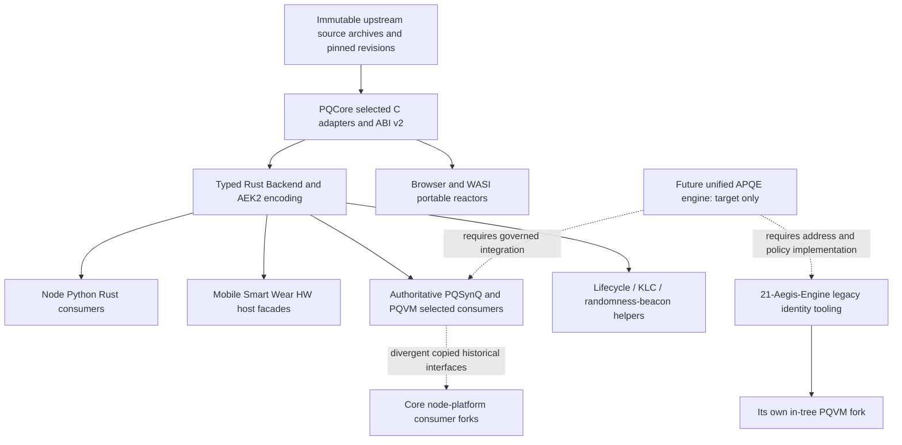

# APQE complete cryptographic and capability audit

**Workspace rename:** The user authorized parent directory rename from `/Volumes/PortableSSD/Synergy-Network` to `/Volumes/PortableSSD/02-Synergy-Network` during this audit. Current absolute locators use the new root; directory identity and contents were verified by the parent. This rename did not change implementation content.

**Audit date:** 2026-11-01. **Mode:** read-only source, provenance, dependency, and design audit. **Disposition:** NOT production qualified; implementation and release decisions remain frozen. This document is an engineering decision aid, not a cryptographic validation certificate or permission to modify validators.

## 1. Findings that control the next decision

1. The authoritative cryptographic modules were inspected under `02-Aegis-Cryptography/aegis-pqc` and relocated externally during the audit to `/Volumes/PortableSSD/01-Aegis-PQC/aegis-pqc`, but the validator's in-tree `aegis-pqvm` is a divergent consumer fork. Matching crate names/version `0.1.0` do not establish matching algorithms, providers, ABI, profiles, or deployment.
2. The authoritative selected provider implements a registry of **55 parameter variants in seven families** with explicit revision, encoding, target and release gates. Its production and approval profiles are **not accepted**. A C library's internal `production` build flavor means non-validation entropy/API behavior, not approval for production deployment.
3. Native selected consumer paths inspected are principally **Darwin arm64 engineering/validation**. Linux build recipes exist, but native Linux runtime acceptance is explicitly unverified and authoritative PQVM rejects it. Browser/WASI implementations have separate actual reactors. Mobile, wearable, hardware and VM names must not be treated as proof of device/platform deployment.
4. The active authoritative ML-KEM provider is pinned **mlkem-native v2.0.0/FIPS 203**. The historical Core implementation compiled legacy Kyber reference C under ML-KEM-shaped names. Equal key/ciphertext lengths concealed incompatible shared-secret semantics. The current local correction is undeployed and is not evidence that the authoritative selected provider has been integrated into Linux validators.
5. The October manual's protected `synw` model is **not implemented by the inspected selected APQE APIs**. Existing native identity tooling still implements legacy 41-character Bech32m/FN-DSA-root identities. A shared prefix cannot reconcile these models. No native protected D+P/recovery-only R, threshold secp256k1 DKG, or exact same-body EIP-55 implementation was established here.
6. **A concrete legacy wallet derivation defect exists:** hardened BIP32 child derivation omits parent-scalar addition; non-hardened invalid scalars are replaced with a fixed fallback. The existing external-address helper cannot be certified BIP32-compatible or used as evidence for protected-wallet DKG.
7. Selected source provenance is largely explicit, but **pqhw/pqwear have stale UOV file hashes**. Their actual `utils_hash.c` is byte-identical to pqcore; this is integrity-metadata drift, not demonstrated different arithmetic. Backend import-manifest and algorithm-manifest bytes also differ by consumer; coordinated provenance needs reconciliation before promotion.
8. No FIPS 140/CMVP certificate, ACVP accreditation, or independent security review establishing production validation was verified. Repository tests/acceptance JSON and FIPS algorithm names do not establish those claims.

## 2. Scope, authority, and evidence quality

The user-designated future unified engine home is now `/Volumes/PortableSSD/02-Synergy-Network/21-Aegis-Engine` (directory-only rename from `21-Address-Engine` authorized separately during this audit). The existing nested package is still named `synergy-address-engine`; the rename does not migrate cryptographic implementation or change crate names. Authoritative cryptographic implementation is under **A**, defined below. The original `02-Aegis-Cryptography` path disappeared during this read-only audit. Parent located the same root HEAD/origin at `/Volumes/PortableSSD/01-Aegis-PQC/aegis-pqc`; this audit agent did not move it. Rechecks of PQCore/PQVM/PQSynQ HEADs and the address-file hash agree with the earlier inventory. Older workspace-relative 02locators below explicitly refer to that prior location, not a second remaining active copy. The future engine architecture is a target, not current deployment.

Path aliases used for concise exact source locators:

- **A** = `/Volumes/PortableSSD/01-Aegis-PQC/aegis-pqc` (current); earlier location `/Volumes/PortableSSD/Synergy-Network/02-Aegis-Cryptography/aegis-pqc` (no longer present)
- **C** = `/Volumes/PortableSSD/02-Synergy-Network/01-Core-Protocol/node-platform`
- **E** = `/Volumes/PortableSSD/02-Synergy-Network/21-Aegis-Engine/synergy-address-engine`

Unless prefixed C or E, source locators below are relative to A. Current source bytes, manifests, compile gates and call paths take precedence over package names and README claims. Module `HEAD` does not imply a clean worktree or identify an installed executable. No build, test, dependency update, source correction, validator operation, custody export, or state mutation was performed for this document. Read-only SHA-256 comparison of registered public source files is not a cryptographic algorithm test.

Design inputs inspected: `/Volumes/jhutzler/Downloads/Synergy_Network_Canonical_Address_and_Identity_Technical_Manual_v1.0.docx` and the user-attached `/Volumes/jhutzler/Downloads/Synergy_Network_Address_and_Identity_Specification.pdf` (223 pages; SHA256 `2ff297e775d9e35bcd0472b4276b1c15f02bb72a5a2d853e76040c8276fcc6cc`). These contain October 2026 target specifications, explicit proposed items and open release blockers. Relevant normative address, authority, provider, recovery, naming, cross-chain and activation sections were compared against source; no claim is made that every historical narrative sentence has been independently verified. PDF pagination is used where specified; DOCX section names avoid pagination differences.

Coverage: all 15 first-level `aegis-*` repositories, selected family registry, shared C/Rust ABI/encoding/entropy, major consumer gates and public interfaces, KLC/beacon, active SynQ identity code, the legacy engine's namespace/address/wallet interfaces, and the Core fork boundary. This is **not** a line-by-line security proof of every vendored C instruction or every historical example; archived trees, generated bindings and device claims without a demonstrated current call path remain explicitly historical/unverified. Full live consumer/deployment inventory belongs to the companion network audit.

## 3. Repository and module inventory

A root repository: branch `main`, HEAD `92133838f74e1e822b5d9194a2099d1d1eb3dbe0`, origin `https://github.com/Synergy-Engineering-Labs/aegis-pqc.git`. Modules are independent nested Git repositories, not one Cargo workspace. Authenticated read-only `git ls-remote --heads --tags origin` confirmed every module's current remote main equals the local HEAD listed below; no tags were advertised. This proves remote-main identity at audit time, **not latest stable release**. Unauthenticated GitHub release API returned 404; private/no-visible-release status cannot be interpreted as missing software.

| Module | Declared package version(s) | Exact local / remote-main revision | Current responsibility and integration | Status / exact controlling source |
|---|---|---|---|---|
| `aegis-pqcore` | npm 1.0.1; selected Rust 0.1.0; KLC 0.1.0 | `f46be7f1ef181069761b755d3314f0ed03f4cabe` | Canonical selected C providers, registry, Rust typed dynamic loader, serialization; KLC/beacon | `backend/algorithm_manifest.json; backend/rust/src/lib.rs; backend/build.py` |
| `aegis-pqhw` | npm 1.0.1; clean 0.1.0; hardware 0.1.0 | `5f61ed5a67eb7daabea2303076e186903c809a4c` | Host wrapper plus FPGA/ASIC/GPU/HSM/PKCS11/TPM target interfaces | `aegis_crypto_clean/src/lib.rs; only HostSoftware enabled; no hardware acceptance` |
| `aegis-pqmavr` | npm 1.0.0; pqmavr 0.1.0 | `05e3244360013e6a34c67109ae3b0718935d2c18` | AVR source skeleton/family mapping | `x - pqmavr/src/lib.rs:46; selected-device unsupported` |
| `aegis-pqmobile` | npm 1.0.1; clean 0.1.0 | `7caee190679db5ad467de6e6d338fdc0682096d8` | Selected host Session, native admission and platform seams | `aegis_crypto_clean/src/lib.rs; no demonstrated iOS/Android secure-hardware provider` |
| `aegis-pqnist` | Rust bindings 0.1.0 | `a1780146de090b05e484249588fbac1df2852b14` | Selected binding/validation-facing facade; historical NIST reference collection distinct | `bindings/src/lib.rs; native Darwin arm64/profile gates` |
| `aegis-pqnodejs` | npm 1.0.1; Rust core 0.1.0 | `e98246da25311429b1a9eff5cb938dc916622df2` | Node native loader, buffer checking, metadata/serialization | `index.mjs:15,51; Darwin arm64; CMCE Worker rejected` |
| `aegis-pqnostd` | npm 1.0.1; pqnostd 0.1.0 | `255162fc7b81a49208009a42139ef31554acc0d7` | Caller-owned buffers/static function tables, no_std interfaces | `pqnostd/src/static_backend.rs:234; accepted execution still Darwin arm64` |
| `aegis-pqpython` | npm 1.0.1; clean 0.1.0 | `51f5b3634596fc144d532444e62aec5382019fd6` | Python/Rust wrapper for selected KEM/signature and serialization | `aegis_crypto_clean/src/selected.rs:160; target and release gates` |
| `aegis-pqrust` | clean 0.1.0; pqrust 0.18.1; family forks differ | `f7b678b69059588793ed8af13fcabff0f60c0832` | Rust selected facade; retained pqcrypto-derived packages | `aegis_crypto_clean/src/lib.rs; selected.rs and vendor/selected-backend/rust` |
| `aegis-pqsmart` | npm 1.0.1; clean 0.1.0 | `443be8e3dd4d1cf3602fce16c84d9c6fd6d060c1` | Selected Session, device-policy/record facade | `aegis_crypto_clean/src/lib.rs:59,376; device service not proof of device crypto` |
| `aegis-pqsynq` | npm historical aegis-crypto-core 1.0.1; pqsynq 0.1.0; historical core 0.2.0 | `dd2309d2039fd0c7de54c6ffb3c4878268723b1a` | Typed SynQ signing, policies, canonicalization and internal signer identity | `pqsynq/src/selected.rs; address.rs; domain.rs; root unsupported.js` |
| `aegis-pqvm` | Rust 0.1.0 | `b0a3ec3e6c184e25a2d43f43bddc8c36323d5d68` | Selected Host, call ABI, deterministic verifier/offchain dispatch, licensing, lifecycle | `src/selected.rs:94; src/lib.rs; build.rs:103; production/approval blocked` |
| `aegis-pqwasi` | npm @aegis/pqwasi 0.2.0; Rust 0.1.0 | `41568ee8c0861aa280957040b901cb631915dd0b` | Portable WASI reactor and JS launcher; separate native retained facade | `selected-wasi/index.mjs:14,25; engineering/validation only` |
| `aegis-pqwasm` | npm historical aegis-crypto-core 2.0.0; Rust 0.1.0 | `15b8465ea015fce066aeabac650fa0f048314ae0` | Portable browser WebAssembly reactors; separate native wrapper | `selected-browser/index.mjs:19,33; browser entropy; engineering/validation only` |
| `aegis-pqwear` | npm aegis-pqwear-module 1.0.0; clean 0.1.0 | `25f877af5bb4e926a8bb123e6d2c6b076fd6a294` | Selected host Session, lifecycle, Shamir key-recovery helper | `aegis_crypto_clean/src/capability.rs:130; threshold/mldsa.rs:1; actual wearable target unverified` |

Each module's upstream is `https://github.com/Synergy-Engineering-Labs/<module>.git`; its exact revision above is the reliable version identifier. Root npm metadata retains legacy repository/package names in several modules; those names are not a routing or release authority. Formal stable version for these private modules is **unverified** because no release tags were advertised.

### Dependency architecture

Consumers embed independent `vendor/selected-backend` snapshots rather than dynamically depending on one installed global provider. Native selected libraries use ABI v2, identity strings incorporating variant/build flavor/import pin, exact size validation, and typed keys. `build.py`, `verify_pin.py`, generated variants and serialization registries are part of the effective contract, not merely documentation. Core's copied provider and E's copied provider are separate build inputs; automatic equivalence cannot be inferred.

## 4. Selected algorithm and provenance inventory

The following registry is the actual selected inventory, **not a statement that all variants are approved on every platform**. Exact C input source paths, SHA-256 entries, flags, required/compiled operations, signature mode registries and per-target/profile eligibility are recorded in `aegis-pqcore/backend/algorithm_manifest.json`, `import_manifest.json` and `PROVENANCE.json`. Their existence is inspectable metadata; the source hashing described below checks bytes against those metadata, not standards conformance.

| Family | Exact selected upstream | Pin / immutable archive hash | Operations and standard status |
|---|---|---|---|
| ML-KEM | [mlkem-native v2.0.0](https://github.com/pq-code-package/mlkem-native/archive/refs/tags/v2.0.0.tar.gz) | `d1b2fe782888bdb761a50336012923180be7f502`; archive `76bf71771f09a25f30463218974ae10752d72bca34bbc470c7f6f8655f51d622` | keypair, encapsulate, decapsulate; production acceptance `false` |
| ML-DSA | [mldsa-native v2.0.0](https://github.com/pq-code-package/mldsa-native/archive/refs/tags/v2.0.0.tar.gz) | `834a90d5e846ffa1e1611bd24e160bb2e9b86d35`; archive `97a7305c32b62cbcae97891823176e18ca96d9eaafc3728587d75bb113862a40` | keypair, sign, verify; production acceptance `false` |
| SLH-DSA | [slhdsa-c](https://github.com/pq-code-package/slhdsa-c/archive/174c02e42257f95c210963272877c49dbb50070f.tar.gz) | `174c02e42257f95c210963272877c49dbb50070f`; archive `578e04a8b405e03e4919a483dc6efaa5dd142af2aceab871da2ad0a2217670b8` | keypair, sign, verify; production acceptance `false` |
| FN-DSA | [Falcon Round 3 specification v1.2; provisional comparison baseline](https://csrc.nist.gov/CSRC/media/Projects/post-quantum-cryptography/documents/round-3/submissions/Falcon-Round3.zip) | `archive-sha256:fd58f0454f6bfb4713734e60b2d2d75d96fbae62d5180fceeef1039df5362f44`; archive `fd58f0454f6bfb4713734e60b2d2d75d96fbae62d5180fceeef1039df5362f44` | keypair, sign, verify; production acceptance `false` |
| HQC-KEM | [HQC v5.0.0](https://gitlab.com/pqc-hqc/hqc/-/archive/main/hqc-main.tar.gz) | `f46e54222ffb76706678a9ec8a43cd2188a12ab1`; archive `29bc16c9737b40da595e04b44bccdb8bb2ba6db9575e20f8d276516ec94bc765` | keypair, encapsulate, decapsulate; production acceptance `false` |
| CMCE-KEM | [libmceliece-20260622](https://lib.mceliece.org/libmceliece-20260622.tar.gz) | `archive-sha256:a30b93fcc51281881a31007c0b82cdfaff532a9d2dba87c7f99760f1f83266b7`; archive `a30b93fcc51281881a31007c0b82cdfaff532a9d2dba87c7f99760f1f83266b7` | keypair, encapsulate, decapsulate; production acceptance `false` |
| UOV-DSA | [UOV Round 3 specification v3.0](https://csrc.nist.gov/csrc/media/Projects/pqc-dig-sig/documents/UOV-R3.zip) | `archive-sha256:13a1c0e9b3c17022c79e611f27e1210471d7ee0a65b4df6cccb872e8b115c7b9`; archive `13a1c0e9b3c17022c79e611f27e1210471d7ee0a65b4df6cccb872e8b115c7b9` | keypair, sign, verify; production acceptance `false` |

### All 55 selected variants and wire sizes

All lengths below are bytes. `—` means not applicable, not zero. Signature sizes are the registry's detached maximum where the upstream permits variable-length encoding. Public names cannot be substituted for binary encoding/profile identity.

| Variant | Public key | Secret key | Ciphertext | Shared secret | Detached signature | Encoding / mode |
|---|---:|---:|---:|---:|---:|---|
| `mlkem512` | 800 | 1632 | 768 | 32 | — | FIPS203 expanded keys/ciphertext |
| `mlkem768` | 1184 | 2400 | 1088 | 32 | — | FIPS203 expanded keys/ciphertext |
| `mlkem1024` | 1568 | 3168 | 1568 | 32 | — | FIPS203 expanded keys/ciphertext |
| `mldsa44` | 1312 | 2560 | — | — | 2420 | FIPS204 expanded key/fixed signature |
| `mldsa65` | 1952 | 4032 | — | — | 3309 | FIPS204 expanded key/fixed signature |
| `mldsa87` | 2592 | 4896 | — | — | 4627 | FIPS204 expanded key/fixed signature |
| `slhdsasha2128s` | 32 | 64 | — | — | 7856 | FIPS205 fixed signature |
| `slhdsasha2128f` | 32 | 64 | — | — | 17088 | FIPS205 fixed signature |
| `slhdsasha2192s` | 48 | 96 | — | — | 16224 | FIPS205 fixed signature |
| `slhdsasha2192f` | 48 | 96 | — | — | 35664 | FIPS205 fixed signature |
| `slhdsasha2256s` | 64 | 128 | — | — | 29792 | FIPS205 fixed signature |
| `slhdsasha2256f` | 64 | 128 | — | — | 49856 | FIPS205 fixed signature |
| `slhdsashake128s` | 32 | 64 | — | — | 7856 | FIPS205 fixed signature |
| `slhdsashake128f` | 32 | 64 | — | — | 17088 | FIPS205 fixed signature |
| `slhdsashake192s` | 48 | 96 | — | — | 16224 | FIPS205 fixed signature |
| `slhdsashake192f` | 48 | 96 | — | — | 35664 | FIPS205 fixed signature |
| `slhdsashake256s` | 64 | 128 | — | — | 29792 | FIPS205 fixed signature |
| `slhdsashake256f` | 64 | 128 | — | — | 49856 | FIPS205 fixed signature |
| `fndsa512` | 897 | 1281 | — | — | 688 | provisional compressed detached header/nonce/vector; NIST attached format separately transcoded |
| `fndsa1024` | 1793 | 2305 | — | — | 1328 | provisional compressed detached header/nonce/vector; NIST attached format separately transcoded |
| `hqckem128` | 2241 | 2321 | 4433 | 32 | — | current HQC v5.0.0 |
| `hqckem192` | 4514 | 4602 | 8978 | 32 | — | current HQC v5.0.0 |
| `hqckem256` | 7237 | 7333 | 14421 | 32 | — | current HQC v5.0.0 |
| `cmcekem348864` | 261120 | 6492 | 96 | 32 | — | libmceliece-20260622 base |
| `cmcekem348864f` | 261120 | 6492 | 96 | 32 | — | libmceliece-20260622 f |
| `cmcekem348864pc` | 261120 | 6492 | 128 | 32 | — | libmceliece-20260622 pc |
| `cmcekem348864pcf` | 261120 | 6492 | 128 | 32 | — | libmceliece-20260622 pcf |
| `cmcekem460896` | 524160 | 13608 | 156 | 32 | — | libmceliece-20260622 base |
| `cmcekem460896f` | 524160 | 13608 | 156 | 32 | — | libmceliece-20260622 f |
| `cmcekem460896pc` | 524160 | 13608 | 188 | 32 | — | libmceliece-20260622 pc |
| `cmcekem460896pcf` | 524160 | 13608 | 188 | 32 | — | libmceliece-20260622 pcf |
| `cmcekem6688128` | 1044992 | 13932 | 208 | 32 | — | libmceliece-20260622 base |
| `cmcekem6688128f` | 1044992 | 13932 | 208 | 32 | — | libmceliece-20260622 f |
| `cmcekem6688128pc` | 1044992 | 13932 | 240 | 32 | — | libmceliece-20260622 pc |
| `cmcekem6688128pcf` | 1044992 | 13932 | 240 | 32 | — | libmceliece-20260622 pcf |
| `cmcekem6960119` | 1047319 | 13948 | 194 | 32 | — | libmceliece-20260622 base |
| `cmcekem6960119f` | 1047319 | 13948 | 194 | 32 | — | libmceliece-20260622 f |
| `cmcekem6960119pc` | 1047319 | 13948 | 226 | 32 | — | libmceliece-20260622 pc |
| `cmcekem6960119pcf` | 1047319 | 13948 | 226 | 32 | — | libmceliece-20260622 pcf |
| `cmcekem8192128` | 1357824 | 14120 | 208 | 32 | — | libmceliece-20260622 base |
| `cmcekem8192128f` | 1357824 | 14120 | 208 | 32 | — | libmceliece-20260622 f |
| `cmcekem8192128pc` | 1357824 | 14120 | 240 | 32 | — | libmceliece-20260622 pc |
| `cmcekem8192128pcf` | 1357824 | 14120 | 240 | 32 | — | libmceliece-20260622 pcf |
| `uovdsaipclassic` | 321300 | 278087 | — | — | 135 | UOV classic |
| `uovdsaippkc` | 46591 | 278087 | — | — | 135 | UOV pkc |
| `uovdsaippkcskc` | 46591 | 32 | — | — | 135 | UOV pkcskc |
| `uovdsaisclassic` | 412160 | 348704 | — | — | 96 | UOV classic |
| `uovdsaispkc` | 66576 | 348704 | — | — | 96 | UOV pkc |
| `uovdsaispkcskc` | 66576 | 32 | — | — | 96 | UOV pkcskc |
| `uovdsaiiiclassic` | 1347912 | 1167440 | — | — | 209 | UOV classic |
| `uovdsaiiipkc` | 189232 | 1167440 | — | — | 209 | UOV pkc |
| `uovdsaiiipkcskc` | 189232 | 32 | — | — | 209 | UOV pkcskc |
| `uovdsavclassic` | 3232320 | 2801024 | — | — | 275 | UOV classic |
| `uovdsavpkc` | 446992 | 2801024 | — | — | 275 | UOV pkc |
| `uovdsavpkcskc` | 446992 | 32 | — | — | 275 | UOV pkcskc |

### Algorithm-family boundaries

- **ML-KEM:** FIPS203 selected mlkem-native; expanded key and ciphertext encodings. Keypair/encapsulation require approved entropy plumbing; decapsulation includes implicit rejection. Historical Kyber and FIPS203 ML-KEM share sizes but not necessarily the secret derivation; a ciphertext length check cannot establish interoperability. Source: `backend/mlkem_adapter.c:3`, typed metadata in `backend/rust/src/variants.rs`.
- **ML-DSA:** selected mldsa-native/FIPS204 expanded keys. Pure mode includes the FIPS context framing; prehash mode uses a declared hash identifier and digest length, not an arbitrary undocumented caller prehash. Context maximum255 bytes. Raw internal/μ modes are validation-only. Source: `backend/mldsa_adapter.c`, `backend/include/contract.h`, Rust `SignOptions`.
- **SLH-DSA:** FIPS205 family, SHA2/SHAKE variants, pure/prehash and context framing. This checkout's selected upstream is explicitly blocked for engineering/production pending readiness/review; validation visibility does not promote it.
- **FN-DSA:** actual provider is **provisional Falcon Round3 v1.2**, not proven final FN-DSA/FIPS206. Detached compressed and attached forms must remain distinct; the identifier `fndsa` does not rename Falcon encoding into a future standard. Native old padded/default variants in historical packages are not the selected detached profile.
- **HQC:** selected v5.0.0; upstream now advertises v5.1.0. This is a version-review item, not permission to update it or claim a standard finalized merely because NIST selected the family.
- **CMCE:** libmceliece dated implementation; base/f and pc/pcf differ by defined parameter/confirmation profile. Very large public keys and per-runtime stack restrictions matter operationally. Family selection is not a blanket low-memory/device guarantee.
- **UOV:** Round3 v3.0 candidate, classic/pkc/pkcskc key encodings. Compressed public/secret keys have different lengths; consumers must preserve exact variant identity. Not a finalized NIST signature standard.

### Current primary-upstream comparison

Read-only checks on the audit date: [mlkem-native releases](https://github.com/pq-code-package/mlkem-native/releases) and [mldsa-native releases](https://github.com/pq-code-package/mldsa-native/releases) advertise v2.0.0 matching the selected pins. [HQC official tags](https://gitlab.com/pqc-hqc/hqc/-/tags) advertise v5.1.0 commit `06567ccbad10580d78dd7863b15d23f41076d57f`, newer than selected v5.0.0. [slhdsa-c main](https://github.com/pq-code-package/slhdsa-c/commit/aab31cdb07e776f8cb1e697be8b1dd67adf3715c) is `aab31cdb07e776f8cb1e697be8b1dd67adf3715c`, newer than the selected commit, but the release API has no latest release; main is not a stable-release recommendation. The [official libmceliece download page](https://lib.mceliece.org/download.html) lists 20260622 as its newest dated package, matching this pin. The [UOV project site](https://www.uovsig.org/) did not establish a newer stable release in the inspected page; newest appropriate UOV release remains unverified. The [crates.io fips204 registry](https://crates.io/crates/fips204) reports latest stable0.5.0; PQVM licensing pins0.4.6, so that independent dependency also needs an explicit compatibility/advisory review, not an automatic upgrade. [NIST selected algorithms](https://csrc.nist.gov/projects/post-quantum-cryptography/post-quantum-cryptography-standardization/selected-algorithms) distinguishes finalized FIPS203/204/205 from additional algorithms still being standardized. No dependency update is authorized by this audit.

### Integrity and generated metadata

Read-only hashing checked **1,163 registered imported files per backend snapshot**, none missing. PQCore, mobile, PQNIST, PQRust, PQSmart, PQSynQ, PQVM, PQWASI and PQWASM each matched all their recorded file hashes. PQHW and PQWear each had one mismatch: `uovdsa/core/utils_hash.c`. Actual bytes in these two match PQCore exactly (`d12d0150019f829452db60b3e6895efc3ffddc6e0edbbd278d145c429811391f`), so the finding is stale recorded metadata. It is still a failed integrity check and must not be silently waved through.

Selected import-manifest SHA256 differs: current PQCore registry points at `e9ba4be9f1c5a1d89a874332905a6811c72cc2e527109c73179ebf4290526fa3`; most native/browser consumer snapshots use `48397f8b1f03bea7c78ea6984b556c669caf110c94200900fc8b9944861dda5b`; mobile/smart/hw/wear use `687c05e8fd51a5f289dc99bfe9ce89eff27d21a96e6703aa332044525f425ce0`. Their seven upstream family versions agree. Different hashes can reflect approved transformations, generated metadata or gate differences; they do **not** establish current cross-consumer byte compatibility. Exact metadata synchronization and semantic adapter comparison remain required before a common release.

## 5. Hashing, symmetric crypto, entropy, encoding and secret lifecycle

| Capability | Concrete implementation / source | Classification and limits |
|---|---|---|
| SHA2/SHA3/SHAKE signature prehash choices | `backend/rust/src/lib.rs` Hash enum; C contract length/mode guard | Implemented selected signature options. Hash enum is not a generic public digest service. |
| SHA256 identity/provenance | selected serialization revision/encoding digests; native admission hash pins | Implemented; encoding header digests are not payload authentication or encrypted custody. |
| SHA3-256/512, BLAKE3 helpers | KLC `src/hash.rs`; PQVM hashing/beacon; E address/object/binding code | Implemented in scoped helpers; not one enforced universal hash API across all consumers. |
| Keccak256 | E `src/wallet.rs:150` using tiny-keccak for external Ethereum address | Classical external-coordinate helper; not threshold DKG or native synw parity. SHA3-256 must not be substituted. |
| AES256-GCM / Argon2id | E `src/encrypt.rs:75,102,113,247`; aes-gcm0.10, argon2 0.5 | Implemented local encrypted envelope/hybrid KEM construction. Does not establish enclave-backed custody or phrase-insufficient quorum. |
| HMAC-SHA512 / RIPEMD160 / BIP39 | E `src/wallet.rs:21,26,118`; bip39/hmac/sha2/ripemd dependencies | Implemented legacy deterministic external-key path; BIP32 defect detailed below. Not the protected recovery-only phrase model. |
| AEAD/KDF universal provider API | No such uniform selected Backend interface found; selected operations are KEM/sign/verify | Absent at central selected interface. Consumer-local AEAD/KDF exists; do not claim ecosystem absence. |
| OS entropy | `backend/entropy.c`: Linux getrandom; other native platforms /dev/urandom; fail clears output | Implemented software CSPRNG. No measured physical quantum entropy established. Validation seed functions require AEGIS_VALIDATION. |
| Browser / WASI entropy | `selected-browser/entropy_browser.c`; `selected-wasi/entropy_wasi.c`, runtime launchers | Separate host imports and fail-closed error plumbing; not proof each deployed frontend uses these paths. |
| AEK2 typed serialization | `backend/rust/src/serialization.rs:89,111` | Magic, type, variant, revision/encoding SHA256 digests and exact payload lengths. Raw key/ciphertext/signature bytes remain distinct from AEK2 framing. No authenticity claim from framing alone. |
| Secret wipe | Rust SecretKey/SharedSecret Drop and zeroize-using consumers; C error clearing | Implemented scoped clearing, not proof that all copies, allocator pages, crash dumps, swap or hardware caches are erased. |
| Key lifecycle | PQVM `src/key_lifecycle.rs:45,64`; KLC modules | Metadata states Active/RotationScheduled/Retired/Destroyed and revision identity; not consensus-authorized wallet recovery. |
| Hardware entropy / beacon | PQVM `src/quantum_randomness_beacon.rs` and KLC variants | Software contribution/proof/commitment machinery; HardwareEntropy name includes OS getrandom path. No attested hardware deployment verified. |
| Licensing | PQVM `src/licensing.rs:8,14,21` | Independent fips2040.4.6 MLDSA44 issuer-key verification, context AegisPQVM-License-v2, compile-time public anchor. This crypto dependency lies outside selected C provider. |
| Classical secp256k1 / Ed25519 | E k256/ed25519-dalek and external address functions | Implemented local key/address helpers; no threshold signing provider or MPC ceremony established. Classical security must be disclosed. |

PQVM's selected call envelope has backend revision2, encoding version1 and bounded message size131072 (`src/selected.rs:13–16`); this is a separate format from AEK2 key framing. Deterministic dispatch is bounded and separated from offchain key generation/signing/encapsulation. A facade's VM platform enum or license entitlement is **not** an installed chain precompile or proof of AIVM integration.

## 6. Capability reality versus labels

| Capability | Actual inspected state | Release meaning |
|---|---|---|
| Typed selected KEM/signature APIs | Implemented C ABI and Rust/JS adapters; exact target/profile gates | Engineering/validation implementation, not production certification |
| Public/secret/ciphertext/signature serialization | Implemented AEK2 typed, revision-bound metadata | Test vectors and every consumer's active packet acceptance still need common-release validation |
| Native Linux selected APQE | Recipes exist; authoritative PQVM target gate rejects | Missing accepted universal validator provider |
| Browser and WASI | Actual selected reactors/loaders exist | Separate platform paths, no inference from native acceptance |
| AVR | `features()` says avr-source-only; selected-device-unsupported | Interface/source only |
| Hardware HSM/PKCS11/TPM/FPGA/ASIC/GPU | Enumerated target seams; host software only accepted path | Unsupported hardware execution, no silent fallback claim |
| Mobile / Wear / Smart | Current selected host facades, policy/lifecycle records | Real device/enclave/firmware implementation not established |
| Embedded no_std | Static buffers/function table APIs | Compile architecture differs; execution acceptance remains guarded Darwin arm64 |
| Threshold MLDSA in PQWear | Shamir split/reconstruct, full key reconstructed; partial sign/aggregate return errors | **Key recovery**, not MPC, DKG, or two independent native D+P signatures |
| Threshold secp256k1 DKG/signing/refresh | No current selected provider/API found | Missing for protected-wallet manual target; no provider may be invented |
| D/P/R protected native policy | No such central APQE policy/account implementation established | Missing; ordinary signatures/lifecycle helpers cannot substitute |
| Quantum randomness | Software entropy, beacon/commitment helpers | No physical quantum attestation established |
| Formal FIPS validation | No certificate/accredited validation verified | Unknown/unproven, not PASS |

## 7. Address and identity inventory: current implementation

### 7.1 Authoritative PQSynQ internal signer identity

`aegis-pqsynq/pqsynq/src/address.rs:11–12,70` derives **41 binary bytes**:

`version(1) || network_u16_BE(2) || algorithm_u16_BE(2) || SHA256(raw_public_key)(32) || SHA256(previous37bytes)[0..4]`.

Its serialization is82 hexadecimal characters; `to_execution_signer_id()` emits `synq-signer:` plus82hex (94 ASCII characters). It is explicitly an **internal signer identifier**, not a public native account. The source notes the removed misleading `tsynq1…` presentation. `from_bytes` and Serde deserialization check length but do not independently validate version/checksum; verifier `expect_address` rederives against the key/network. Therefore callers cannot treat arbitrary decoded bytes as authenticated identity. Empty public key rejects; algorithm-specific key validation belongs to the selected verification path.

`pqsynq/src/domain.rs:8,34` still hardcodes testnet1266 and maps recognized network strings to u16 values (testnet1266/devnet1/mainnet0), rejecting unknown networks. This is an actual reusable-path restriction, not authenticated genesis-derived network context. `verifier.rs:30` also exposes a testnet convenience constructor. No genesis hash is present in this 41byte identity preimage. Transaction signing domains bind further data, but that must not be confused with genesis binding in this identifier.

### 7.2 Existing engine at the new home

E `src/address.rs:23,50,67,83` implements legacy SNTS-01v1.3: SHA3-256 of canonical FN-DSA1024 public key (exact1793bytes) or owning-standard object preimage; convert digest to five-bit symbols, **truncate by HRP capacity**, encode lowercase Bech32m to fixed41characters. Key-controlled and object-address classes are checked separately. Burn is an exact non-Bech32 synthetic literal. This is not new protected-wallet addressing.

`src/registry.rs:8–26` pins the legacy registry/version/source digest,36namespace names and burn constant. The exact current namespace classification table is reproduced below; it is implementation inventory, not activation or a grant of authority. Generic derivation itself has no chain/genesis argument; object standards may include chain context in their canonical preimage and authorization bindings separately bind context. `is_valid_address` considers the burn literal valid, whereas `decode_address` rejects treating it as Bech32m; consumers need operation-specific checks rather than a generic boolean.

| Namespace | Registry class | State | Encoding / retained payload | Meaning |
|---|---|---|---|---|
| `synw` | key_controlled_address | active | bech32m_v1; 150 bits if Bech32m | primary wallet |
| `syns` | key_controlled_address | active | bech32m_v1; 150 bits if Bech32m | secondary utility or service wallet |
| `syna` | key_controlled_address | active | bech32m_v1; 150 bits if Bech32m | autonomous or DAO-controlled account wallet |
| `synz` | key_controlled_address | active | bech32m_v1; 150 bits if Bech32m | advanced or UMA-linked smart wallet |
| `syntxn` | typed_identifier | active | typed_hash; 140 bits if Bech32m | standard PoSy transaction identifier |
| `synxxn` | typed_identifier | active | typed_hash; 140 bits if Bech32m | SXCP cross-chain transaction identifier |
| `synb1` | object_address | active | bech32m_v1; 145 bits if Bech32m | STS-9 basic fungible token |
| `synb2` | object_address | active | bech32m_v1; 145 bits if Bech32m | STS-9 managed fungible token |
| `synb3` | object_address | active | bech32m_v1; 145 bits if Bech32m | STS-9 policy fungible token |
| `synn1` | object_address | active | bech32m_v1; 145 bits if Bech32m | standard NFT |
| `synn2` | object_address | active | bech32m_v1; 145 bits if Bech32m | controlled NFT |
| `synj` | object_address | active | bech32m_v1; 150 bits if Bech32m | multi-asset token |
| `synk` | object_address | active | bech32m_v1; 150 bits if Bech32m | identity and credential token |
| `synq` | object_address | active | bech32m_v1; 150 bits if Bech32m | system contract |
| `sync` | object_address | active | bech32m_v1; 150 bits if Bech32m | custom contract |
| `synv1` | key_controlled_address | active | bech32m_v1; 145 bits if Bech32m | class I consensus node and canonical node ID |
| `synv2` | key_controlled_address | active | bech32m_v1; 145 bits if Bech32m | class II interoperability node and canonical node ID |
| `synv3` | key_controlled_address | active | bech32m_v1; 145 bits if Bech32m | class III execution data and cryptography node and canonical node ID |
| `synv4` | key_controlled_address | active | bech32m_v1; 145 bits if Bech32m | class IV AI and intelligence node and canonical node ID |
| `synv5` | key_controlled_address | active | bech32m_v1; 145 bits if Bech32m | class V service and access node and canonical node ID |
| `syngrp1` | object_address | active | bech32m_v1; 135 bits if Bech32m | node cluster group 1 |
| `syngrp2` | object_address | active | bech32m_v1; 135 bits if Bech32m | node cluster group 2 |
| `syngrp3` | object_address | active | bech32m_v1; 135 bits if Bech32m | node cluster group 3 |
| `syngrp4` | object_address | active | bech32m_v1; 135 bits if Bech32m | node cluster group 4 |
| `syngrp5` | object_address | active | bech32m_v1; 135 bits if Bech32m | node cluster group 5 |
| `syndao` | typed_identifier | active | owning_standard; 140 bits if Bech32m | DAO governance proposal identifier |
| `syno` | key_controlled_address | active | bech32m_v1; 150 bits if Bech32m | governance oversight auditor |
| `syny` | key_controlled_address | active | bech32m_v1; 150 bits if Bech32m | DAO committee |
| `synm` | key_controlled_address | active | bech32m_v1; 150 bits if Bech32m | general multisig wallet |
| `synu` | key_controlled_address | active | bech32m_v1; 150 bits if Bech32m | DAO treasury multisig wallet |
| `synl` | key_controlled_address | active | bech32m_v1; 150 bits if Bech32m | validator council or emergency multisig wallet |
| `synf` | object_address | active | bech32m_v1; 150 bits if Bech32m | network and uDEX fee collector |
| `synr` | reserved_namespace | reserved | none; 150 bits if Bech32m | future use |
| `syni` | reserved_namespace | reserved | none; 150 bits if Bech32m | future use |
| `synp` | reserved_namespace | reserved | none; 150 bits if Bech32m | future use |
| `syne` | reserved_namespace | reserved | none; 150 bits if Bech32m | future use; independent of burn |

Burn: `syn0000000000000000000000000000000` exact34characters, no checksum/key material. Registry has typed hashes `syntxn-`, `synxxn-`, `synblk-`, `synmkl-`, `synepoch-`, `synqc-`; these are domain-specific hash identifiers, not payable addresses. `synixn-` explicitly rejects. E's `src/snts07.rs:782` derives transport peer ID as lowercase hex SHA3-256(node public key), distinct from `synv1…` node address. An identity root, transport key, validator consensus key, ETDAG ingress KEM key and account authorization key are not interchangeable roles.

### 7.3 Legacy wallet and multisig defects/gaps

E `src/wallet.rs:39–60` hardened-child function computes HMAC-SHA512 but returns its left32bytes directly rather than adding the parent scalar modulo secp256k1 order. Lines83–86 substitute `[1;32]` on scalar conversion errors instead of defined BIP32 invalid-child handling. Existing Ethereum uses uncompressed point coordinates/Keccak256, but the derived scalar path is not sufficient evidence of BIP32 correctness; no EIP55 same-body native renderer is established by that function. Bitcoin/Cosmos share this defective scalar derivation. E `src/multisig.rs:55` builds legacy identity/policy artifacts, not manual CREATE2-backed bytes20 generation or an executed multi-party signing ceremony. E `src/types.rs:18` labels FNDSA as FIPS206 in a comment while authoritative provenance explicitly says provisional Falcon; this is a misleading standard-status claim.

The current engine's local passphrase envelope encrypts secret material; that alone does not satisfy the manual's “phrase cannot authorize spending” or distributed security-domain invariants. Existing key-generation/export utilities must be retained only under their exact legacy/operational scope pending approved migration, never advertised as completed protected-wallet architecture.

## 8. October manual conformance and ownership matrix

The manual explicitly separates design-settled, proposed, open-release-blocker, legacy and unaffected profiles. This audit preserves those statuses. A missing implementation does not authorize inventing an unresolved profile.

| Manual requirement / exact section | Intended identifier, derivation and authority | Current APQE / E evidence | Disposition and required owner boundary |
|---|---|---|---|
| PartI§§3–4; PW§4 | synw +40EIP55hex =44chars; bytes20 = last20 Keccak256(uncompressed secp point excluding04); malicious-secure DKG aggregate | E legacy41char FNDSA/SHA3/Bech32m; selected PQSynQ internal41binary bytes | **Not implemented**; APQE account engine + consensus class registry + wallet integration, not prefix replacement |
| PW§§1,5,8 | Native spending requires independent current MLDSA87 D+P; R recovery-only; epochs/nonces/genesis | Signature primitives and metadata lifecycle exist; PQWear reconstructs a key | **Not established**; consensus account policy required, no Shamir-helper substitution |
| PW§4.6 |32byte non-spending SynergyObjectID with SHA3-domain-bound continuity, distinct ChainAccountID | No such selected APQE object graph/API found; intended formula SHA3_256(UTF8("AEGIS/PROTECTED-OBJECT/v1") || wallet_uuid_bytes16 || native_genesis_hash), PDFp62 | **Absent in inspected public surface**, not proof no consumer has prototype |
| PW§§7,10,12 | Independent recovery entropy, at-most-one participant secrets; no aggregate-scalar export; provider-supported refresh preserving public point | E phrase/HD/external scalar path; local encryption | **Not conformant** to protected target; no claim of phrase-only safety or preserved-address MPC recovery |
| PartI§5; MS policy chapters | synm/synu/synl bytes20 CREATE2-backed approved factory/initializer/salt; distinct logical authorities and thresholds | E legacy namespaces/artifact policy; selected primitives | **Proposed target missing**; exact factory/profile serialization still ADDR001 open |
| PartI§6; SC§§2–3 | sync user vs synq system authenticated class; full256or160payload; linked deployments default | E fixed41char150bit envelope; PQSynQ signer identity unrelated | **Legacy only**; ADDR002/003/008 remain protocol decisions, no silent widening/truncation |
| SC§3 | contract_family/build_release/deployment_group/deployment_instance identities; authenticated link, receipts, code/upgrade/finality | No complete selected APQE deployment-link verifier found | **Not established**; compiler/Forge/runtime/SXCP ownership, not equality of displayed addresses |
| PartI§7; SC§4 | Typed reserved identifiers/permissions, one canonical burn grammar | E exact legacy burn; reserved prefixes | **Partial legacy**; ADDR004 unresolved, generic syn000 range cannot grant permissions |
| PartI§8 | syns/syna/synz, nodes, tokens,clusters andtyped hashes unaffected until separately specified | E registry implements these legacy distinctions | **Preserve and audit separately**; no global EIP55 rewrite |
| PartI§9; PW§13 | SynID normalized .syn, SHA3_256(AEGIS/SYNID-NODE/v1 || name); commit/reveal, current native authorities, reverse/forward agreement | Not a selected cryptographic primitive/API here | **Consumer/protocol integration not verified**; current mobile SynID work is not proof of this complete design |
| PW§14; MS SXCP | Name-controller + payment-account + native authorization; chain/finality/current-implementation proofs | No complete APQE ENS/Basename/SXCP policy verifier found | **Missing/unverified**; signatures alone do not prove remote mutable authority |
| PW§16 | Versioned engine interface/SecurityProfile, explicit provider identity androle capabilities | Typed provider metadata/capability catalogs exist, no complete unified account API | **Partial primitive/provider infrastructure**; no end-to-end architecture claim |
| PartI§10; G1–G12 | Legacy migration, frozen vectors, no class privilege from prefix, activation/consent | Legacy profiles/source vectors exist; no common activated October profile shown | **Not qualified**; no source-only migration of funded identities |

## 9. Authoritative versus Core/engine consumer forks

Authoritative `aegis-pqvm/src/lib.rs` makes historical `pqc` private and exposes selected revision2 through `selected`; historical revision1 exports require an explicit feature. `build.rs` rejects packaged-runtime+historical and historical without validation, rejects unaccepted acceleration flags, verifies selected pins, and only builds/accepts the native Darwin host path. Core's crate retains public historical APIs and compiles its own C provider. Same crate version0.1.0 is therefore insufficient to select a safe import.

Historical Core Git inspection (companion audit): original `runtime/aegis-pqvm/build.rs` at boundary commit `fb71260` already mapped legacy Kyber sources under ML-KEM ABI names; preservation commit `df17c926` brought that path into node-platform. This is provenance of a source path, not proof which build every old validator ran. Current local Core edits replace the provider and add compatibility controls; those edits remain unqualified/undeployed during this freeze and must not be merged mentally with authoritative Aegis.

The safe architectural recommendation is one explicit versioned provider boundary with pinned algorithm revision/encoding and negative compatibility tests, not unconditionally copying one fork over another. Existing ciphertexts and keys require proven compatibility/migration treatment, not destructive reinterpretation or regeneration. Approval of this report would still not itself authorize implementation or deployment.

## 10. Recommendations, without implementation authorization

| Priority | Demonstrated issue | Smallest reviewable next change after approval | Verification needed before claiming completion |
|---|---|---|---|
| P0 | Legacy Kyber masquerading as MLKEM in consumer history | Pin correct provider/revision/encoding at actual caller boundary; explicit historical persisted-data handling, no ingress downgrade | Original mobile/current custody interop, malformed rejection, historical pending preservation, allfive actual-host effects |
| P0 | Universal provider absent on Linux selected target | Decide canonical APQE provider ownership and supported Linux integration; preserve fail-closed capability gates | Exact release/host target validation, frozen selected APIs/packet vectors, no bypass flag |
| P0 | Manual protected address/policy not implemented | Approve account/profile rollout boundaries first; implement DKG/provider and native D+P/R separately from legacy | Independent vectors and actual consensus authorization/recovery tests; no identity rewrite |
| P0 | Broken legacy BIP32 scalar derivation | Correct only explicitly supported legacy external-key derivation after migration-impact review, or fail closed for new generation | Independent BIP32 invalid-child and external-address vectors; existing wallet continuity review |
| P1 | Stale UOV source hash registrations | Reconcile actual known bytes and provenance/consumer pin generation; no automatic source upgrade | Hash checks match and semantic source transformations reviewed |
| P1 | Multiple snapshots / package names conceal provider drift | One canonical versioned installation/provider contract with per-consumer pinned provenance | Negative version/encoding/profile tests and deployed artifact conformance |
| P1 | HQCv5.1.0 newer than selected; SLH upstream changed | Review upstream changes against exact selected profile, licensing and compatibility; no automatic update | Independent algorithm/KAT/interop and resource/release review |
| P1 | DKG/MPC and hardware claims exceed code | Explicitly report unsupported capabilities; replace reconstruction helper claims | Actual independent participant/device/provider evidence |
| P2 | Hardcoded PQSynQ network mapping | Authenticate selected network/genesis context through interface; retain replay checks | Cross-network initialization and rejection with same executable |
| P2 | Misleading FIPS206 comment, legacy npm labels | Correct documentation and version contract under separate authorization | Source/provider metadata alignment; no formal validation overclaim |

## 11. Residual limitations and release conclusion

No new cryptographic tests were run during the freeze. Existing KAT/acceptance reports were treated as historical scoped evidence, not rerun or upgraded into current passes. No complete independent side-channel analysis, formal proof, physical-device assurance, licensing audit, FIPS140 certificate search, or every-transitive-dependency vulnerability assessment was completed. Mutable upstream “main” checks establish available source versions, not safe-update recommendations. Source file hashes do not establish cryptographic correctness, build reproducibility, deployed provider selection or custody safety.

The inventory supports a concrete conclusion: **APQE contains substantial pinned cryptographic and provider infrastructure, but the currently inspected ecosystem is not one universally accepted production engine, and the October protected-wallet/address architecture is not implemented end-to-end by these APIs.** Release remains blocked on explicit provider/consumer integration, address/policy decisions, and actual verified acceptance. The existing validator chain must not be restarted, modified or represented as qualified solely because this audit document exists.

## Appendix A. Exact package/dependency and build contract inventory

The table lists direct dependencies and features of the current principal manifests, as declared, without resolving or writing a lockfile. A semver range is not an exact selected artifact. Lockfile contents and target feature selection must accompany the release, and a current clean build was intentionally not performed during the freeze. Optional and legacy features below are not automatically active. Third-party stable-version checks not explicitly recorded in §4 remain **unverified**, not assumed current. Dev-only/fuzz/example dependencies are outside this production-interface table and not evidence of runtime availability.

| Manifest (A-relative unless E-prefixed) | Declared package | Direct dependencies / feature contract |
|---|---|---|
| `aegis-pqcore/backend/rust/Cargo.toml` | `aegis-selected-backend 0.1.0` | sha2 0.10 |
| `klc-rb/Cargo.toml` | `aegis-klc-rb 0.1.0` | aegis-klc-rb-selected https://github.com/Synergy-Engineering-Labs/aegis-pqcore.git; features {"default":["mlkem","mldsa","serde"],"mlkem":["aegis-klc-rb-selected/mlkem"],"mldsa":["aegis-klc-rb-selected/mldsa"],"serde":["aegis-klc-rb-selected/serde"],"wasm":["aegis-klc-rb-selected/wasm","mlkem","mldsa"],"hardware-entropy":["aegis-klc-rb-selected/hardware-entropy"],"validation-backend":["aegis-klc-rb-selected/validation-backend"]} |
| `aegis-pqcore/klc-rb/Cargo.toml` | `aegis-klc-rb 0.1.0` | aegis-selected-backend ../backend/rust; sha2 0.10; sha3 0.10; blake3 1.5; subtle 2.5; zeroize 1.8; getrandom 0.2 features=std; rand 0.8 features=std,rand_chacha; hex 0.4; base64 0.22.1; serde 1.0 optional features=derive; serde_json 1.0 optional; wasm-bindgen 0.2 optional; js-sys 0.3 optional; features {"default":["mlkem","mldsa","serde"],"mlkem":[],"mldsa":[],"serde":["dep:serde","dep:serde_json"],"wasm":["dep:wasm-bindgen","dep:js-sys","mlkem","mldsa"],"hardware-entropy":[],"validation-backend":[]} |
| `aegis-pqvm/Cargo.toml` | `aegis-pqvm 0.1.0` | fips204 =0.4.6 features=ml-dsa-44; hex =0.4.3; zeroize =1.8.2; sha2 0.10; aegis-selected-backend vendor/selected-backend/rust; rand 0.8; tiny-keccak 2 features=sha3,shake; libc 0.2; thiserror 1.0; serde 1.0 optional features=derive; serde-big-array 0.5 optional; criterion 0.5 optional; getrandom 0.2 features=std,js; pqrust-internals vendor/pqcrypto-internals optional; pqrust-traits vendor/pqcrypto-traits optional; blake3 1.5; features {"default":["mlkem","mldsa","fndsa","security"],"mlkem":[],"mldsa":[],"fndsa":[],"security":[],"validation-backend":[],"historical-revision1":["dep:pqrust-internals","dep:pqrust-traits"],"packaged-runtime":[],"dev-test-license":[],"serialization":["serde","serde-big-array"],"benchmarks":["criterion"],"evm":[],"substrate":[],"cosmwasm":[],"move":[],"solana":[],"synergy":[],"avx2":[],"hardware-entropy":[],"neon":[],"aes":[]} |
| `aegis-pqsynq/pqsynq/Cargo.toml` | `aegis-pqsynq 0.1.0` | aegis-selected-backend ../vendor/selected-backend/rust; serde 1.0 features=derive; serde_json 1.0; thiserror 1.0; hex 0.4; sha2 0.10; zeroize 1.8 features=alloc; getrandom 0.2 optional features=std,js; features {"validation-backend":[],"default":["mlkem","mldsa","fndsa","std"],"std":["dep:getrandom"],"mlkem":[],"mldsa":[],"fndsa":[],"hqckem":[],"full":["std","mlkem","mldsa","fndsa","hqckem"]} |
| `aegis-pqnist/bindings/Cargo.toml` | `pqnist 0.1.0` | sha2 0.10; aegis-selected-backend ../vendor/selected-backend/rust; features {"default":[],"validation-backend":[]} |
| `aegis-pqnodejs/aegis_crypto_core/Cargo.toml` | `aegis_crypto_core 0.1.0` | wasm-bindgen 0.2 optional; js-sys 0.3.61 optional; zerocopy 0.8.26; pyo3 =0.24.1 optional features=extension-module; pqrust-traits 0.3.5 optional; sha3 0.10; sha2 0.10; blake3 1.5; subtle 2.5; zeroize 1.8; getrandom 0.2; rand 0.8 features=std,rand_chacha; hex 0.4; base64 0.22.1; web-sys 0.3 optional features=Request,RequestInit,RequestMode,Response,Window; wasm-bindgen-futures 0.4 optional; axum 0.7 optional; tokio 1.0 optional features=full; tower-http 0.5 optional features=cors; serde 1.0 features=derive; serde_json 1.0; features {"default":["mlkem","mldsa","fndsa","slhdsa","hqckem"],"std":[],"wasm":["dep:wasm-bindgen","dep:js-sys","getrandom/js"],"js-bindings":["dep:wasm-bindgen","dep:js-sys"],"python-bindings":["dep:pyo3"],"mlkem":["dep:pqrust-traits"],"mldsa":["dep:pqrust-traits"],"fndsa":["dep:pqrust-traits"],"slhdsa":["dep:pqrust-traits"],"hqckem":["dep:pqrust-traits"],"cmcekem":["dep:pqrust-traits"],"nist-wasm":["dep:web-sys","dep:wasm-bindgen-futures","dep:pqrust-traits"],"wasm-only":["nist-wasm","wasm"],"wasm-compatible":["mlkem","mldsa","fndsa","slhdsa","hqckem","wasm","nist-wasm"],"wasm-pure":["wasm","nist-wasm"],"wasm-clean":["wasm","nist-wasm"],"wasm-nodejs":["wasm","nist-wasm"],"wasm-nodejs-pure":["wasm"],"wasm-minimal":["wasm"],"server":["dep:axum","dep:tokio","dep:tower-http"],"nist-ref":[]} |
| `aegis-pqrust/aegis_crypto_clean/Cargo.toml` | `aegis_crypto_core 0.1.0` | No direct dependencies declared; features {"default":[],"validation-backend":[],"nist-wasm":[]} |
| `aegis-pqmobile/aegis_crypto_clean/Cargo.toml` | `aegis_crypto_core 0.1.0` | No direct dependencies declared; features {"default":["native-tools"],"native-tools":[],"validation-backend":[],"nist-wasm":[]} |
| `aegis-pqsmart/aegis_crypto_clean/Cargo.toml` | `aegis_crypto_core 0.1.0` | aegis-selected-backend ../vendor/selected-backend/rust; wasm-bindgen 0.2 optional; js-sys 0.3.61 optional; zerocopy 0.8.26; pyo3 =0.24.1 optional features=extension-module; sha3 0.10; sha2 0.10; blake3 1.5; subtle 2.5; zeroize 1.8; getrandom 0.3 features=std,wasm_js; rand 0.8 features=std,rand_chacha; hex 0.4; base64 0.22.1; web-sys 0.3 optional features=Request,RequestInit,RequestMode,Response,Window; wasm-bindgen-futures 0.4 optional; axum 0.7 optional; tokio 1.0 optional features=full; tower-http 0.5 optional features=cors; serde 1.0 features=derive; serde_json 1.0; features {"default":["mlkem","mldsa","fndsa","slhdsa","hqckem"],"std":[],"validation-backend":[],"wasm":["dep:wasm-bindgen","dep:js-sys"],"js-bindings":["dep:wasm-bindgen","dep:js-sys"],"python-bindings":["dep:pyo3"],"mlkem":[],"mldsa":[],"fndsa":[],"slhdsa":[],"hqckem":[],"cmcekem":[],"nist-wasm":["dep:web-sys","dep:wasm-bindgen-futures"],"wasm-only":["nist-wasm","wasm"],"wasm-compatible":["mlkem","mldsa","fndsa","slhdsa","hqckem","wasm","nist-wasm"],"wasm-pure":["wasm","nist-wasm"],"wasm-clean":["wasm","nist-wasm"],"wasm-nodejs":["wasm","nist-wasm"],"wasm-nodejs-pure":["wasm"],"wasm-minimal":["wasm"],"server":["dep:axum","dep:tokio","dep:tower-http"],"nist-ref":[]} |
| `aegis-pqwear/aegis_crypto_clean/Cargo.toml` | `aegis_crypto_core 0.1.0` | aegis-selected-backend ../vendor/selected-backend/rust; wasm-bindgen 0.2 optional; js-sys 0.3.61 optional; zerocopy 0.8.26; pyo3 =0.24.1 optional features=extension-module; sha3 0.10; sha2 0.10; blake3 1.5; subtle 2.5; zeroize 1.8; getrandom 0.3 features=std,wasm_js; rand 0.8 features=std,rand_chacha,std_rng; hex 0.4; base64 0.22.1; web-sys 0.3 optional features=Request,RequestInit,RequestMode,Response,Window; wasm-bindgen-futures 0.4 optional; axum 0.7 optional; tokio 1.0 optional features=full; tower-http 0.5 optional features=cors; serde 1.0 optional features=derive; serde_json 1.0 optional; features {"default":["mlkem","mldsa","fndsa","slhdsa","hqckem","serde","serde_json"],"std":[],"validation-backend":[],"serde":["dep:serde"],"serde_json":["dep:serde_json"],"wasm":["dep:wasm-bindgen","dep:js-sys"],"js-bindings":["dep:wasm-bindgen","dep:js-sys"],"python-bindings":["dep:pyo3"],"mlkem":[],"mldsa":[],"fndsa":[],"slhdsa":[],"hqckem":[],"cmcekem":[],"nist-wasm":["dep:web-sys","dep:wasm-bindgen-futures"],"wasm-only":["nist-wasm","wasm"],"wasm-compatible":["mlkem","mldsa","fndsa","hqckem","slhdsa","wasm","nist-wasm"],"wasm-pure":["wasm","nist-wasm"],"wasm-clean":["wasm","nist-wasm"],"wasm-nodejs":["wasm","nist-wasm"],"wasm-nodejs-pure":["wasm"],"wasm-minimal":["wasm"],"hardware-entropy":[],"server":["dep:axum","dep:tokio","dep:tower-http","dep:serde","dep:serde_json"],"nist-ref":[]} |
| `aegis-pqhw/aegis_crypto_clean/Cargo.toml` | `aegis_crypto_core 0.1.0` | zeroize 1.8; sha2 0.10; aegis-selected-backend ../vendor/selected-backend/rust; features {"default":["selected-host"],"selected-host":[],"validation-backend":[],"std":[],"mlkem":[],"mldsa":[],"fndsa":[],"slhdsa":[],"hqckem":[],"cmcekem":[],"wasm":[],"nist-ref":[],"nist-wasm":[]} |
| `aegis-pqnostd/pqnostd/Cargo.toml` | `pqnostd 0.1.0` | aes 0.8 optional; sha2 0.10; digest 0.10; rand_core 0.6; rand_chacha 0.3 optional; rand 0.8 optional; features {"default":[],"validation-backend":[],"sha2":[],"slhdsa":[],"cmcekem":[],"hw-accel":["aes","sha2"],"arm-cryptocell":[],"ultra-constrained":[],"standard-embedded":[],"high-end-embedded":["hw-accel"],"cortex-m0":["ultra-constrained"],"cortex-m3":["standard-embedded"],"cortex-m4":["standard-embedded","hw-accel"],"cortex-m7":["high-end-embedded"],"cortex-m33":["high-end-embedded","arm-cryptocell"],"esp32":["high-end-embedded"],"esp8266":["standard-embedded"],"riscv":["standard-embedded"],"test":["dep:rand","dep:rand_chacha"]} |
| `aegis-pqmavr/x - pqmavr/Cargo.toml` | `pqmavr 0.1.0` | No direct dependencies declared; features {"default":["std"],"std":[]} |
| `aegis-pqwasm/aegis_crypto_clean/Cargo.toml` | `aegis_crypto_core 0.1.0` | wasm-bindgen 0.2 optional; js-sys 0.3.61 optional; console_error_panic_hook 0.1 optional; zerocopy 0.8.26; pqrust-cmcekem 0.2.0 optional; pqrust-traits 0.3.5 optional; pyo3 =0.24.1 optional features=extension-module; sha3 0.10; sha2 0.10; blake3 1.5; subtle 2.5; zeroize 1.8; getrandom 0.3 features=std,wasm_js; rand 0.8 optional features=std,rand_chacha; hex 0.4; base64 0.22.1; web-sys 0.3 optional features=Request,RequestInit,RequestMode,Response,Window; wasm-bindgen-futures 0.4 optional; mlkem 0.3.0-rc.0 optional; fips204 0.4.6 features=ml-dsa-44,ml-dsa-65,ml-dsa-87; axum 0.7 optional; tokio 1.0 optional features=full; tower-http 0.5 optional features=cors; serde 1.0 optional features=derive; serde_json 1.0; features {"default":["mlkem","mldsa","fndsa","slhdsa","hqckem","rand"],"std":["rand"],"wasm":["dep:wasm-bindgen","dep:js-sys","dep:console_error_panic_hook"],"js-bindings":["dep:wasm-bindgen","dep:js-sys","dep:console_error_panic_hook"],"python-bindings":["dep:pyo3"],"mlkem":["aegis-klc-rb-selected/mlkem"],"mldsa":["aegis-klc-rb-selected/mldsa"],"fndsa":[],"slhdsa":[],"hqckem":[],"cmcekem":["dep:pqrust-cmcekem","dep:pqrust-traits"],"nist-wasm":["dep:web-sys","dep:wasm-bindgen-futures","dep:mlkem"],"rand":["dep:rand"],"wasm-only":["nist-wasm","wasm"],"wasm-compatible":["mlkem","mldsa","fndsa","slhdsa","hqckem","wasm","nist-wasm"],"wasm-pure":["wasm","nist-wasm"],"wasm-clean":["wasm","nist-wasm"],"wasm-nodejs":["wasm","nist-wasm"],"wasm-nodejs-pure":["wasm"],"wasm-minimal":["wasm"],"server":["dep:axum","dep:tokio","dep:tower-http","dep:serde"],"nist-ref":[],"validation-backend":["aegis-klc-rb-selected/validation-backend"]} |
| `aegis-pqwasi/aegis_crypto_clean/Cargo.toml` | `aegis_crypto_core 0.1.0` | serde_json 1.0; features {"default":["selected-wasi"],"selected-wasi":[],"nist-wasm":[],"nist-ref":[],"mlkem":[],"mldsa":[],"fndsa":[],"slhdsa":[],"hqckem":[],"cmcekem":[],"wasm":[],"std":[]} |
| `E:Cargo.toml` | `synergy-address-engine 2.0.0` | aegis-pqvm aegis-pqvm; pqrust-traits aegis-pqvm/vendor/pqcrypto-traits; ed25519-dalek 2 features=rand_core; bip39 2; hmac 0.12; sha2 0.10; sha3 0.10; ripemd 0.1; serde 1.0 features=derive; serde_json 1.0; base64 0.21; bech32 0.9; bs58 0.5; hex 0.4; ureq 2.12; dialoguer 0.11; blake3 1; tiny-keccak 2.0 features=keccak; k256 0.13 features=ecdsa,sha256; chrono 0.4; aes-gcm 0.10; argon2 0.5; rpassword 7; rand 0.8; rand_core 0.6; zeroize 1.8 |

Target-specific dependencies are part of the actual manifest as well. In particular mobile native selected backend is under cfg(not(wasm32)); its empty generic dependency cell above does not mean it has no provider. Root KLC facade pins the PQCore Git revision `52eb75f02202e543d8e5e1d64344c33163470b70`, rather than following current PQCore HEAD. This is another explicit provider-version edge.

| Manifest | Target dependency edges |
|---|---|
| `aegis-pqmobile/aegis_crypto_clean/Cargo.toml` | cfg(not(target_arch = "wasm32")): {'aegis-selected-backend': {'path': '../vendor/selected-backend/rust'}, 'sha2': '0.10'}; cfg(target_arch = "wasm32"): {'wasm-bindgen': '=0.2.108', 'wasm-bindgen-futures': '=0.4.58', 'js-sys': '=0.3.85'} |
| `aegis-pqrust/aegis_crypto_clean/Cargo.toml` | cfg(not(target_arch = "wasm32")): {'aegis-selected-backend': {'path': '../vendor/selected-backend/rust'}, 'sha2': '0.10'}; cfg(target_arch = "wasm32"): {'wasm-bindgen': '=0.2.108', 'wasm-bindgen-futures': '=0.4.58', 'js-sys': '=0.3.85'} |
| `aegis-pqcore/klc-rb/Cargo.toml` | cfg(target_arch = "wasm32"): {'getrandom': {'version': '0.2', 'features': ['js']}} |

Build/runtime boundaries: native selected `.dylib` providers are loaded through explicit directories and checked identity/import pins; packaged PQVM resolves executable-adjacent `lib` and license trust anchor, not an arbitrary generic provider. PQVM `build.rs:103` gates historical/packaged/validation/acceleration combinations; source default flags are not a Linux acceptance waiver. Browser/WASI build scripts generate per-variant reactors, variants/serialization registries and validation-specific APIs. Their generated `.wasm` existence is not proof every application's deployed asset matches current source. E uses an independent in-tree PQVM fork and external key libraries; this manifest has no dependency on the current authoritative selected APQE.

### Additional manual-specific discrepancies

Manual PDFpp63–66 specifies HKDF-SHA256 domain/context separation, AES256GCM with12byte nonce/16byte tag, and Argon2id65,536KiB/t3/p4 with16random salt. E `src/encrypt.rs:75–78` uses p1 and32byte salt, and `derive_hybrid_key` at102 uses SHA3_256(Kpass||KEMss), not that HKDF profile. These are **different versioned local envelope designs**, not automatically proven unsafe solely by differing parameters; they cannot be advertised as the manual profile or silently rewritten for existing ciphertext. Ethereum helper renders lowercase `0x`+40hex at `wallet.rs:156`, not EIP55 canonical mixed-case checksum. Existing BTC native-SegWit helper uses HASH160(compressedsecpkey), witnessv0 Bech32; Cosmos uses HASH160/compressedkey and `cosmos` Bech32; Solana uses hardened SLIP0010/Ed25519 and Base58 of32bytepublickey. They are independent external accounts derived by this legacy CLI, not matched protected native/EVM authority or a common20byte namespace.

### Evidence source precision

Highest-value exact locators: authoritative PQVM `src/selected.rs:94` target gate, `:103` release exclusion, `:157` Host open, `:353` call encoding, `:380` decoding, `:527` deterministic dispatch; `src/licensing.rs:8` separate fips204; PQSynQ `pqsynq/src/address.rs:70`, `domain.rs:8,34`, `verifier.rs:233`; PQNoStd `pqnostd/src/static_backend.rs:234`; PQMAVR `x - pqmavr/src/lib.rs:46`; PQNodeJS `index.mjs:15,51`; PQWear `threshold/mldsa.rs:26,42,50,57,70`. E `src/address.rs:23,50,67,83,124`; `registry.rs:8,17,19,22`; `wallet.rs:39,83,118,142,167,204`; `encrypt.rs:75,102`; `types.rs:18`. These source locations support the findings; README/package branding alone does not.

## Appendix B. Every located address-engine implementation: inventory and duplicate boundaries

This inventory distinguishes an actual derivation implementation from a wrapper, generated asset, deployment copy, test fixture, source snapshot or name-only documentation. “Active” below means a manifest/source consumer edge was established, **not a claim that the fleet is running it**. No directory was deleted or synchronized. Exact-file hashes establish equality only for that named file, not an entire source tree. Repository-wide consumer locations supplied by the parallel inventory are added below; build caches and mounted external roots cannot be certified exhaustively without enumerating their accessible contents, so unresolved coverage is explicit.

### Canonical and Core implementation locations

| Exact location (workspace-relative) | Role / selection | Relationship |
|---|---|---|
| `21-Aegis-Engine/synergy-address-engine/src/address.rs` | User-designated engine home; existing legacy CLI/library derivation | SHA3/FNDSA/object preimage→truncated41char Bech32m. SHA256 e61447b2a2a8142ba9ac419a945885feffda2eea4c067754d442094e1958dfed |
| `21-Aegis-Engine/synergy-address-engine/src/registry.rs`, `standards/snts-01-address-registry-v1.3.json` | Typed namespace/profile authority for that package | Legacy36namespaces; no new20byte protected profile |
| `21-Aegis-Engine/synergy-address-engine/src/wallet.rs`, `src/multisig.rs`, `src/validator.rs`, `src/object_binding.rs`, `src/auth_binding.rs` | Separate local generation/artifact/authorization functions | External-chain helpers and legacy policies; not a complete independent engine implementing the new manual |
| `21-Aegis-Engine/synergy-address-engine/synergy-cli/src/main.rs` | Independently implemented CLI address/key functions | Duplicates derivation/parser logic; imports and SHA3 code at988/1072; must be kept distinct from central library |
| `21-Aegis-Engine/synergy-address-engine/synergy-genesis/src/main.rs` | Genesis namespace/config generation consumer | Embeds legacy namespace41char settings; not runtime provider itself |
| `21-Aegis-Engine/synergy-address-engine/synergy-inspect/src/main.rs` | Inspection/validation tool | Consumer, not proof of independently implemented protected account generation |
| `21-Aegis-Engine/synergy-address-engine/aegis-pqvm` | In-tree cryptographic provider fork | Different owner/revision/API from current authoritative Aegis; package name alone insufficient |
| `A/aegis-pqsynq/pqsynq/src/address.rs` (current external Aegis root) | Authoritative SynQ internal signer identifier | Version1 binary41byte, NOT public account address; SHA256 9789b71fb2a27712fc44cf38e72d05cccbe7294a098dd40a76b93c3705e3e72d |
| `01-Core-Protocol/node-platform/crates/aegis-pqsynq/pqsynq/src/address.rs` | **Selected Core Cargo workspace member** (`Cargo.toml:24`) | Divergent version2/current context path; SHA256 f62c581d50135b69bfe738ce24bd99617a8031502092aada3d1acfd9fe56d807 |
| `01-Core-Protocol/node-platform/crates/aegis-pqsynq/aegis-pqsynq/pqsynq/src/address.rs` | Nested duplicate, not selected by that member edge | Exact file duplicate of authoritative version1; not the active outer Core version2 |
| `01-Core-Protocol/node-platform/crates/synergy-address/src/lib.rs` | Actual node address implementation; node depends on synergy-address | Independent parser/deriver; SHA256 7c090fabb3eb12939bb5d47ea413e7e5c203d01773f87bfb6214fae0424b4ebc. `STANDARD_ACCOUNT_PREFIX=syna`; contains legacy native/FNDSA and standard-account handling |
| `01-Core-Protocol/node-platform/crates/synergy-address/src/{snts_registry.rs,registry.rs,bech32m.rs}` | Runtime registry/codec components | Not the same source file as E; architecture/format equivalence requires explicit vectors |
| `01-Core-Protocol/node-platform/crates/synergy-identity/src/{node_address.rs,synv.rs,public_identity.rs,key_binding.rs,authorization.rs}` | Identity binding, node role, transport/consensus key separation | Related identity implementation, not a public wallet address-engine clone |
| `01-Core-Protocol/node-platform/crates/aegis-pqvm` | Actual Core cryptographic provider fork | Source/runtime incompatibility boundary described in §9 |

Core's outer address version2 uses `derive_with_tag` for explicitly policy-selected historical formats; the nested duplicate remains version1. This is substantive code divergence despite identical crate name0.1.0. Core `crates/aegis-pqsynq/pqsynq/Cargo.toml` points at Core's pqrust forks, whereas authoritative PQSynQ points at selected backend. The actual node's manifest has direct `synergy-address`, `synergy-aegis`, `synergy-crypto` and `synergy-synq` dependencies. A developer reading the nested copy would be inspecting the wrong implementation for the current workspace.

### Aegis generic blockchain-address helpers and encryption placeholders

These helpers are additional independent address derivations and must not be hidden by calling only E “the address engine.” Every listed `generate_address` hashes arbitrary provided public-key bytes with Keccak256 and renders last20bytes as lowercase0x. That does **not** establish a secp256k1-controlled EVM account when the input is a PQ signature key. It is distinct from SNTS Bech32m, internal SynQ41byte identity and the protected DKG model.

| Exact A-relative implementation file | SHA256 | Library text export / encryption status |
|---|---|---|
| `aegis-pqhw/aegis_crypto_clean/src/blockchain.rs` | `0efcf3d005fb733007b67ce55607a815b95267fe5c148e8f9f2849432e149c79` | pub mod blockchain not present; plaintext concatenation placeholder, mlkem feature |
| `aegis-pqmavr/aegis_crypto_clean/src/blockchain.rs` | `0efcf3d005fb733007b67ce55607a815b95267fe5c148e8f9f2849432e149c79` | pub mod blockchain present; plaintext concatenation placeholder, mlkem feature |
| `aegis-pqmobile/aegis_crypto_clean/src/blockchain.rs` | `0efcf3d005fb733007b67ce55607a815b95267fe5c148e8f9f2849432e149c79` | pub mod blockchain not present; plaintext concatenation placeholder, mlkem feature |
| `aegis-pqnodejs/aegis_crypto_core/src/blockchain.rs` | `f32ce908193883221ed5e82bf8fd0006d04df491ce31bdbd93e2e8a5a8fd8f43` | pub mod blockchain not present; plaintext concatenation placeholder, mlkem feature |
| `aegis-pqnostd/aegis_crypto_clean/src/blockchain.rs` | `99056bb89b219fdd788dadadddf33be9a84e6c5750dcfa8cb25cc3df69cfaf26` | pub mod blockchain present; plaintext concatenation placeholder, mlkem feature |
| `aegis-pqpython/aegis_crypto_clean/src/blockchain.rs` | `5e5a0e175fc6b9dbc0513abaa762a94b339725e555191b230c0ad540e5e5f8ca` | pub mod blockchain present; plaintext concatenation placeholder, mlkem feature |
| `aegis-pqrust/aegis_crypto_clean/src/blockchain.rs` | `bb1f7dfce679250d8bb6bf9489fabd1eba5c757967294c4957e6fa7b86f13e20` | pub mod blockchain not present; plaintext concatenation placeholder, mlkem feature |
| `aegis-pqsmart/aegis_crypto_clean/src/blockchain.rs` | `0efcf3d005fb733007b67ce55607a815b95267fe5c148e8f9f2849432e149c79` | pub mod blockchain present; plaintext concatenation placeholder, mlkem feature |
| `aegis-pqwasm/aegis_crypto_clean/src/blockchain.rs` | `a612527e4b1b06cc7484367cb01ddd300359d9305525fab9759cb2c91dee0b3d` | pub mod blockchain present; AEAD ABE2/HKDF/AESGCM |
| `aegis-pqwear/aegis_crypto_clean/src/blockchain.rs` | `bb1f7dfce679250d8bb6bf9489fabd1eba5c757967294c4957e6fa7b86f13e20` | pub mod blockchain present; plaintext concatenation placeholder, mlkem feature |

**Concrete unsafe helper:** e.g. PQWear `aegis_crypto_clean/src/blockchain.rs:70–81` appends unencrypted input to a KEM ciphertext; decrypt parses fixed1088byte prefix and returns the tail without AEAD verification. PQSmart/Python/retained NoStd/MAVR sources also contain export declarations (actual compilation still depends on their surrounding feature/module gates); no deployed invocation was demonstrated. These paths must not be described as secure encrypted transaction implementation. PQWASM's separately corrected `blockchain.rs:119–185` uses bounded ABE2 framing, HKDF-SHA256 and AES256GCM and rejects historical concatenations; it is not byte-identical to those placeholders. This is a recommended P0 fail-closed/removal-or-correction review after authorization, not permission to edit it now.

### Remaining reproducibility qualification

Lockfiles were rechecked at the relocated canonical A path. An intermediate “missing” observation occurred while the old directory was disappearing; it was a relocation race and is **not a repository reproducibility defect**. Actual lockfile hashes and resolved relevant dependencies follow. These are source lock contents, not proof of an installed binary's dependency graph.

| Current A-relative lockfile | SHA256 | Resolved relevant crates |
|---|---|---|
| `aegis-pqvm/Cargo.lock` | `f67b8b42e64695a660317e657d61fbda04c9bf5f4f1d1d5497475a068baccf62` | blake3 1.8.5; fips204 0.4.6; getrandom 0.2.16; getrandom 0.3.4; hex 0.4.3; libc 0.2.178; rand 0.8.5; serde 1.0.228; serde-big-array 0.5.1; sha2 0.10.9; thiserror 1.0.69; tiny-keccak 2.0.2; zeroize 1.8.2 |
| `aegis-pqsynq/pqsynq/Cargo.lock` | `39b8a92daa3c3c635a2e5706264385d53686c6c15a819ccc517722bf02c36463` | getrandom 0.2.17; getrandom 0.3.4; hex 0.4.3; libc 0.2.177; rand 0.9.2; serde 1.0.228; sha2 0.10.9; thiserror 1.0.69; zeroize 1.9.0 |
| `aegis-pqrust/Cargo.lock` | `95f77e10988a523304f9dad8d55255622f061ad534e24429e9cfae533ddb73cd` | blake3 1.8.7; getrandom 0.2.17; getrandom 0.3.4; hex 0.4.3; libc 0.2.180; rand 0.8.8; rand 0.9.2; serde 1.0.228; serde-big-array 0.5.1; sha2 0.10.9; zeroize 1.8.2 |

Following the authorized directory rename, `07-Node-Control-Panel/control-service/Cargo.toml:47` still references `../../21-Address-Engine/...` (parent source review). This is a **stale build dependency edge**, not evidence that the renamed directory was absent before the audit. The eventual path correction must be explicit and tested under subsequent authorization; no symlink, extra checkout, or silent fallback was introduced.

### Full engine and historical runtime roots: 13 engine packages plus 4 runtime packages

This expanded inventory lists **13 actual synergy-address-engine package declarations plus 4 historical synergy-testnet runtime packages** from 17 candidate locations, individually parsed as TOML here. The 4 runtime manifests contain engine references; they are not additional engine package declarations. Historical presence does not establish build or runtime selection. Paths are relative to the current workspace root.

| Exact package root | Manifest package/version | Status | Named source SHA256 |
|---|---|---|---|
| `21-Aegis-Engine/synergy-address-engine` | `synergy-address-engine 2.0.0` | Designated engine home | `src/address.rs` `e61447b2a2a8142ba9ac419a945885feffda2eea4c067754d442094e1958dfed` |
| `07-Node-Control-Panel/synergy-address-engine` | `synergy-address-engine 1.0.0` | Local Control Panel fork; not canonical deployed by presence | `src/lib.rs` `6c1d487c35d8f737f5787d85950817e13020624637c44659650cb48e7e02e0b8` |
| `07-Node-Control-Panel/control-service/synergy-address-engine` | `synergy-address-engine 1.0.0` | Local Control Panel fork; not canonical deployed by presence | `src/lib.rs` `84fa8bcdb83edd30417b691b58f6278c68030b1a019d00ab4cbb6e50cf6058f4` |
| `01-Core-Protocol/.chain1266-faucet-hotfix/runtime/src` | `synergy-testnet 20.0.0` | Historical snapshot; selection unverified | `—` `not located` |
| `01-Core-Protocol/.chain1266-faucet-hotfix/runtime/src/synergy-address-engine` | `synergy-address-engine 1.0.0` | Historical snapshot; selection unverified | `—` `not located` |
| `01-Core-Protocol/.chain1266-faucet-hotfix/runtime/node-control-panel/synergy-address-engine` | `synergy-address-engine 1.0.0` | Historical snapshot; selection unverified | `src/lib.rs` `6c1d487c35d8f737f5787d85950817e13020624637c44659650cb48e7e02e0b8` |
| `01-Core-Protocol/.chain1266-faucet-hotfix/runtime/node-control-panel/control-service/synergy-address-engine` | `synergy-address-engine 1.0.0` | Historical snapshot; selection unverified | `src/lib.rs` `3c079c0cb1343bec804d738b4145df8f4caa646579d03a261eef045aff90745e` |
| `01-Core-Protocol/testnet-v3/runtime/src` | `synergy-testnet 20.0.0` | Historical snapshot; selection unverified | `—` `not located` |
| `01-Core-Protocol/testnet-v3/runtime/src/synergy-address-engine` | `synergy-address-engine 1.0.0` | Historical snapshot; selection unverified | `—` `not located` |
| `01-Core-Protocol/networks/testnet-v3/runtime/src` | `synergy-testnet 20.0.0` | Historical snapshot; selection unverified | `—` `not located` |
| `01-Core-Protocol/networks/testnet-v3/runtime/src/synergy-address-engine` | `synergy-address-engine 1.0.0` | Historical snapshot; selection unverified | `—` `not located` |
| `22-Network-Environments/validators/val4/evacuation-20260918/home/node/Synergy-Chain-Work/source/synergy-address-engine` | `synergy-address-engine 2.0.0` | Historical snapshot; selection unverified | `src/address.rs` `e61447b2a2a8142ba9ac419a945885feffda2eea4c067754d442094e1958dfed` |
| `22-Network-Environments/validators/val4/evacuation-20260918/home/node/Synergy-Chain-Work/source/node-control-panel/synergy-address-engine` | `synergy-address-engine 1.0.0` | Historical snapshot; selection unverified | `src/lib.rs` `84fa8bcdb83edd30417b691b58f6278c68030b1a019d00ab4cbb6e50cf6058f4` |
| `22-Network-Environments/validators/val4/evacuation-20260918/home/node/Synergy-Chain-Work/source/testnet-v3-r11/runtime/src` | `synergy-testnet 20.0.0` | Historical snapshot; selection unverified | `—` `not located` |
| `22-Network-Environments/validators/val4/evacuation-20260918/home/node/Synergy-Chain-Work/source/testnet-v3-r11/runtime/src/synergy-address-engine` | `synergy-address-engine 1.0.0` | Historical snapshot; selection unverified | `—` `not located` |
| `22-Network-Environments/validators/val4/evacuation-20260918/home/node/Synergy-Chain-Work/source/testnet-v3-r11/runtime/node-control-panel/synergy-address-engine` | `synergy-address-engine 1.0.0` | Historical snapshot; selection unverified | `src/lib.rs` `6c1d487c35d8f737f5787d85950817e13020624637c44659650cb48e7e02e0b8` |
| `22-Network-Environments/validators/val4/evacuation-20260918/home/node/Synergy-Chain-Work/source/testnet-v3-r11/runtime/node-control-panel/control-service/synergy-address-engine` | `synergy-address-engine 1.0.0` | Historical snapshot; selection unverified | `src/lib.rs` `3c079c0cb1343bec804d738b4145df8f4caa646579d03a261eef045aff90745e` |

These are independent implementations/copies, not simply references to one engine. Local07 version1.0.0 uses pqcrypto-falcon0.3/traits0.3, SHA3 andBech32. Its main src/lib.rs136–152 and control-service nested src/lib.rs167–183 implement separate address functions; the latter has AES/PBKDF2 storage at223–265. Their custody/provider contracts differ from E2.0.0. No overwrite or migration is authorized.

Exact named-file equality groups (no whole-package equality implied):

- Current E and evacuated source/synergy-address-engine `src/address.rs` share `e61447b2a2a8142ba9ac419a945885feffda2eea4c067754d442094e1958dfed`; their lib.rs differs: current `b6c44cf346432f7d50db80c9c14c9331e4499feafbf69cf8896249fbf1e2776b`, evacuated `f4e9b8e8cffc2badcfc0dc247c48baec287c3d7e9f51c5808ee0c248cce12581`.
- Local07main, hotfix/runtime/node-control-panel/main and evacuated/source/testnet-v3-r11/runtime/node-control-panel/main engine lib.rs share `6c1d487c35d8f737f5787d85950817e13020624637c44659650cb48e7e02e0b8`.
- Local07/control-service engine lib.rs equals evacuated/source/node-control-panel engine lib.rs: `84fa8bcdb83edd30417b691b58f6278c68030b1a019d00ab4cbb6e50cf6058f4`.
- Hotfix and evacuated runtime/node-control-panel/control-service engine lib.rs share `3c079c0cb1343bec804d738b4145df8f4caa646579d03a261eef045aff90745e`.

### Wallet, application, generated and historical consumer locations

The parallel consumer inventory supplied these additional locations. The checks classify source/asset location and named-file equality; installed/runtime selection is not inferred from a source duplicate.

| Exact workspace-relative location(s) | Role / duplicate identity | Runtime status |
|---|---|---|
| `09-Wallet/synergy-wallet/packages/wallet-core/src/address.js`; `09-Wallet/synergy-wallet-app/packages/wallet-core/src/address.js` | Independent shared-JS derivation/parser copies, SHA256 `fc1749aa984ad9bbdfe9f30cf1cd12bd9bb70d0465a9a5a61cf3f256b5bdb116` | Main source versus duplicate app tree; duplicate's active use unverified |
| `09-Wallet/synergy-wallet/apps/web/src/utils/address.js`; `09-Wallet/synergy-wallet-app/apps/web/src/utils/address.js`; `27-Marketing-Brand/branding-raw-files/wallet-app/js/apps/web/src/utils/address.js` | Reexport facades; shared SHA256 `a6201a69711e7e9dfa5f9b80e7baac7ffa5e19177ff574f9ff13de0bd0002278` | Binding, not another independent engine; branding copy historical |
| `09-Wallet/synergy-wallet/apps/desktop/src-tauri/src/synergy.rs`; `09-Wallet/synergy-wallet-app/apps/desktop/src-tauri/src/synergy.rs` | Native desktop integration copies, SHA256 `945ba9ad794a5e982278262d5773517098ded1c5a7dcc4c9672abe543d06173b` | Manifest/runtime invocation must select actual app tree |
| `09-Wallet/{synergy-wallet,synergy-wallet-app}/packages/pqc-aegis/{aegis-pqwasm,aegis-pqnostd,aegis-pqmobile}/aegis_crypto_core/src/blockchain.rs` (explicit2×3 Cartesian product) | Six consumer-local copies; reported group `23bc80c55b4eeb358996478a4ff822cc4d84537aa2dc61febe5d2057119308e9` | Parent verified exact six paths by rg; consumer copies, not authoritative Aegis by name |
| `14-Forge/old-synergy-forge/src/lib/synergy/address.js`; `27-Marketing-Brand/branding-raw-files/synergy-forge/js/src/lib/synergy/address.js` | Parsing-only shared hash `59bce4c7c3b09e82362183246a46827f86a4559e61365ff68048b7b1ca15aee5`; line87 checksum adapter not wired | Historical/frontend helper, no complete engine claim |
| `08-Synergy-Website/backend/src/synergyWalletSignature.js:40–51` | Independent wallet address/signature verification helper | Service source; no deployment claim |
| `10-Atlas/atlas-v3/backend/src/walletSignature.ts:59,82` | Independent verification/address boundary | Service source |
| `11-Relay/synergy-relay/server/wallet-signature.mjs:46` | Independent verification/address boundary | Service source |
| `13-Keystone/synergy-keystone/server/wallet-signature.mjs:46` | Independent verification/address boundary | Service source |
| `16-Horizon/horizon-v3/workers/horizon-edge-router/src/wallet-auth.ts` | Edge wallet-auth/address verification | Service source |
| `19-Learn/synergy-learn/apps/learn-api/src/walletSignature.ts` | Independent verification/address boundary | Service source |
| `14-Forge/old-synergy-forge/server/wallet-signature.mjs` | Historical verifier | Not active by file presence |
| `29-Developer-Tooling/sam_tool/sam/wallet_bundle/synergy-testnet-tx.py:91–145,312–324`; `sam/wallet.py:477–507,1159` | Local parser and external wallet-pqc-cli / engine-decrypt subprocess binding | Tool consumer, not a common engine implementation |
| Aegis `aegis-pqwasm/selected-browser/{index.mjs,serialization.mjs,serialization-variants.mjs,*.wasm}`; `aegis-pqwasi/selected-wasi/{index.mjs,serialization.mjs,serialization-variants.mjs}` and reactors | Generated cryptographic provider/serialization assets, not a native account engine | Distinct target/profile contracts; source presence not deployed asset identity |
| `AJ A05 Preservation/address-engine-source-hashes-2026-10-15.json.gz` and historical binary/cache references | Historical inventory reference, not source engine or active runtime | Not decompressed/reclassified or retained anew by audit |

External APFS filtered scan of `/Volumes/SynergyBuilds/Source/{synergy-portal,portal-native,synergy-dev-portal}` found no direct engine Cargo package or address.rs/address.js matches. This does not exclude inline/minified/generated assets, inaccessible paths or historical caches. “Every located implementation” above is the bounded observed inventory, not an unsupported assertion that no other byte sequence exists on any disk. No destructive deduplication follows from this inventory.
