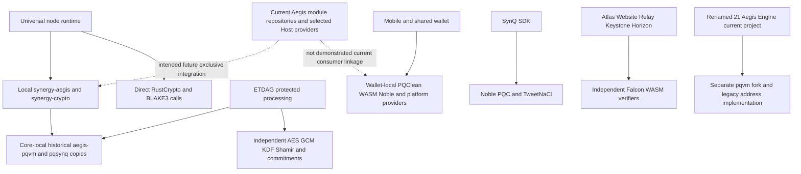

# Synergy Network complete cryptographic provenance audit

Audit date: 1 November 2026. Deliverable 2 of the read-only cryptographic audit.

## Executive finding

**APQE is not the exclusive cryptographic authority of the inspected Synergy Network implementation.** The canonical node uses a local historical `aegis-pqvm` fork and `synergy-aegis` adapters; ETDAG independently implements its AEAD, KDF, secret sharing and commitments. Wallets use another PQClean/WASM copy, Noble packages and platform cryptography. Multiple applications independently load Falcon WASM and derive addresses. These are demonstrated source call paths, not conclusions inferred from package names.

The available five validators have identical installed executables, but all five were stopped at the read-only observation. The installed artifact differs from the newer local package. Neither identical hashes nor newer source proves deployment of a correction. No service was started, stopped or restarted during this audit.

The October address manual is a **target specification**. Its protected-wallet EIP-55/20-byte architecture is not established by the current SHA3/FN-DSA/Bech32m implementations. Several other target profiles remain explicitly unresolved in the manual itself.

This report provides a repository-wide inventory and operation-level tracing for the material paths inspected. **It is not an exhaustive certification of every operation in every generated bundle, vendored dependency or deployed service.** Significant inaccessible and unverified boundaries are enumerated below. An unknown is not a compliance finding, and no unsupported completeness percentage is assigned.

## Authority, scope and evidence conventions

The source root is `/Volumes/PortableSSD/02-Synergy-Network`. The user explicitly authorized renaming the former `/Volumes/PortableSSD/Synergy-Network` root during the audit. This directory-only rename preserved directory identity, all 120 top-level entries and six selected file-content hashes. Existing source/configuration files containing old absolute paths were not rewritten under the implementation freeze; those references require later controlled reconciliation. The audit reports themselves use the new root. In source tables, `NP/` means `/Volumes/PortableSSD/02-Synergy-Network/01-Core-Protocol/node-platform/`; every other numbered path is relative to the source root. Line numbers identify the current working-tree bytes, not necessarily the committed or installed version. APFS Portal candidates are absolute paths outside that root.

Current authoritative Aegis source locators use `/Volumes/PortableSSD/01-Aegis-PQC/aegis-pqc`; old `02-Aegis-Cryptography` paths in history are historical locators.

The authoritative Core Protocol repository is `/Volumes/PortableSSD/02-Synergy-Network/01-Core-Protocol`, branch `reconcile/core-protocol-root-2026-09-15`, HEAD `ad615c07b3d8ed05c6a6989cdb4dc558ee194fe6`, with pre-existing uncommitted work. The universal node source is `node-platform`; `networks/testnet-v3/runtime` is a historical semantic reference, not another production owner. `Node-Architecture/Linux/Synergy` is the generated universal installation layout.

During this audit the user separately authorized the directory rename `/Volumes/PortableSSD/02-Synergy-Network/21-Address-Engine` → `/Volumes/PortableSSD/02-Synergy-Network/21-Aegis-Engine` and designated that directory as the future APQE home. The filesystem rename preserved directory identity and contents; the inner `synergy-address-engine` project and its code were not renamed or consolidated. The previously inspected cryptographic module tree was externally relocated during the audit from `02-Aegis-Cryptography/aegis-pqc` to `/Volumes/PortableSSD/01-Aegis-PQC/aegis-pqc`. Read-only rechecks established the same root Git HEAD and origin; module/file identity checks are recorded in Document1. This audit did not perform that relocation. Future location authority for `21-Aegis-Engine` does not establish code consolidation. Older references to `21-Address-Engine` identify the same pre-rename content.

Evidence classes: **S** direct source and caller inspection; **D** dependency/feature metadata; **H** Git history; **A** existing artifact; **R** read-only host observation; **T** existing pre-freeze test/probe result; **P** target documentation. High confidence means the named fact is directly supported; it does not extend to unobserved runtime paths. Severity concerns the architectural or interoperability impact, not a claim of a remotely exploitable vulnerability.

No audit-phase builds or cryptographic test submissions were run. Existing pre-freeze tests are identified separately. Source code, dependencies, manifests, configurations, packages, identities, wallets and canonical chain state were not modified. The only audit report outputs are the two requested Markdown files; the separately requested Address Engine and workspace parent-directory renames are the additional explicitly authorized filesystem changes.

### Design sources

- `/Volumes/jhutzler/Downloads/Synergy_Network_Address_and_Identity_Specification.pdf`: 223 pages, SHA-256 `2ff297e775d9e35bcd0472b4276b1c15f02bb72a5a2d853e76040c8276fcc6cc`.
- `/Volumes/jhutzler/Downloads/Synergy_Network_Canonical_Address_and_Identity_Technical_Manual_v1.0.docx`: SHA-256 `158e031d106c8b1d2a9204703bb22a837f2bf659e43d061480754fecfe9c16e3`. The PDF and DOCX contain the consolidated manual and specialized blueprints; page references below use the PDF. These were read as design inputs, not as instructions overriding the audit freeze.
- The complete APQE algorithm/module inventory, provider details and Address Engine location inventory are in sibling `APQE_COMPLETE_CRYPTOGRAPHIC_AND_CAPABILITY_AUDIT.md`. This report independently states the network consequences and traceable consumer evidence.

## Coverage register

| Location or component | Inspection performed | Boundary and result |
|---|---|---|
| 00 Corporate Admin Legal | Source-tree inventory | Administrative material; not a cryptographic runtime assurance |
| 01 Core Protocol | Workspace/lock/build scripts, current node callers, consensus, ETDAG, address, state/storage and existing artifacts; Git history | Material source paths traced; frozen runtime/research/test trees classified separately; not every old/generated file traced |
| Former 02 Aegis Cryptography, now /Volumes/PortableSSD/01-Aegis-PQC/aegis-pqc | Fifteen module repositories, selected backend/profile inventory and imports | Document 1 gives revisions, 55 selected variants, APIs and limitations; names alone do not certify conformance |
| 03 Proof of Synergy Consensus | Inventory | Design material; current execution authority is NP, not this folder |
| 04 SynQ | SDK, compiler and copied pqsynq call paths | Independent JS providers and separately copied Rust module; deployed compiler artifact not proven |
| 05 AIVM | Runtime manifests and state/governance/hash callers | Direct SHA implementations plus copied pqsynq; active deployed execution path not attested |
| 06 Interoperability | Rosetta source and prototypes; SXCP-adjacent inventory | Mock signatures explicitly development-only; some other release snapshots untraced |
| 07 Node Control Panel | Local authority instructions | Local tree is not canonical; scoped instructions identify Val4 `/home/node/Synergy-Network/07-Node-Control-Panel`. Remote source not inspected in this audit; Unknown |
| 08 Synergy Website | Backend wallet proof, staff/developer authentication, external-chain adapter | Direct Node crypto and independent Falcon WASM; deployed server versions not inspected |
| 09 Wallet | Shared core, mobile iOS/Android bindings, desktop Rust and WASM provider | Source paths traced; simulator release is separate existing artifact, not all-platform runtime qualification |
| 10 Atlas | atlas-v3 backend/frontend and alternative synergy-atlas indexer | Direct crypto and wallet delegation; alternative tree deployment authority unknown |
| 11 Relay | Actual pairing verifier caller, database/cache hashes | Independent Falcon WASM, SHA3, SHA256, HMAC and randomness |
| 12 Spark | Source inventory and limited JS/TS inspection | Large standalone HTML/embedded assets not fully traced; Unknown |
| 13 Keystone | Pairing backend, wallet connection and governance carrier parsing | Independent Falcon proof implementation; native Expo variant not exhaustively traced |
| 14 Forge | Wallet delegation, GitHub signing/webhooks, artifact and identity hashes | Direct classical/platform cryptography; no exclusive APQE path established |
| 15 Vault | Maintained UI JS | Observed signature/connection simulation; not evidence of secure vault implementation |
| 16 Horizon | Worker auth, control-plane auth and artifact verification | Independent Falcon WASM, HMAC, SHA256 and Ed25519 |
| 17 Prism | Maintained UI JS | Observed connection toggle; backend/injected cryptography Unknown |
| 18 Quest | Maintained UI JS | Observed connection toggle; not wallet cryptographic support evidence |
| 19 Learn | Wallet-link implementation | P-256, HKDF and AES-GCM directly through platform provider |
| 20 Portal | SSD archive inventory, APFS source candidates | Archived SSD source is not asserted active. `/Volumes/SynergyBuilds/Source/synergy-portal` inspected; `portal-native` and `synergy-dev-portal` alternatives require authority reconciliation |
| 21 Aegis Engine | Existing Address Engine source, local pqvm build, address/encryption/HD code | Future APQE home; currently independent legacy implementation, not consolidated engine |
| 22 Network Environments | Config/tool/history inventory | Historical evacuation/evidence trees not current runtime; rewrite tooling is not primitive implementation |
| 23 Design System | Source/export inventory | Duplicate demo/export assets; no production crypto linkage conclusion |
| 24 Documentation | Inventory | Design claims only, not implementation evidence |
| 25 Security Audits | Historical security snapshot inventory | Certik/SynQ/SXCP copies are historical review inputs, not deployed source authority |
| 26 Patents | Inventory | Not treated as runtime implementation |
| 27 Branding | Demo/source-export inventory | Generated/historical application copies do not establish current deployment |
| 28 Infrastructure | Workers, external auth delegation and simulation bridge | Actual external access-enforcement implementation unavailable; Unknown |
| 29 Developer Tooling | SAM wallet CLI delegation and release-checksum code | Python hashes, handwritten parser and external CLI; provider provenance incomplete |
| 31 SNRG Token and Contracts | SXCP staking service, witness, Merkle and Solidity verifiers | Direct ethers/Solidity cryptography, unresolved aegis RPC implementation |
| 34 SynQ Website | Compiler WASM wrapper | Compiles through WASM; embedded cryptographic linkage Unknown |
| 99 Unclassified | Maintained source and bundle inventory | Minified/generated assets and deployment authority unresolved |
| Node Architecture Linux | Generated package and manifest inspection | Identifies sealed local artifact; does not prove installed fleet linkage |
| Val2, Val3, Val4, Val5, Val6 | Existing SSH masters, installed hashes/manifest, service/VPN state | All five observed read-only; no live process to hash; runtime cryptographic calls cannot be observed while stopped |

The complementary search covers manifests, lockfiles, imports, actual calls, build selection, local forks, history and existing host artifacts. Broad lexical discovery excludes `.git`, dependency install trees, build/target/dist output, designated archive/vendor trees and files over 2 MB, with an explicit depth bound; generated/vendored primitives were instead selectively inspected along material call paths. That search is discovery, not proof that every operation is classified. External registry presence, TLS backend execution, runtime feature dispatch and inaccessible canonical components remain limitations.

## Actual cryptographic architecture

The dotted edges are intended migration, not existing execution paths. A local module named `aegis` is not automatically the selected, authoritative APQE provider. A transport's VPN encryption is likewise not proof that application AEAD, signing or key derivation is selected through APQE.

## Operation-level provenance matrix

Each row separates a meaningful operation. Library versions are exact where recoverable; unknown provider versions are explicitly marked. Unless `R` or `T` is stated, runtime use is **source-connected, not freshly observed execution**. Standards identify the algorithm family, not FIPS module certification.

| ID and component | Operation and algorithm or standard | Caller and source evidence | Actual provider and version | APQE path / bypass | Status, confidence and severity |
|---|---|---|---|---|---|
| N01 node consensus | ML-DSA-65 signing/verification, claimed FIPS 204 family | NP/bin/synergy-node/src/services/authority.rs:962; services/posy.rs:811; NP/crates/synergy-aegis/src/pqvm.rs:2,24–125 | Core-local aegis-pqvm 0.1.0 → generated FFI/C source | Local facade → fork; no selected APQE Host | S,D; connected source; High confidence; High |
| N02 QC/finality | Verify constituent validator signatures and three-QC certificates | NP/crates/synergy-posy/src/finality/verifier.rs:6; protocol.rs:17; N01 concrete verifier | Same N01 backend; multiple signatures, not demonstrated threshold aggregate | Fork path | S; High; High |
| N03 proposal/vote/QC commitments | BLAKE3-256 over domain bytes, u64be domain length, JSON bytes | NP/crates/synergy-posy/src/protocol.rs:37–48 canonical_hash | blake3 1.8.7 direct | No APQE call | S,D; High; High compatibility sensitivity |
| N04 epoch/leader-ring identity | BLAKE3 canonical_hash domains for leader ring and epoch | NP/crates/synergy-posy/src/membership/epoch.rs:57,82,117 | N03; leader selection itself deterministic policy, not a discovered VRF | Direct | S; High; Medium |
| N05 safety journal | Signed-slot record identifier commitment | NP/crates/synergy-posy/src/persistence/safety_journal.rs:313–315 | N03 BLAKE3 | Direct | S; High; High persisted-identity sensitivity |
| N06 P2P handshake | ML-DSA-65 sign/verify over framed handshake, governed key binding and chain/genesis checks | NP/bin/synergy-node/src/services/network.rs:171–266; network_session.rs:12,320; NP/crates/synergy-network/src/handshake/aegis.rs:46–142; signing.rs:85 | PqvmSigner/Verifier → local fork | Facade does not reach authoritative Host | S; High; High |
| N07 local signer memory | Secret bytes retained in Vec; volatile clearing on drop | NP/crates/synergy-aegis/src/pqvm.rs:62–125,92–98 | Consumer-owned memory policy; zeroize 1.9.0 also in lock, presence not use proof | No centralized APQE key lifecycle established | S,D; High fact; protection completeness Unknown; High |
| N08 KEM facade | ML-KEM-768 encapsulation/decapsulation | NP/crates/synergy-aegis/src/kem.rs:2,20–42 | Local aegis-pqvm 0.1.0 | Fork facade; actual per-service reachability requires caller proof | S; API present; Medium |
| E01 ETDAG ingress capsule | ML-KEM-1024 encapsulation/decapsulation; 1568B pk/ct, 3168B sk, 32B shared secret | NP/crates/synergy-etdag/src/crypto/protected.rs:8,316–326,411–491 | Local pqvm FFI; current working-tree build selects FIPS PQClean, installed older artifact differs | Direct local fork, bypasses APQE selected Host | S,A,T; interoperability Critical |
| E02 ETDAG content and capsule encryption | AES-256-GCM, 12B random nonce, appended 16B tag | protected.rs:166–191 | aes-gcm 0.10.3 / aes 0.8.4 | Direct RustCrypto consumer | S,D; High; High |
| E03 capsule key derivation | SHA3-512 framed custom KDF, first 32B | protected.rs:200–221, domain PoSy/ETDAG/CapsuleKey/v3 | sha3 0.10.9 | Consumer construction, not HKDF or APQE API | S; High; High |
| E04 shared content-key distribution | Custom GF(256) Shamir, AES-polynomial multiplication and random coefficients | protected.rs:223–285 | Handwritten code + rand OsRng | Independent secret-sharing construction; not threshold signatures/DKG | S; High; High |
| E05 key/nonce entropy | OS randomness for content key, shares, nonce | protected.rs:14,166–169 and encryption path | rand 0.8.8 / getrandom resolved variants | Consumer directly acquires entropy | S,D; High; Medium |
| E06 envelope/dependency/share/result commitments | SHA3-512, length-framed domain and payload, JSON canonical input where used | NP/crates/synergy-etdag/src/digest.rs:2,10–23; crypto/envelope.rs:94–106; crypto/key_registry.rs:68–70 | sha3 0.10.9 | Direct, distinct from consensus BLAKE3 | S; High; High migration sensitivity |
| E07 historical decryption | SHAKE256(prekey || SHA3-256(ciphertext)) compatibility secret, AEAD-gated retry | protected.rs:411–491; NP/bin/synergy-node/src/services/processing_store.rs:776,1058,1117,1136–1145 | Core consumer implements compatibility outside APQE | Local source v1 retained provenance vs v2 FIPS-only; not deployed proof | S,T; High; Critical compatibility boundary |
| E08 ingress key possession | Encapsulate/decapsulate check | protected.rs:576–580 | Same local backend on both sides | Self-consistency is not cross-provider conformance | S,T; High; High |
| H01 block commitment | SHA3-256 | NP/crates/synergy-block/src/commitment.rs:1,34 | sha3 0.10.9 | Direct | S,D; High; High wire sensitivity |
| H02 state root | SHA3-256 | NP/crates/synergy-state/src/root.rs:1 | sha3 0.10.9 | Direct | S,D; High; High persisted compatibility |
| H03 storage integrity | SHA3-256 | NP/crates/synergy-storage/src/integrity.rs:1,17 | sha3 0.10.9 | Direct | S,D; High; Medium |
| H04 transaction and receipt IDs | SHA3-256 | NP/crates/synergy-transaction/src/id.rs:2; receipt.rs:3 | sha3 0.10.9 | Direct | S,D; High; High |
| H05 AIVM artifact verification | SHA3-256 | NP/crates/synergy-aivm/src/validation.rs:2 | sha3 0.10.9 | Direct | S,D; High; High |
| H06 SynQ bytecode commitment | SHA3-256 | NP/crates/synergy-synq/src/bytecode.rs:1,27 | sha3 0.10.9 | Direct | S,D; High; High |
| H07 crypto hash facade | SHA3-256/512 | NP/crates/synergy-crypto/src/hash.rs; synergy-aegis/src/digest.rs:2,16,34,42 | Local facade directly uses sha3 0.10.9 | Name does not establish APQE Host | S,D; High; High |
| H08 SynQ facade artifact/input hash | SHA256 and copied pqsynq verifier | NP/crates/synergy-aegis/src/pqsynq.rs:12,138 | sha2 0.10.9 + local aegis-pqsynq 0.1.0 | Copied integration, independently hashes | S,D; High; High |
| H09 WebSocket accept | SHA1 interoperability checksum | NP/bin/synergy-node/src/services/rpc.rs:12,1414 | sha1 0.10.7 | Direct; protocol checksum, not consensus collision resistance | S,D; High; Low |
| H10 updater artifact hash | SHA3 | NP/crates/synergy-updater/src/verification.rs:1,48 | Direct RustCrypto; installed updater linkage not independently attested | Direct | S; Medium; Medium |
| H11 keytool address/key commitment | SHA3 | NP/bin/synergy-keytool/src/wallet.rs:12,31; aegis_keys.rs:8,89 | Direct sha3 + fork signatures | Independent tool crypto | S; High; High |
| A01 runtime native address | SHA3-256(raw 1793B FN-DSA-1024 public key), HRP-dependent bit truncation, Bech32m | NP/crates/synergy-address/src/lib.rs:13,17,45–99,193–208; snts_registry.rs:171–179 | sha3 0.10.9, Bech32 codec | No APQE address API | S; High; High manual incompatibility |
| W01 wallet protected envelope | Framed SHA3-512, BLAKE3/SHA256 helpers and envelope roots | 09-Wallet/synergy-wallet/packages/wallet-core/src/processing.js:5–7,37,155–159 | Noble hashes; exact selected package varies import resolution | Independent implementation | S,D; High; High |
| W02 wallet AEAD | AES-GCM content/capsules | wallet-core/src/processing.js:111,151 | crypto.subtle, mobile polyfill/native selection | Direct platform provider | S; High; High |
| W03 wallet shares/KDF | GF256 Shamir and CapsuleKey SHA3-512 | wallet-core/src/processing.js:138,149 | Handwritten JS + Noble | Independent copy of ETDAG construction | S; High; High |
| W04 mobile KEM | FIPS-profile ML-KEM-1024 | apps/mobile/src/services/pqcProvider.js:74–85; ios/AegisPqc/Sources/AegisPqc.m:353–380; Android CMakeLists.txt:22,26–65 and aegis_pqc_jni.cpp | Wallet-local PQCLEAN_MLKEM1024_CLEAN C | AegisPqc branding; no authoritative engine path | S,T; High; Critical cross-provider mismatch observed pre-freeze |
| W05 mobile signatures | FN-DSA/Falcon profile, ML-DSA-65/87 | pqcProvider.js:17–69,89–119 | Native local PQClean C / binding | Independent provider selection | S; High; High |
| W06 wallet password KDF | PBKDF2 SHA256, default 200000 rounds; HKDF helpers | wallet-core/src/crypto/envelope.js:17–20,28–82 | Native PBKDF2/CommonCrypto or Noble fallback; polyfills.js:6–8,43–77 | Independent platform/fallback selection | S; High; High |
| W07 wallet vault AEAD | Platform AES-GCM | envelope.js:95–146 | WebCrypto/native/polyfill; selected runtime varies | Independent | S; High; High |
| W08 wallet address | SHA3-256(FN-DSA public key), truncated Bech32m | wallet-core/src/address.js:18–19,65–100 | Noble + handwritten/Bech32 codec | Independent, legacy manual profile | S; High; High |
| W09 desktop keys | Deterministic Falcon/ML-KEM | apps/desktop/src-tauri/src/identity.rs:10–14; Cargo.toml | wallet-local aegis_crypto_core and aegis_klc_rb | Copied/local providers, not authoritative Host | S,D; High; High |
| W10 desktop signatures | Direct Falcon-1024 detached_sign | desktop/src-tauri/src/synergy.rs:10,493 | pqcrypto-falcon local resolution | Bypasses even local facade; old native plaintext send is blocked at :20 | S; code present, send reachability qualified; High |
| W11 desktop address/hash | Handwritten Bech32m and BLAKE3 | synergy.rs:50,147–174 | Local code + blake3 | Independent | S; High; High |
| W12 wallet WASM PQC | FNDSA/MLDSA/MLKEM functions | packages/pqc-aegis/src/providers/{fndsa,mldsa,mlkem}.js; wasm-loader.js:75,112,195; index.js:12–15 | Separately loaded local WASM assets | No selected APQE Host linkage proven | S,A; High; High |
| Q01 SynQ SDK signatures | Falcon/MLDSA and TweetNaCl primitives | 04-SynQ/synq-language/sdk/src/keys.ts:1–4,65–75 | @noble/post-quantum 0.6.1; tweetnacl 1.0.3 | Direct third-party providers | S,D; High; High |
| Q02 SynQ SDK KEM | MLKEM key exchange | keys.ts:94–105; src/crypto/ml-kem.ts:1,15–34 | Noble PQC 0.6.1 | Direct | S,D; High; High |
| Q03 SynQ compiler verification/KEM | MLDSA/FNDSA verification; MLKEM/HQC decap | compiler/Cargo.toml:17; pqc_integration.rs:197–275 | SynQ-local aegis-pqsynq/pqsynq | Separate module copy, actual backend version not authoritative by name | S,D; High; High |
| V01 separate AIVM governance | MLDSA governance verification | 05-AIVM/synergy-aivm/runtime/aivm-core/src/stateful_synq.rs:1027–1039,1079–1151 | SynQ-local pqsynq | Partial copied integration | S; High; High |
| V02 separate AIVM hashes | SHA256 | stateful_synq.rs:251,1339,1849,2409; synq_runtime.rs:97,2268; state.rs:139; execution.rs:216,282,472 | Direct SHA2 dependency | Bypass | S; High; High |
| V03 NP AIVM crypto opcodes | Explicit injected-provider requirement | NP/crates/synergy-aivm/src/quantum/vm.rs:576–597 | Errors unless provider injected | Interface presence is not functioning APQE opcode proof | S; incomplete/unverified runtime; High |
| X01 renamed engine signatures/KEM | Local pqvm + Ed25519 | 21-Aegis-Engine/synergy-address-engine/src/crypto.rs:11–17,45–120; Cargo.toml:30 | Separate local aegis-pqvm and ed25519 | Independent fork | S; High; Critical legacy KEM exposure |
| X02 renamed engine legacy KEM | Legacy Kyber under MLKEM symbols | aegis-pqvm/build.rs:11,192–246; vendor/pqnist/.../kyber1024/kem.c:60–72,110–124 | Legacy submission C + wrappers | Not authoritative selected APQE; same-size encoding hides semantic mismatch | S,H; High; Critical |
| X03 renamed engine address | SHA3 and legacy Bech32m | src/address.rs:23–64 | Local address implementation | Independent | S; High; High |
| X04 renamed engine HD derivation | Custom BIP32-like secp256k1 child derivation | src/wallet.rs:38–91 | HMAC and local scalar logic; hardened path omits parent-scalar addition | Incorrect relative to claimed BIP32; no new runtime test | S; High; Critical recovery/identity compatibility |
| X05 renamed engine encrypted storage | AES-GCM/Argon2 | src/encrypt.rs:29–37 | Direct provider dependency, exact params in Document1 | Independent | S; High; High |
| X06 renamed engine bindings | Hashes for registry/auth/object bindings | src/registry.rs:4; auth_binding.rs:13; object_binding.rs:13 | Direct hash imports | Independent | S; High; High |
| S01 website wallet proof | SHA3→Bech32 address, Falcon signature verify | 08-Synergy-Website/backend/src/synergyWalletSignature.js:1,5,40–51,66–114 | Node crypto + own falcon1024.wasm | No APQE | S; High; High |
| S02 website node-admin proof | Ed25519 sign/verify and SHA256 fingerprints | adminNodeVerificationOperations.js:365–390,648 | Node/OpenSSL provider; exact deployed version unknown | Direct platform crypto | S; High; Medium |
| S03 website developer auth | scrypt/HMAC | developerAuthentication.js:1,94,98 | Node crypto | Direct | S; High; Medium |
| S04 website staff auth | scrypt/SHA256 | staffPreviewAccess.js:1,18 | Node crypto | Direct | S; High; Medium |
| S05 presale chain proof | Keccak and Ethereum protocol | onchainPresaleStatus.js:1,13,50 | ethers 6.17.0 | External-chain algorithm must remain exact; APQE ownership missing | S,D; High; High |
| T01 Atlas wallet proof | SHA3 address and Falcon verification | 10-Atlas/atlas-v3/backend/src/walletSignature.ts:1,59,82–85,137,162–177; index.ts:1278,2540 | Own Falcon WASM and Node crypto | Direct independent | S; High; High |
| T02 Atlas asset provisioning | Copy/check Falcon WASM export | backend/scripts/copy-wallet-verifier.mjs:3–6 | Copied assets/falcon1024.wasm | Artifact copy ≠ source/version proof | S,A; High; High |
| T03 Atlas telemetry/security | SHA256, timingSafeEqual, random | posyPublicRpc.ts:39,48; staffTelemetry.ts:51–53; index.ts:542,573 | Node crypto | Direct | S; High; Medium |
| T04 Atlas wallet caller | Delegate synergy_signMessage | frontend src/wallet/synergyWallet.ts:72–73,95 | User wallet; suite declaration not primitive proof | Delegated, implementation depends wallet | S; High; Unknown provider at boundary |
| T05 alternative Atlas indexer | SHA3 | 10-Atlas/synergy-atlas/indexer/src/index.ts:590–594 | Independent import | Source present; active deployment Unknown | S; High fact; Medium |
| F01 Forge wallet proof | Delegate wallet signing | 14-Forge/forge-v3/app/lib/adapters/wallet.ts:71,103 | Wallet provider | Delegation not APQE proof | S; High; Medium |
| F02 Forge GitHub auth | RSA-SHA256 JWT and HMAC-SHA256 webhook | app/lib/developer-hub/github.ts:1,108–111,327–328 | Node crypto | Direct external-protocol crypto | S; High; Medium |
| F03 Forge artifacts/IDs | WebCrypto SHA256, Node SHA256 and UUID/random | document-storage.ts:13–14; workforce-sync.ts:129,273; ide/id.ts:4–8 | OS/browser crypto | Direct | S; High; Medium |
| C01 SXCP service PQC | mldsa sign/verify via aegis_signPQC/aegis_verifyPQC JSON RPC | 31-SNRG-Token-And-Contracts/sxcp-staking-integration-v0.3/service/src/relayer/aegis.js:1,4–12; witness/server.js:34–35 | Unresolved remote RPC server implementation | Unknown; method name is not provenance | S; High uncertainty; High |
| C02 SXCP Merkle commitments | Keccak leaves and pairs | service/src/shared/merkle.js:1,6–20; contracts/sxcp/SXCPStakingVerifier.sol:25–43,132–191 | ethers 6.17.0 / EVM opcode | Direct protocol implementation | S,D; High; High |
| C03 SXCP external settlement | ECDSA account/nonce signing | service/src/relayer/submitter.js:1,8–9 | ethers Wallet/NonceManager 6.17.0 | Direct independent external-chain provider | S,D; High; High |
| R01 Rosetta hash/mock signature | SHA256(secret || message), mock-sha256-dev-only | 06-Interoperability/project-rosetta/crates/rosetta-core/src/hash.rs:2; rosetta-attestation/src/mock_signature.rs:19–24,43 | Direct SHA2, explicitly mock | Development-only; not PQ security support | S; High; High if activated as real auth |
| R02 Rosetta SDK/escrow | SHA256 intent/mock finality; Keccak EVM escrow | sdk/typescript/src/intent.ts:1,73–88,124,128; contracts/evm/src/RosettaEscrow.sol:90 | Node crypto/EVM | Independent/prototype | S; High; Medium |
| L01 Learn wallet-link signatures | ECDSA P-256 SHA256 | 19-Learn/synergy-learn/packages/synergy-wallet-adapter/src/walletLinkCrypto.ts:90–114,144–149 | WebCrypto | Independent classical protocol | S; High; High |
| L02 Learn key exchange/AEAD | ECDH P-256→HKDF SHA256→AES-GCM-256 | walletLinkCrypto.ts:182–225 | WebCrypto | Independent | S; High; High |
| L03 Learn key wrapping/hash | AES wrapping and SHA256 | walletLinkStore.ts:138,158,192; walletLinkCrypto.ts:56 | Platform provider | Independent | S; High; High |
| O01 Horizon wallet proof | Falcon verifier | 16-Horizon/horizon-v3/workers/horizon-edge-router/src/wallet-auth.ts:1,245–255 | Own falcon1024_opt.wasm | Independent | S; High; High |
| O02 Horizon session auth | HMAC-SHA256 and random | wallet-auth.ts:215,265–277; shared/horizon-control-plane-auth.ts:22,33,53 | WebCrypto | Independent | S; High; Medium |
| O03 Horizon artifact proof | SHA256 and Ed25519 | services/horizon-control-plane/src/artifact-transfer.ts:100,116–119 | Platform crypto | Independent | S; High; High |
| P01 Portal distribution | Ed25519 signed feed; sign/verify and SHA256 release checksum | /Volumes/SynergyBuilds/Source/synergy-portal/packages/portal-native/src/distribution.js:11–35,51–57; services/portal-distribution/lib.mjs:1,9–17; publish-release.mjs:2,13–14 | WebCrypto and Node crypto | Independent; source authority/deployment unresolved | S; High fact; High |
| P02 Portal transport | TLS libraries declared | apps/desktop/src-tauri/Cargo.toml:28,35 | tokio-tungstenite 0.28 rustls/webpki; reqwest 0.12 rustls requested | Dependency evidence; actual negotiated TLS/provider Unknown | D; Medium; High |
| Y01 Relay proof/hash | Falcon verify, SHA3 address; HMACSHA256 and SHA256 cache | 11-Relay/synergy-relay/server/wallet-signature.mjs:1,9,46,69–103; wallet-pairing-relay.mjs:5,125; db/walletHash.mjs:6; cache/cacheService.mjs:17 | Own WASM + Node crypto | Independent | S; High; High |
| Y02 Relay entropy | randomBytes/UUID | wallet-pairing-relay.mjs:240,327 | Node crypto | Direct | S; High; Medium |
| K01 Keystone proof | Falcon verify and SHA3 address | 13-Keystone/synergy-keystone/server/wallet-signature.mjs:1,9,46,69–103; wallet-pairing-relay.mjs:4,273 | Own WASM + Node crypto | Independent; exact tree path subject source inventory verification | S; High; High |
| K02 Keystone entropy and signing delegate | randomBytes/UUID; wallet signTransaction | wallet-pairing-relay.mjs:87,169; src/services/wallet-connection.js:186–188,343 | Node crypto / external wallet | Independent or delegated | S; High; Medium |
| D01 SAM wallet parser | Handwritten Bech32 validator | 29-Developer-Tooling/sam_tool/sam/wallet_bundle/synergy-testnet-tx.py:91–145 | Python local code | Independent | S; High; High |
| D02 SAM signing/decryption | CLI sign-tx/decrypt delegation | sam_tool/sam/wallet.py:477–507,1159; wallet_bundle/synergy-testnet-tx.py:312–324 | External wallet-pqc-cli/address-engine binary unresolved | Unknown provider; command parameters include pinned chain coordinates | S; High uncertainty; High |
| D03 SAM releases | SHA256 checksum | sam_tool/sam/github_release.py:3,75–98 | Python hashlib/platform | Independent | S; High; Medium |

The operation list is a measured lower bound. It contains independent providers in at least **22 named consumer groups** when Core, ETDAG, node address/key tools, shared wallet, mobile provider, desktop wallet, wallet WASM, SynQ SDK, SynQ compiler, separate AIVM, renamed engine, website, Atlas, Forge, SXCP, Rosetta, Learn, Horizon, Portal, Relay, Keystone and SAM are counted separately. This grouping is explicit and intentionally does not count every file as another product. The exact count is not a claim that all other components are compliant.

## Cryptographic dependency and facade assessment

### Core dependency resolution

`NP/Cargo.lock` resolves `aegis-pqvm 0.1.0`, `aegis-pqsynq 0.1.0` and `pqrust-internals 0.2.11` as local paths; `aes-gcm 0.10.3`, `aes 0.8.4`, `sha3 0.10.9`, `sha2 0.10.9`, `sha1 0.10.7`, `blake3 1.8.7`, `tiny-keccak 2.0.2`, `rand 0.8.8/0.9.5`, `getrandom 0.2.17/0.3.4/0.4.3`, `ed25519-dalek 2.2.0`, `zeroize 1.9.0`. Presence in this graph does not prove each version is linked or invoked in a particular executable.

`NP/crates/aegis-pqvm/Cargo.toml` defaults `mlkem,mldsa,fndsa,security`; optional `avx2`, `neon`, hardware-entropy and serialization selections exist. The package's top-level `features=[]` does not disable default features of all dependencies. The current build script uses `AEGIS_PQ_SOURCE_ROOT` resolution; backend path authority is therefore a separate build input to verify, not infer from Rust package version.

The canonical Aegis selected provider architecture described in Document 1 is a different source revision/profile mechanism. Its module HEADs matching remote main does not make Core's local version 0.1.0 fork current. Versions with the same module name are not interchangeable provider attestations.

### Facades

| Facade | Actual delegation | Finding |
|---|---|---|
| synergy-aegis PqvmSigner/Verifier | Local pqvm signatures, local signing-context policy | Useful boundary but disconnected from authoritative selected Host |
| synergy-aegis PqvmMlKem768 | Local pqvm KEM | Name provides no final FIPS guarantee; backend source selection matters |
| synergy-aegis digest | Direct RustCrypto SHA3 | Independent implementation selection inside copied facade |
| synergy-crypto hashes | synergy-aegis local digest adapter | Extra wrapper does not establish authoritative APQE ownership |
| synergy-crypto AES trait | Provider interface | Interface alone does not prove registered production AEAD provider or consumer migration |
| wallet AegisPqc | React Native bridge to wallet-local C | Branding hides separate source authority/version |
| wallet pqc-aegis WASM | Local browser assets and independent dispatch | Asset provenance/feature compatibility needs explicit provider manifest |
| SynQ pqsynq copies | Compiler/runtime-local module | Not automatically current authoritative APQE |
| SXCP aegis RPC | ethers JSON-RPC method wrapper | Server provenance unresolved; cannot mark compliant |
| SAM address-engine/CLI delegation | Subprocess binary | Binary/source identity not proven by executable name |

### Secure transport and platform providers

TLS in desktop and infrastructure stacks, NetBird/WireGuard VPN cryptography, browser WebCrypto, CommonCrypto, Android JNI and Node/OpenSSL are separate provider boundaries. External protocol requirements may legitimately mandate classical algorithms; the intended architecture still requires an APQE-owned interface and exact provider policy, not changing those algorithms to arbitrary PQ substitutes. This audit did not inspect every negotiated connection or establish deployed OpenSSL, rustls, WireGuard or platform patch levels. No inference of post-quantum transport is made from an encrypted VPN or a PQ application signature.

## Legacy Kyber and ML-KEM incident provenance

### What differs

The older Core build compiled `vendor/pqnist/NIST-ml-kem/Reference_Implementation/crypto_kem/kyber{512,768,1024}` and exported `PQCLEAN_MLKEM*` wrapper symbols. The file and wrapper names did not make it final FIPS 203. The actual C `kem.c` hashes input randomness and derives its shared secret through `kdf(ss, prekey || H(ciphertext))`; the historical variant's SHAKE derivation differs from standardized ML-KEM's successful shared secret. Key and ciphertext sizes can agree while shared-secret semantics do not.

The mobile provider selected wallet-local FIPS-profile PQClean ML-KEM. Existing pre-freeze native probes of Val2 and Val5 failed the original mobile capsule's AES-GCM authentication while native same-backend key-possession checks passed. That is why a same-provider round trip was insufficient. The mismatch is a supported explanation for that cryptographic capsule failure; it does not establish the cause of every historic finality or performance stall.

### Accessible history

| Evidence | What is established | What is not established |
|---|---|---|
| `git blame` on Core HEAD build.rs lines192–225 | Legacy directory/symbol mapping traces to boundary commit `fb71260`, 25 July 2026, former `runtime/aegis-pqvm/build.rs` | The first-ever introducing commit is not proven beyond available history boundary |
| `git show fb71260:runtime/aegis-pqvm/build.rs` | Same mapping existed before October standardized installation layout | Does not prove all binaries ever used that branch |
| Core preservation commit `df17c926`, 15 September | Build logic propagated into retained canonical source | Not a cryptographic qualification or correction |
| Earlier installed artifact/probes | Actual installed backend incompatibility observed in bounded pre-freeze probes; package now identical on all five | No fresh runtime probe during audit; all stopped |
| Current Core working-tree build.rs:161–210 | Pre-freeze local correction selects clean FIPS PQClean scheme sources | Not migration to selected authoritative APQE Host; not installed fleet proof |
| Current renamed engine build.rs:192–246 | Another copy still maps legacy C to MLKEM names | Its current production execution is unverified |

The standardized installation architecture therefore propagated an existing defective backend selection; the available history does not support claiming it introduced the defect. The pre-freeze correction fixed backend selection in the local Core fork, not the whole network's APQE provenance architecture.

### Compatibility and persisted data

Current source `protected.rs:411–491` contains a historical shared-secret transform and AEAD-gated retry. `processing_store.rs:776` assigns recovery permission to retained version1 records; new admissions are version2 at :1058 and explicitly FIPS-only at :1117,1136–1145. This source boundary is preferable to unconditional retry, but it is implemented outside APQE and not installed or independently security-qualified by this audit. Persisted format, sender authorization, network/genesis provenance and exact original ciphertext must remain part of any later migration design.

Existing pre-freeze results include a deterministic mobile/native FFI vector, historical AEAD/tamper/provenance tests, and a five-socket regression. Those are useful narrowly scoped evidence, **not** five independent hosts executing the new artifact, nor FIPS validation. The actual-custody corrected five-host probe remained outstanding when the freeze took effect. Previously accepted uncertain transactions must not be re-admitted simply to test interoperability.

## Additional address-copy and authoritative-helper findings

Document1 Appendix B lists full Address Engine package copies, independently implemented derivation/parsing modules, re-export shims and historical snapshots, with exact-file duplicate hashes. Those categories are deliberately distinct: identical `address.rs` does not prove whole-package identity, and re-exporting a function is not another cryptographic implementation.

A focused TOML package check verified **13 locations declaring package `synergy-address-engine`**, plus **four historical `synergy-testnet` runtime package locations** containing address implementations or engine references. The 17 candidate locations span the new engine home, local control-panel packages, Core historical/hotfix trees and Val4 evacuation/source trees. Document1 lists each with the actual parsed package identity; a name appearing elsewhere in a manifest is not counted as its package name. Two local `07-Node-Control-Panel` Address Engine packages contain their own SHA3/Bech32/Falcon and encrypted-key code. The local control service manifest at `07-Node-Control-Panel/control-service/Cargo.toml:47` references `../../21-Address-Engine/synergy-address-engine`; the separately authorized directory rename leaves that source edge stale. It was not repaired or bypassed with a symlink under the freeze. The canonical deployed control-panel source remains uninspected, so its exact edge is Unknown.

Duplicate `09-Wallet/synergy-wallet-app` core address and desktop implementations coexist with `synergy-wallet`. Full engines also appear in Core frozen/hotfix and Val4 evacuation snapshots. Six wallet-local generic Aegis `blockchain.rs` copies derive last20(Keccak256(public-key-bytes)) and emit lowercase `0x`; that helper does not establish secp256k1 ownership when passed arbitrary PQ public keys. Learn also has an independent API `apps/learn-api/src/walletSignature.ts` verifier/address implementation. Historical Forge and branding parser copies are not asserted active.

Document1 additionally identifies authoritative Aegis generic `blockchain.rs` helpers which concatenate plaintext after a KEM ciphertext. For example, current PQWear `aegis_crypto_clean/src/blockchain.rs:70–81` does not provide authenticated content encryption. Export declarations exist in several legacy modules, but actual production invocation was not established. This is a P0 fail-closed/correctness review item; it is **not** evidence that the current ETDAG AEAD path sends plaintext. PQWASM has a separately corrected AEAD implementation, so these helpers are not one consistent backend. Their full current paths and file hashes are in Document1.

## Existing artifact and five-validator observation

| Attribute | Val2 | Val3 | Val4 | Val5 | Val6 |
|---|---|---|---|---|---|
| Service state | inactive, MainPID0 | inactive, MainPID0 | inactive, MainPID0 | inactive, MainPID0 | inactive, MainPID0 |
| Installed executable | /opt/Synergy/bin/synergy-node | same | same | same | same |
| SHA-256 | `10418aad801e298c3c78be0e9661459e77cdeadb0445b5976388324dde9c324c` | same | same | same | same |
| Installed release | synergy-linux-58db14bdb6534672 | same | same | same | same |
| Source fingerprint | `58db14bdb653467224943a8cf9f44cc138d774cd4a5deeeff25e3973a96a2583` | same | same | same | same |
| Package manifest SHA-256 | `7e89c7f38044e817c811e1e64c872529cbc1e8e14c98be2626cae35416b64dbe` | same | same | same | same |
| Declared package features | [] | [] | [] | [] | [] |
| ExecStart | /opt/Synergy/bin/synergy-node start --config /opt/Synergy/config/node.json | same | same | same | same |
| MemoryMax / swap | 1GiB / 0 | same | same | same | same |
| NRestarts | 0 | 0 | 0 | 0 | 0 |
| Existing VPN client | active | active | active | active | active |
| Running executable hash | unavailable: no process | same | same | same | same |

These are bounded audit-time observations, not a continuously monitored health statement. No independent remote connection per action was opened; existing SSH masters were reused. Reading installed bytes does not execute them. The manifest source fingerprint is not a Git commit and does not independently reconstruct all C source inputs or static linkage.

### Newer local package, not deployed

`Node-Architecture/Linux/Synergy/package.json` identifies local release `synergy-linux-91f61792930cf67c`, source fingerprint `91f61792930cf67cba69a00ec32697187730ad194e8c1a0f5380e6f6e3270b5f`, manifest hash `ffec16b382af260b75519a73b8418ae4977be0292c35e30fcfc7fab5a4453571`, node hash `ed71118c22f9f5e8edac694f34eff5f75923a09444d7fefc281d405fa9716037`, keytool hash `4872ce90e076d464462c394d18c208bb23d36e73f47c5c56aaeaac4645ab08d9`. The package targets x86_64 Linux/glibc2.28 and existed before the freeze. It was neither rebuilt nor deployed by the audit. Comparing installed/local hashes conclusively establishes they differ; it does not certify the newer package's cryptographic behavior on every CPU/platform.

An existing mobile simulator release also predates the freeze: native executable hash `8a5eb76b3947b719641bce2b72b3b0bb681bdb916c28d96d00add4930db6136a`, JS bundle hash `4513236043115ea923b1501452608cb075d92b0e06f33b7b9e98ac4e14430c5d`. No wallet unlock, transaction or state change was performed during this audit. A simulator bundle does not attest installed Android devices or browser assets.

## Component APQE compliance matrix

| Consumer group | Classification | Reason and operation references |
|---|---|---|
| Current authoritative Aegis module implementations | APQE-internal, qualification limited | Document1; selected profile ownership exists but production availability/platform coverage limited |
| Core validator and crypto facades | Independent implementation / copied integration | N01–N08,H07–H08; no authoritative selected Host edge |
| ETDAG | Independent implementation / historical compatibility | E01–E08, Critical mismatch history |
| Node address and provisioning tools | Independent implementation / legacy | A01,H11 |
| Shared/mobile/desktop/browser wallet | Independent implementation | W01–W12; multiple real providers |
| SynQ SDK | Independent implementation | Q01–Q02 |
| SynQ compiler | Copied integration / Unknown deployed backend | Q03 |
| Separate AIVM runtime | Copied integration plus independent hashes | V01–V03; not another authorized production VM |
| Renamed Address Engine | Legacy / independent implementation | X01–X06; folder designation is not code consolidation |
| Website / Atlas | Independent implementation | S01–S05,T01–T05 |
| Forge | Independent / delegated wallet | F01–F03 |
| SXCP staking | External provider / Unknown RPC / independent commitments | C01–C03 |
| Rosetta prototype | Legacy/development mock | R01–R02; not production cryptographic security |
| Learn | External platform provider | L01–L03 |
| Horizon | Independent implementation | O01–O03 |
| Portal source candidate | Independent implementation / runtime Unknown | P01–P02 |
| Relay / Keystone | Independent implementation | Y01–Y02,K01–K02 |
| SAM tools | Independent / delegated CLI Unknown | D01–D03 |
| Node Control Panel | Unknown | Canonical remote source not inspected |
| Spark / Vault / Prism / Quest | Unknown or UI-only observed | No compliance certification from source search absence |
| Infrastructure delegated auth | Unknown | External access-enforcement source unavailable |
| Remaining unclassified/generated/historical components | Unknown | Coverage register limits apply |

No external network consumer is certified **APQE-exclusive** by the available evidence. This is not a claim that every unexamined component bypasses APQE; those are Unknown.

## Address and identity architecture reconciliation

### Profile matrix

| Manual target and PDF reference | Intended operation | Inspected current implementation | Status and consequence |
|---|---|---|---|
| SYNW_HEX_EIP55_V1, pp20–22,60–62 | Threshold secp256k1 aggregate SEC1 public key U=04||X||Y; last20(Keccak256(U[1:65])); synw + checksummed40hex, total44; matching0x body | A01,W08,X03 use SHA3-256(raw FNDSA pk), 41char HRP-dependent truncated Bech32m | Implemented differently / legacy only. No in-place text rewrite or zero padding can migrate authority |
| Account chain coordinates, p22,62 | Raw account20 + actual chain/genesis identity | Existing derivation has no chain/genesis parameter; transaction/handshake scope checks exist separately | Partial separation, not full manual account registry implementation; shared account bytes may intentionally span chains |
| SynergyObjectID, p62 | 32B SHA3-256 of domain-framed wallet UUID and native genesis; non-spending continuity | Local object-binding helpers are not proof of exact profile or consensus integration | Partial/Unable to verify full target; freeze exact schema and vectors |
| D/P/R protected authorities, pp63–78 | Native independent MLDSA87 D+P ordinary authorization; R recovery-only, epochs | Mobile exposes MLDSA87; current wallet root/delegation and consensus MLDSA65 paths are different mechanisms | Target enforcement not established; algorithm API availability does not implement capability semantics |
| synm/synu/synl, pp24–25 | Predicted deterministic smart-account bytes20, CREATE2, immutable creation identity and mutable policy | Legacy registry/prefixes exist; no complete inspected approved factory/initializer/salt/DKG/policy workflow | Legacy/different; exact target version IDs and serialization explicitly unresolved ADDR001 |
| sync user contracts, pp27–29 | Authenticated user class; chosen lossless160 or native256 profile | Legacy41char truncation; current contract tooling/source paths differ across snapshots | New width unresolved ADDR002; 150bits cannot losslessly encode160bits |
| synq system contracts, pp27–29 | System class bound to signed intent, genesis/governance authority and profile | Namespace recognition is not proof of class authorization; independent SynQ address types also exist | Partial/different; domain/class/genesis rules unresolved ADDR003 |
| tsynq and prior synq-contract forms | Explicit historical parsing/migration | Historical source forms and runtime copies | Legacy, never silently authorize as new class |
| syn000 exact typed identifiers, pp30–31 | Individually activated ReservedIdentifierRecord; burn/custody/alias/caller kinds distinct | NP lib.rs:15 has exact old34char burn constant; other proposals differ | Existing legacy constant only; canonical new grammar unresolved ADDR004 |
| syns/syna/synz, p32 | Legacy unaffected wallet families pending own policy | Prefix registry + local derivation | Legacy implemented; do not globally convert to EIP55 |
| syntxn/synxxn, p32 | Typed transaction identifiers, not payable accounts | Runtime transaction digest is SHA3 and domain-specific | Typed identifier recognition/formatter parity not fully proven; no generic account reinterpretation |
| synb1–3,synn1–2,synj,synk, pp32–33 | Asset/credential object namespaces | Local registry entries and object derivation where active | Registration is not full token/credential behavior |
| synv1–5,syngrp1–5, p33 | Node and cluster namespaces | Native node generator plus independent engine/SDK codecs | Legacy profile; node ID, transport peer identity and validator signing key remain distinct |
| syndao,syno,syny,synf, p33 | Typed governance/oversight/fee objects | Independent registry/parser code | Partial/legacy; not presumed private-key wallets |
| synr,syni,synp,syne, p33 | Unallocated reservations | May be present in registry | Reserved, not activated simply by listing |
| synixn,mixed-case sYn forms, p33–34 | Explicit historical migration cases | Historical documents/source candidates | Legacy only, no new admission implied |
| SynID/SNS/ENS/Basenames, pp35–36,94–102 | Names distinct from authority; current chain-scoped proof and destination resolution | Apps independently verify wallet proofs and link records | Partial implementations, no complete manual proof/refresh/APQE integration certification |
| LINKED_TARGETS_V1, pp28–29 | Authenticated DeploymentLinkRecord, finality, code/init/upgrades, four distinct IDs | Forge/Atlas/wallet source interfaces do not establish complete signed linkage lifecycle | Documentation/partial/unverified activation |
| MIRRORED_EVM20_V1, p29 | Optional approved predicted EVM20 registered losslessly natively | Legacy truncation cannot implement parity | Proposed separate profile, not implemented by changing prefix |

Legacy fixed41 is profile-specific: payload symbols =41−HRP length−1−6. Four-character HRP retains150bits; five-character retains145bits; seven-character retains135bits. SHA3-256 and Ethereum Keccak-256 are different functions. BLAKE3 contract build identifiers, SHA3 address hashing and EIP55 checksum hashing cannot be interchanged by labeling.

### Consumer integration duties

| Boundary | Current observation | Required future APQE integration |
|---|---|---|
| Engine/APQE | Current address code split from current selected crypto modules | One explicit authoritative profile/address API in user-designated home, with provider provenance |
| Runtime/admission/account registry | Native key/policy checks exist; target D/P/R/account20 not established | Consensus-enforced profile activation, chain/genesis, capability and epoch checks; preserve old state |
| SynQ compiler/AIVM | Separate address objects, pqsynq copies and direct hashes | Canonical typed derivation/profile API and cross-target commitments; AIVM remains sole execution VM |
| SDKs/wallets | JS/native/Rust independently derive/parse | Bindings to same engine profile, byte-for-byte vectors and platform capability evidence |
| Forge/Atlas/website | Independent parser/verifier assets and wallet delegation | Canonical verified metadata, target/profile-aware display, authenticated counterpart state |
| Portal/provisioning/genesis | Separate CLI/platform crypto and incomplete source authority | Authenticated genesis-selected network context, canonical node/address generator and release verification |
| RPC/explorer/SynID | Multiple proof implementations; legacy assumptions | Explicit profile IDs, no length-only type inference, names separate from payment authority |

The manual's ADDR001–009 remain decisions, not instructions for this audit to invent final wire bytes: multisig creation, contract width, system class/genesis rules, reserved grammar, unaffected namespaces, chain coordinates, deployed conformance, linkage/mirror verification, and external naming proof/refresh. Exact target naming/serialization must be ratified before implementation can be judged against final vectors.

## Required migration inventory and dependency order

Every identified bypass operation is assigned below; these are recommendations, not changes performed.

| Priority and work item | Operations covered | APQE capability required first | Later integration and compatibility constraints | Required verification |
|---|---|---|---|---|
| P0 provider authority and package identity | All rows | Authoritative module/source manifest, selected providers, platforms, algorithm/profile policy; reconcile future home vs current modules | Eliminate ambiguous same-name copies through planned migration, not blind deletion; preserve uncommitted work and old required decoding | Reproducible source→FFI→binary manifests and cross-platform provider identity |
| P0 KEM correctness and controlled history | E01,E07,E08,W04,X01–X02,Q02–Q03 | Verified final FIPS203 MLKEM and versioned historical decoder gated by authenticated provenance | Never admit new legacy ciphertext; preserve exact accepted intents/custody; semantic mismatch can occur at identical key sizes | Independent KATs, deterministic cross-provider vectors, invalid ciphertext/rejection tests, actual custody on real hosts only after separate authorization |
| P0 signing and threshold truth | N01–N02,N06–N07,W05,W09–W10,Q01,Q03,V01,C01,T01,S01,O01,Y01,K01 | Exact MLDSA/Falcon profiles/context APIs, secure key lifecycle, threshold/DKG capability separated from reconstruction | Consensus wire transcripts and old signatures must continue verifying under explicit profiles; do not relabel reconstruct-and-sign as independent MPC | Context/domain negative tests, authority/quorum independence, key lifecycle and cross-language verification |
| P0 address/HD recovery correctness | A01,W08,W11,X03–X04,D01–D02 | Canonical legacy codec plus ratified new address/profile APIs and correct deterministic derivation | Existing keys/addresses/balances cannot be silently regenerated. Hardened BIP32 fix changes identities; needs explicit migration/recovery strategy | Published positive/negative BIP32 and address vectors; unchanged old-address recovery; profile mismatch rejection |
| P1 ETDAG construction ownership | E02–E06,W01–W03 | AEAD, entropy, framed KDF, authenticated share primitives and canonical serialization under APQE | Preserve nonce/AAD/tag/transcript bytes and digest domains. Secret sharing is not a signing algorithm | Mobile/native interoperability, tamper tests, threshold/reconstruction checks, deterministic commitments, resource bounds |
| P1 consensus/storage/VM commitments | N03–N05,H01–H08,V02,X06 | Hash/domain/serialization APIs with exact legacy profiles | No global hash substitution; state roots, IDs, journal names and historical archives require stable decoding | Golden byte vectors, replay/recovery equivalence, persisted root compatibility, cross-language canonicalization |
| P1 wallet vault/recovery | W06–W07,X05,L02–L03 | KDF parameters, AEAD envelopes, key wrapping and platform-keystore adapters | Versioned salts/work factors and existing vault access; OS non-exportability requires platform evidence | Known vault recovery, wrong-password/tag negatives, no silent downgrade, actual device platform tests |
| P1 external-chain crypto | S05,C02–C03,R02,L01–L02 | Exact EVM Keccak/ECDSA, external proof/finality and classical provider adapters under APQE | External protocols mandate their algorithms; do not replace Keccak with SHA3 or classical signature with incompatible PQ wire format | EVM/chain vectors, policy/finality proof rejection, replay/chain separation |
| P2 supporting app authentication | S02–S04,T03,F02–F03,O02–O03,P01,Y02,K02,D03 | APQE-owned Node/WebCrypto/platform adapters, hashes/MAC/password/TLS policy | Preserve JWT/webhook/update/public-web compatibility; no superficial renamed wrapper or fallback | Feed/webhook/password/session positive/negative vectors and provider attestations |
| P2 browser verifiers and delegated boundaries | W12,T02,T04,F01,C01,P02,D02 | Signed/profile-bound WASM/bindings, RPC provider identity, TLS trust policy | Bundle hash alone does not show execution; resolve external RPC/server authority | Runtime load/provider evidence, malformed asset rejection, authentic endpoint and TLS checks |
| P2 unsupported/mock/unknown scopes | V03,R01 plus coverage Unknown rows | Explicit capability availability and fail-closed API | Keep mock paths development-only; do not present UI simulation as security | Resolve canonical source/deployment, inspect missing implementations, demonstrate disabled unsupported features |

For every migration, dependencies precede consumers: freeze profile bytes and provider identity → qualify APQE primitive/API/platform implementation → expose tested bindings → migrate one consumer class with explicit old-format support → verify artifact identity and actual caller execution → migrate fleet only under separately authorized procedure. Historical compatibility belongs inside a provenance-controlled APQE interface rather than scattered retries.

Neither a new universal wrapper nor replacing every hash with one primitive satisfies this requirement. APQE must own selection, execution and policy while preserving protocol-required distinct algorithms and formats.

## Direct answers and conclusions

1. **Single authoritative engine now? No.** Material direct consumer paths demonstrably bypass the current selected APQE architecture.
2. **Which bypass?** At least the 22 named groups above; operation IDs identify exact callers. Supporting application crypto is included, not silently exempted.
3. **Different implementations of the same algorithm? Yes.** Core local C/FFI, renamed engine fork, wallet-local native/WASM, Noble SDK, Node/platform crypto and app-specific Falcon assets have separate source/selection authority.
4. **Incompatible versions/encodings? Yes.** Supported legacy Kyber/FIPS203 shared-secret mismatch; legacy Bech32 truncation vs new protected-wallet EIP55 target; separate SynQ binary/signer/address formats. Not every platform discrepancy was independently executed.
5. **Legacy?** Historical Kyber mappings, Falcon compatibility profiles, native fixed41 codecs, frozen runtimes and explicit development mock signatures need distinct classification, not automatic removal.
6. **Direct dependencies requiring APQE ownership?** RustCrypto, BLAKE3, PQClean copies, Noble, TweetNaCl, Node/WebCrypto/CommonCrypto, ethers and delegated CLI/RPC providers in the matrix. External libraries may remain legitimate behind APQE; direct consumer ownership is the architectural gap.
7. **No meaningful current APQE linkage?** Most consumer groups use independent copies/platform providers; unknown scopes cannot be certified either way.
8. **Misleading facade naming?** synergy-aegis, AegisPqc, local aegis-pqvm/pqsynq copies and aegis_* RPC names do not prove authoritative selected-engine integration.
9. **Five packages same?** Installed node and manifest hashes match all five. All were inactive, so this establishes installed byte equality, not current execution or correctness.
10. **Standardized installation based on new APQE?** Available build/history shows an older local backend packaged into the universal layout; current pre-freeze local correction still uses a fork integration.
11. **Wallet APQE?** Not exclusive: source mixes native/WASM copies, Noble, platform primitives and local constructions.
12. **ETDAG/SXCP/SynQ/AIVM/SDK/Portal/Forge/Atlas?** See per-component matrix; independent, copied, delegated or Unknown, not blanket compliant.
13. **Manual address model supported?** Legacy implementations exist; the full intended model is not demonstrated. Some target profiles intentionally remain unresolved.
14. **What changes first?** Correct and qualify authoritative APQE's missing/inconsistent primitives, provider/platform capability and canonical address/profile APIs; then migrate consumers preserving authenticated network/legacy boundaries.

There is no verified list of APQE-exclusive external consumers to certify. The list of independent/copied implementations is the operation matrix and component matrix; the Unknown list is the coverage register and delegated/provider boundaries. The authoritative APQE's own version, integrity metadata, platform, threshold and network-domain findings belong to Document1 and are prerequisites for remediation.

**Audit disposition:** No implementation, deployment, package rebuild, dependency change, validator state mutation or transaction submission is authorized by these findings. Stop for review of both documents. The separately authorized parent-directory rename was completed without content changes. No remedial code has been applied as part of the audit.

## Appendix Source discovery accounting

This bounded read-only discovery pass counted source and manifest candidates across numbered project roots, excluding the separately audited Aegis module root. Limits: at most eight child-directory levels; source extensions Rust, JS/TS, C/C++, Objective-C, Swift, Kotlin/Java, Solidity, Python and shell; files over2MB and AppleDouble sidecars excluded; `.git`, `node_modules`, `target`, `build`, `dist`, `.next`, `Pods`, `.gradle`, `vendor`, `archive`, `archives`, `document-archive`, `.turbo`, `coverage`, `.venv`, `venv`, `out`, `DerivedData` pruned. Other retained history/export trees can still occur in counts. A matching file means a lexical crypto token occurred, including comments/tests; it is not an additional verified primitive or deployed consumer. Zero matches does not certify absence, especially embedded HTML, dynamic imports and binaries. Counts reflect the pass before subsequently observed external directory moves, not a frozen filesystem snapshot.

| Project root | Source candidates read | Crypto-token matching files | Manifests/locks discovered |
|---|---:|---:|---:|
| 00-Corporate-Admin-Legal | 1 | 0 | 0 |
| 01-Core-Protocol | 15006 | 2638 | 330 |
| 03-Proof-of-Synergy-Consensus | 0 | 0 | 0 |
| 04-SynQ | 15227 | 1052 | 26 |
| 05-AIVM | 82 | 12 | 20 |
| 06-Interoperability | 3813 | 693 | 44 |
| 07-Node-Control-Panel | 276 | 49 | 17 |
| 08-Synergy-Website | 704 | 91 | 10 |
| 09-Wallet | 21195 | 3259 | 107 |
| 10-Atlas | 197 | 12 | 8 |
| 11-Relay | 115 | 4 | 2 |
| 12-Spark | 0 | 0 | 0 |
| 13-Keystone | 29 | 4 | 4 |
| 14-Forge | 166 | 16 | 6 |
| 15-Vault | 4 | 0 | 2 |
| 16-Horizon | 74 | 13 | 5 |
| 17-Prism | 4 | 0 | 2 |
| 18-Quest | 4 | 0 | 2 |
| 19-Learn | 38 | 8 | 10 |
| 20-Portal | 11 | 0 | 4 |
| 21-Aegis-Engine | 2694 | 421 | 15 |
| 22-Network-Environments | 91 | 84 | 6 |
| 23-Design-System | 604 | 6 | 12 |
| 24-Technical-Documentation | 8 | 2 | 0 |
| 25-Security | 3666 | 758 | 76 |
| 26-Patents-IP | 0 | 0 | 0 |
| 27-Marketing-Brand | 977 | 52 | 49 |
| 28-Operations-Infrastructure | 5 | 0 | 0 |
| 29-Developer-Tooling | 21 | 4 | 0 |
| 31-SNRG-Token-And-Contracts | 2331 | 439 | 29 |
| 34-SynQ | 8 | 0 | 2 |
| 99-Unclassified | 70 | 0 | 1 |
| Node-Architecture | 5 | 4 | 1 |

No source-read errors were reported by this bounded pass. It does not cover complete third-party transitive implementation internals, all embedded HTML/minified output, roots outside the supplied workspace except named Portal/Aegis candidates, or unavailable runtime executions. These limitations prevent an unqualified exhaustive-network certification.
