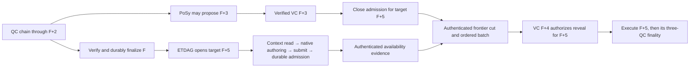
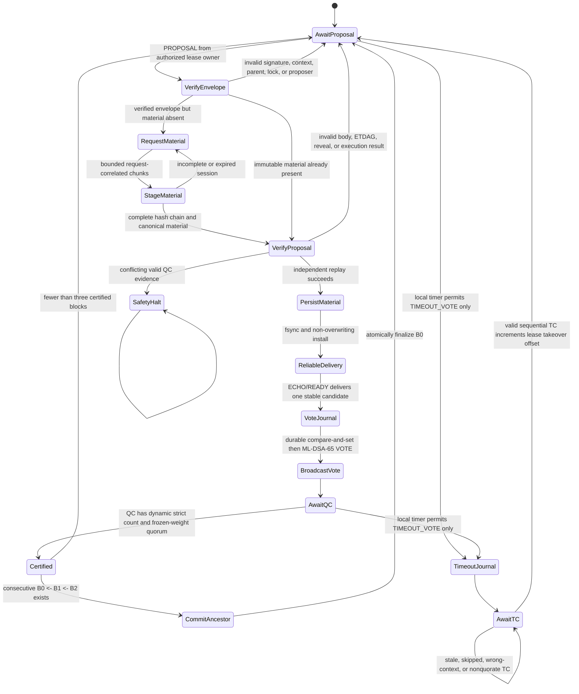
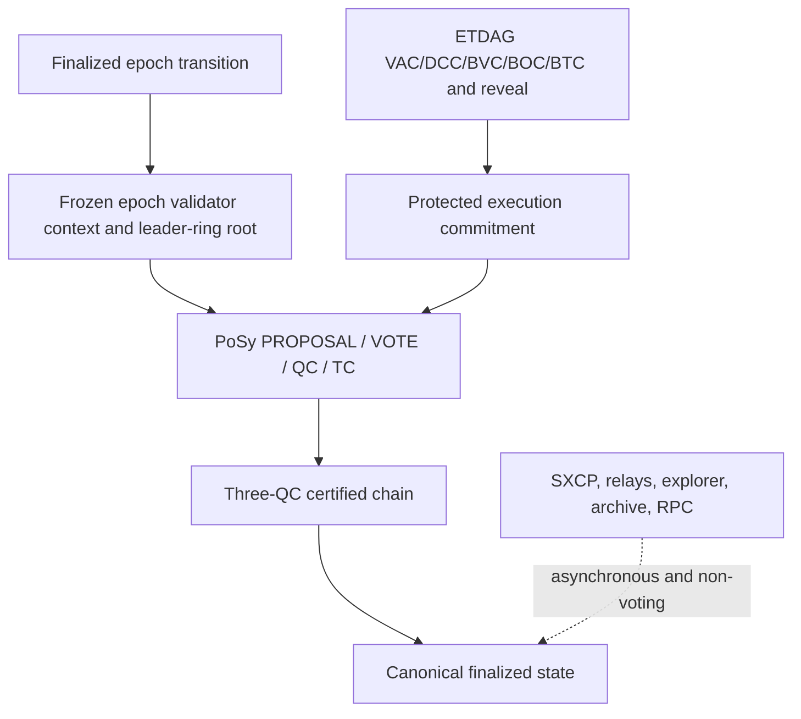
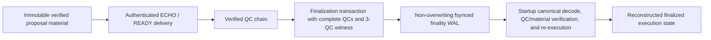

# PoSy v3 simplified consensus architecture

## Canary critical path — 2026-10-21

The operator has frozen architectural scope. The current evidence, blocker
classification, minimal repairs and next action are maintained in the canonical
[implementation status](../../docs/refactor/IMPLEMENTATION_STATUS.md). Earlier checkpoints below remain historical;
no v43 actual-host pass, deployment, TPS baseline or soak is claimed.

## Resource qualification checkpoint — account World lifetime, 2026-10-21

The memory/OOM gate remains **OPEN**. The sealed v41 runtime passed all28
component cases on each of five actual hosts (140 independently audited
records), under256MiB with zero swap and unchanged OOM counters. Val2/3/5
shared1GiB runs failed the unchanged30-second funded context-to-proof budget.
Val4/6 completed31 funded encrypted transfers and restart/rejoin, with no OOM
or swap; both pass the fixed anonymous/RSS and normalized I/O comparisons.
Their overall journal qualification fails because a few bounded metadata scans
could not obtain coherent snapshots during live writes. These failed records
and the original schema-error audit are preserved; no v41 overall pass is claimed.

The account-read repair releases the fully verified candidate World before
reconstructing the separately archived finalized World. Both archives retain
full validation; only verified scalar block/root commitments survive between
reads. This reduces simultaneous decoded residency, without a historical cache
or any consensus, signature, quorum or admission-policy change. Eight focused
RPC tests pass, including pinned/latest account values and missing candidate
World rejection. Encoded record limits are not a proven universal decoded-heap
bound; the actual-host qualification is explicitly scoped to its declared workload.

The next resource profile will use the canonical storage writer lock in shared
mode for bounded metadata-only observations. It will preregister a60-second
resource proof wait, retain the900-second funded cohort bound and separately
report every transaction exceeding30seconds as an admission timing failure.
This prospective measurement profile does not qualify default5 admission or
waive the canary admission gate. Full source/artifact freezing, all-five component
and shared-runtime requalification remain required. No deployment, initial TPS
baseline, canary launch or24-hour soak has started.

## Current resource qualification checkpoint — telemetry commitment reads, 2026-10-21

The memory/OOM gate remains **OPEN**. The v40 candidate lifetime repair passed
all27 component cases on all five actual hosts (135 independently audited
records), under256MiB with zero swap and unchanged OOM counters. Shared1GiB
runs completed on Val2/4/6; Val3 exceeded its30-second context-to-proof budget
at30.341s and Val5 exceeded native finality timing. All failure evidence is
preserved. No production deployment, TPS baseline or canary soak has started.

The independent v40 audit remains incomplete/failed: the last common native
observations preceded the scheduled1281-second shutdown, while the audit
required an observation at or after it. Val2/4 passed quantitative memory,
journal and I/O checks; Val6 failed the journal mean-count growth threshold
(post-restart34 to39 files during32-height retirement cycles). No v40 overall
qualification is claimed and no acceptance threshold is changed retroactively.

The next source repair exposes a bounded canonical candidate commitment read
for telemetry. It validates protected material, canonical block identity and
transaction/receipt correspondence and binds the result to durable finalized
state and PoSy finality, without reconstructing/hash-checking the archived
account world for every status poll. A telemetry commitment attests finalized
identity, not archived world readability. Block/account/execution/import and
recovery paths retain full world validation. No strong historical-world cache,
consensus owner, quorum, signature or governed admission policy is changed.

The final revised runtime requires focused regressions, a complete source freeze,
sealed artifacts and all-five actual-host qualification. The next measurement
harness parallelizes exactly five independent pinned account-proof reads while
preserving all proof checks and the30-second budget; explicit stage timings
are retained. Startup/end sampling and journal retirement observations must be
qualified before the memory gate can close. Default governed admission/finality,
initial TPS baseline, encrypted ETDAG canary and24-hour soak remain subsequent gates.

## Current memory qualification checkpoint — candidate lifetime repair, 2026-10-21

The memory/OOM gate remains **OPEN**. All26 v35 component cases passed on each
of the five actual hosts under256MiB with zero swap and no OOM. This does not
qualify the final integrated runtime. The v37 four-inflight mixed runs failed
on durable admission rejection; v38 serial runs on Val2/3 failed their300-second
count deadline despite verified wallet effects for19/12 cohort transfers.
Two Val3 transfers also exceeded the30-second context-to-proof budget.

Further source review found that PoSy retained executed candidates indefinitely
by height, pinning historical `Arc<WorldState>` values. Candidate payloads must
retire only after verified finality is durable; delayed finalized handoffs must
not repin them. Current/unfinalized candidates and durable safety commitments
remain required. The v39 successor campaigns were explicitly interrupted on
all five hosts after this defect was found; none is a qualification pass.

The revised candidate requires a new source freeze, sealed artifacts, focused
lifetime regressions and repeated actual-host qualification. Sustained memory,
I/O and protected-journal stabilization, restart/rejoin and funded encrypted
wallet effects remain mandatory. No production deployment, active admission
amendment, canary, TPS baseline or24-hour soak has started. Establish the initial
TPS baseline after the resource and admission gates pass, before stabilization
tuning, then repeat the controlled comparison after the canary soak.

## Current memory qualification checkpoint — v35 test correction, 2026-10-20

The memory/OOM gate remains **OPEN**. The v32 actual-host component campaign
passed single-owner4096-generation maximum-proof recovery but failed the
new three-owner4096 test: the test round-robinned three partial indexes in a
pool sized for two complete owners, then incorrectly assumed an owner had
installed before pressure. The production runtime already drives the earliest
pending recovery to completion before decoding the next owner. Its scheduler,
32MiB aggregate pool,40MiB scratch cap and consensus rules are unchanged.

The v35 test correction follows that runtime scheduling, asserts waiting
owners retain zero decoded history, requires two installed owners before
third-owner pressure, and checks retirement/resume with original journal
hashes unchanged. Local and actual-host qualification of the corrected test
and final sealed candidate remain required. v32 failures remain evidence;
they are not passes. Shared-process v33/v34 packages were staged but never
launched. The next mixed-memory package is v36, including bounded sampled
process I/O and per-device host counters for ZFS hosts whose cgroupio.stat
is empty; empty counters mean unavailable, never zero disk activity.

No deployment, active admission amendment, canary, TPS baseline or24-hour
soak has started. Those remain gated on memory/resource and admission closure.

## Remaining memory allocation audit — 2026-10-20

Overall memory qualification remains OPEN. The v27 Linux candidate is sealed
with matching complete source inventories before and after compilation. Runtime
SHA3-256: `8d1ad0f869f0ae60f0a8b49718907b91369f9d1e317075c3dbc9424b6208f168`.
The previous v22/v24 passes remain limited to their declared workload.

The repaired retry iterator selects at most64 payload/peer pairs before cloning.
Authenticated v3 collecting journal actions append/fsync before memory mutation,
preserve original native signatures and proofs, and replace whole-graph intake
rewrites. Cut/prepare/recovery phase frames retain their required full state;
this does not claim all persistence writes are constant-size.

Aggregate intake reserves completion across live targets, including native quorum
votes/certificates, runtime mirrors and all16 ETDAG outbound queue slots. The
collecting reservation pool is32MiB; transition/recovery scratch is40MiB.
Admission checks prospective per-target phase copies before accepting work.
Rejected, nondurable work restores its exact prior reservation; safety/storage
ambiguity retains reservations. Legacy recovery that cannot fit stops further
decoding with an explicit capacity diagnostic and preserves originals. Other
transport queues, finalized worlds and historical proof caches keep their
separate existing bounds; these two pools are not a whole-process memory bound.

Strict node/ETDAG Clippy passes. All46 ETDAG tests and seven focused collecting
regressions pass. Four resource regressions cover native quorum completion after
same-target saturation, many-target pressure, spare allocation capacities and
64 rejected speculative reservations. The real65536-byte encrypted wallet
carrier completes reveal/execution/finality on all five validators. A131072-byte
wallet carrier exceeds the existing1MiB authenticated-frame bound and is rejected
before durable vertex admission; that bound is preserved. Separate twelve-vertex
maximum131072-byte native collecting/restart tests preserve exact originals.

All23 new-artifact component qualification records pass on each actual Val2–Val6
under256MiB/Swap0: collecting/retries/resource pressure, both wallet cases,
all46 ETDAG tests,96/1024/4096 history and4096 maximum-proof recovery, ten native
runtime/restart cases and live-source proof validation. Final exported evidence
and independent audits remain pending.

V28 combined actual-host qualification FAILED on all five hosts. The isolated
signed-offset16 fleets each finalized the initial transfer, then lost readiness
during the first four concurrent funded submissions; zero of the required30
workload transfers finalized. All five1GiB/Swap0 monitors recorded zero OOM,
OOM-kill and MemoryMax events, with validated cleanup. The runs ended before
the scheduled restart and full native-pressure campaign. Fixed public exports
are preserved under node-platform/target/resource-repair-memory-host-evidence-v28-20261020.
The service-health/resource-pressure cause is under investigation using an
isolated diagnostic repeat; component passes do not close this failure.
No deployment, active policy change, TPS baseline, canary launch or24-hour soak
is qualified by these tests.

The isolated v29 diagnostic repeat captured a prospective intake request for
55,047,536 transition bytes against40MiB, degrading the whole-node readiness
while other validators remained healthy. The v30 source correction counts the
exact cut reference instead of a second full encrypted wallet vertex, separates
ordinary queued intake pressure from durable-phase health failures, and checks
closed queued targets before retrying capacity.32MiB/40MiB limits and exact
pipeline allocation guards remain unchanged. The phase bound also uses the
maximum of collecting and prepared serialization, reserves the one parent proof
actually present in runtime preparation, and separately counts canonical native
share wire instead of treating padded heap charges as JSON. Five resource
regressions and strict node/ETDAG Clippy pass on this candidate. The sealed v30
release four-wallet regression passes on every actual Val2-Val6 under256MiB/Swap0,
verifying all four transfers and all five account states. Peak process RSS is
142,958,592-151,822,336 bytes. The local debug build reached all-four certification
but hit its60-second no-finality-progress guard; that failure is retained. Full
24-case v30 host component qualification is still running.

The aggregate retained-history accounting repair is implemented in the v32 source:
both installed and in-progress owners charge indexes, proof locations, allocation
capacity and their latest proof to the same32MiB retained pool. Replay scratch
also includes resident history before decoding another frame. Prospective live
generation charges precede append; typed pressure preserves journal originals.
Each owner excludes its own existing reservation on retry. Finalization releases
only retired heights and re-enables capacity-blocked recovery when space changes.
The pending PoSy-to-ETDAG generation handoff now has an8MiB shared deep-byte
budget as well as entry caps; normal pressure retries from durable PoSy authority.
Each installed generation acknowledges its exact durable prefix immediately.

All47 ETDAG tests, six runtime resource tests and the shared proof-handoff test
pass locally. Genuine R3 timeout recovery, native empty/nonempty close and restart
also pass. The new three-owner regression verifies shared pressure, maximum1MiB
latest proofs, unchanged original journal hashes, retirement/retry without
self-reservation deadlock, and live append rollback. Fresh final source sealing,
all-five-host qualification and sustained memory/I/O stabilization remain OPEN.
V31 is HELD and will not qualify this revised source. V30 component results are
24/24 on Val3-Val6; Val2's measurement stopped on a disappearing cgroup pseudo-file
(ENODEV) after14 successful records, not a qualified all-host pass. Its failure
evidence and four complete public component exports are preserved under
node-platform/target/resource-repair-component-only-host-evidence-v30-20261020.
No canary or deployment starts before the memory gate closes.

## Live admission proof checkpoint — 2026-10-20 (v21–v24)

Fresh default5 reproduction v21 on actual Val5 uses the sealed v17 runtime and
native signed Genesis verification. It fails with a durable `closed_target`
receipt, not OOM: the target opens at0ms, RPC enqueue occurs at396.44ms and
verified cutoff closes at495.48ms on one native monotonic clock. The complete
failed public export and analysis are retained in
`node-platform/target/resource-repair-default5-host-evidence-v21-20261020/`.

The current v22 source candidate snapshots PoSy's bounded, already committed
live source record/witness instead of reopening the record and three QC files
and repeating the ingress-history QC verification. Publication still verifies
all three QCs against the active signed authority, exact ancestry, finalized
record and governed target context; historical sources keep the authenticated
durable reader. A malformed live witness fails closed without fallback. No
new retained cache, cutoff, quorum or signed lookahead policy is introduced.
A genuine five-validator regression passes locally with and without timing:
no-history live proof succeeds, historical proof remains readable, malformed,
truncated, forged and conflicting proofs fail. Targeted Clippy and format pass.
Complete pre/post Linux build source inventories match. Standalone v22 SHA3-256:
`c927a76e559bf4c6b7984a8732594338f429b817c171a80a5280583184b3e129`.
ETDAG, signing and Genesis artifacts remain byte-identical to v17.

V22 now passes all55 actual-host native/component measurement records across
Val2–Val6 under256MiB MemoryMax, zero swap and zero host/cgroup OOM deltas,
with validated cleanup. Peak native RSS is136.84MiB. Public exports and the
independent audit are retained in
`node-platform/target/resource-repair-node-host-evidence-v22-20261020/`.
The fresh v22 default5 retest fails admission: cutoff closes at330.93ms and
server enqueue-shape processing starts at534.49ms. Its complete failure export
is preserved; the cached source proof optimization does not fix default5.

The separately signed isolated six-height comparison v23 reaches durable
admission but its first transfer does not finalize within30seconds. It is a
failed comparison, not a pass or policy amendment. Its verified public export
is retained in
`node-platform/target/resource-repair-lookahead6-host-evidence-v23-20261020/`.
V24 full-process resource qualification of the current sealed v22 runtime
PASSES on all five actual hosts, using the maximum supported experimental
offset16, the same1GiB/zero-swap five-validator group cap, transfer counts,
deadlines and restart schedule. Each host finalizes1 initial plus30 workload
transfers with all-five effects verified (155 total). The30-transfer workloads
finish in98.68–217.35seconds against the unchanged300-second limit. Independent
public-evidence auditing verifies exact runtime/exporter identity, signed-profile
attestations, native observation and transaction proof streams, zero host/cgroup
OOM deltas, zero swap use, signer death before replacement, continued matching
finality after restart and validated cleanup. Final common heights are1140,659,
1277,578,1267 on Val2–Val6. Anonymous memory peaks are605.84–633.02MiB per
five-validator group. Four groups reach the cap and reclaim file cache; this
is survival under pressure, not spare headroom. Retained protected journals are
contiguous recent tails of25–51 records rather than all finalized heights.
Val4 ZFS ARC is accounted separately (peak8.49GiB; host available minimum108.93GiB).
The complete exports, independent audit and post-cleanup file metadata are in
`node-platform/target/resource-repair-memory-host-evidence-v24-20261020/`.

The declared current-runtime memory gate is now passed, together with the
supported-bound protected-history evidence on unchanged ETDAG artifacts below.
This closes the previously open protected-recovery growth and actual-host OOM
qualification for the declared profiles. It does not prove arbitrary-history
support,24-hour stability, default5 admission or distributed canary readiness.
The default5 and experimental6 failures remain open canary blockers. No
production/canary deployment or TPS/24-hour soak has started. Capture the initial
TPS baseline immediately after canary startup and before performance tuning.

## Admission comparison continuation — 2026-10-20 (v25–v26)

With the declared memory gate passed, the existing architecture comparison
continues using the same sealed v22 runtime and unchanged genuine workloads.
Fresh signed experimental offset7 (v25) fails on all five hosts: Val2 receives
a durable `closed_target` rejection; Val3/Val4/Val5/Val6 exceed the unchanged
30-second per-transaction finality budget during the30-transfer workload.
Initial single transfers pass on all five; none of these failed campaigns has
OOM or swap use. Public archives and envelope-correlated native availability
timings are retained in
`node-platform/target/resource-repair-lookahead7-host-evidence-v25-20261020/`.
The completed offset8 comparison (v26) fails the unchanged30-second loaded
transaction finality budget on all five hosts. Initial single transfers pass;
loaded finalized counts are19,6,0,2,9 on Val2 through Val6. Public manifests,
zero host/cgroup OOM deltas, zero swap and cleanup are independently checked in
`node-platform/target/resource-repair-lookahead8-host-evidence-v26-20261020/ANALYSIS.json`.
These diagnostic failures do not qualify healthy timing or activate a policy.
Further admission-window comparisons are paused for the remaining memory repair.

Native proposal timing hooks conservatively label all current observations
`recovered`; their source explicitly lacks healthy-cohort provenance. The
comparison reports observed latency only and cannot supply the required
healthy/worst-eligible p99 or50-percent admission headroom qualification by
relabeling those observations. This diagnostic limitation remains explicit.

## Memory qualification checkpoint — 2026-10-19 (v17–v20)

The final sealed v17 native candidate removes the consumed-state proof rewrite:
a small hash-chained durable transition replaces cloning and serializing the
full prepared record for a boolean change. Legacy frames, native verification,
original-byte indexes, atomic persistence and torn-tail recovery remain intact.
All39 ETDAG tests and strict targeted Clippy/format checks pass locally. Sealed
standalone SHA3-256:
`0613144c8d997965770e024297976e041fc9e6e1fe18d023d7dc63bcd700b565`.
Complete pre/post build source inventories match. Signing/Genesis companions
are byte-identical to v11. Other phase transitions still persist their bounded
current state; this repair does not remove every persistence write.

Actual Val2–Val6 hardware passes55 final-artifact component/native cases under
256MiB MemoryMax and zero swap (one39-test ETDAG suite plus ten native cases
per host); peak native RSS is131.61MiB. All25 final-artifact recovery/history
cases also pass. Each host verifies96,1024 and4096 generations with256KiB
authorizations,4096 generations with1MiB authorizations, and timeout-prefix
recovery. The maximum journal is8,891,619,937 bytes; peak native history RSS is
25.07MiB, with zero pending historical proof payloads and verified original
reads. Metadata is capped at4096 generation/marker entries; authorization size
is capped at1MiB. Cleanup is validated, every host/cgroup OOM delta is zero,
and swap remains unused. Val4 ZFS ARC is separately accounted (peak7.44GiB,
minimum available host memory110.04GiB); device io.stat cannot attribute ZFS
physical I/O. Four unchanged, exactly pinned libraries retain20 earlier passes;
old ETDAG artifacts receive no final-candidate qualification credit.

Final native full-process memory qualification passes on all five actual hosts
for the declared mixed campaigns. Val2/4/6 completed v18 with concurrent,
separately capped256MiB history pressure; Val3 completed fresh v19 against the
original ongoing history jobs. Val5 completed isolated v20 after validated
history cleanup. Each process unit runs five real validators at1GiB MemoryMax,
zero swap, signed experimental16 lookahead, four wallets, initial transfer plus
30 exact proof-verified transfers and all-five wallet effects within300s, then
stop531s/restart561s and681s total validator lifetime. The complete independent
public evidence audit passes all five, including original-signer stop before
replacement and matching advancing all-five commitments after restart.
Anonymous memory peaks are616.37–630.23MiB per five-validator unit. Four hosts
reach the1GiB cgroup cap and reclaim cache; every cgroup/host OOM delta is zero.
This demonstrates survival under the cap, not unused memory headroom or24-hour
stability. All five also pass the two native R4 exact retirement safety tests
under256MiB/zero swap. Six snapshot-cache pressure, reservation, active-custody,
lease/restart, incremental-cleanup and corrupt-input tests also pass on every
host under the same cap, with at most8MiB native RSS. Post-cleanup metadata confirms contiguous recent tails
of protected journals after hundreds of finalized heights; it does not claim
constant total chain storage or arbitrary-history support.

Failed campaigns remain failed: v18 Val3 stopped before initial transfer on a
bundled native telemetry identity/epoch/height check; source permits a null
finalized height before the first finalized state, but the original report
does not prove the exact invalid field. External v19 tooling adds only a
bounded wait for this valid null startup state, with strict immutable identity,
schema, five-validator finality and deadline checks retained (53 baseline tests
and23 runner tests pass). v18 Val5 finalized12 of16 submitted transfers before
its unchanged30s unresolved-finality budget expired; native finality continued
advancing together, with zero process-cap/OOM events. CPU/I/O contention was
observed, not proven causal. The separately declared v20 Val5 run starts only
after all original history jobs complete and their cgroups are proven empty;
it preserves the same artifact, caps, count, deadlines and restart schedule.
No all-five concurrent-pressure success is claimed.

Public archives, exact proof streams, sampled resource counters and independent
complete auditing are retained under
`node-platform/target/resource-repair-final-host-evidence-v18-20261019/`,
`node-platform/target/resource-repair-final-host-evidence-v19-20261019/` and
`node-platform/target/resource-repair-final-host-evidence-v20-20261019/`.
The complete mixed audit is `independent-audit-final.json` in the v20 directory;
R4 supplemental artifacts are in
`node-platform/target/resource-repair-final-host-r4-v17-20261019/`; snapshot-cache
artifacts are in `node-platform/target/resource-repair-final-host-cache-v17-20261019/`.

Default-lookahead5 funded ingress remains blocked by the reproduced admission
window failure. The experimental16 memory profile does not qualify default5,
production deployment, distributed canary, TPS/capacity or release Gate D/E.
No deployment, initial canary TPS baseline, ETDAG canary test or24-hour soak has
started. Capture the initial canary TPS baseline before tuning, then repeat the
same workload after stability. Earlier checkpoints below remain historical.

## Final memory candidate checkpoint — 2026-10-19 (v11)

Actual Val2–Val6 hardware passes75/75 capped component/native cases:25 cases
reuse the five unchanged, exactly pinned library artifacts;50 cases run the
final node test artifact SHA256
`25c0081f609f4dd8509f30802baef9002b4ca2c0eac1e7df037abef89cc495e1`.
All use256MiB MemoryMax and zero swap, with positive native test counts and
zero cgroup/host OOM events. Maximum native-test RSS is136.875MiB. Both stale
verified-head regressions pass on every host; strict same-height conflict
rejection remains intact. Complete build inventories match before/after;
standalone runtime SHA3-256 is
`2336bf66586f7786557049f086753dd7a9d4e92d38616832df1bae60088a0b02`.
Public archives and independently checked logs/hashes are retained under
`node-platform/target/resource-repair-final-host-evidence-v11-20261019/`,
including `summary-2-3-4-5-6.json`. Earlier checkpoints below remain historical.

The separate-process gate remains OPEN. All five v11 campaigns stopped at
funded-workload observation boundaries despite advancing native finality:
four report admission-context readiness unavailable; Val4 reports an ambiguous
admission response with receipt lookup unavailable. No OOM was observed;
aggregate cgroup peaks were487.32–576.13MiB under the declared1GiB cap. These
short failed runs do not qualify sustained load or restart/rejoin. The workload
harness is being corrected and ambiguous submission must be reconciled without
resubmission. Protected-growth and actual-host memory completion boxes remain
unchecked pending successful integrated qualification. No deployment, initial
canary TPS baseline, ETDAG canary test or24-hour soak has started.

## Resource amplification repair contract — 2026-10-18

Current source review confirms full-world cloning in every `StateDiff::apply`,
a full-world copy retained by each of up to64 finalized publication messages,
and unconditional snapshot serialization/chunk persistence at every finalized
height. These are amplification mechanisms; live OOM attribution still requires
actual-host RSS/allocation and I/O measurements.

The repair keeps the existing Execution and Sync owners. Execution applies a
validated diff by staging only touched accounts and validating all protocol
preconditions before mutation. Its finalized acknowledgement contains compact
commitments only. Sync acknowledges every sequential durable Execution commit
without building a snapshot; an authenticated exact snapshot request triggers
materialization from the corresponding durable world and independently verified
PoSy finality. Cached chunks serve subsequent requests. Optional state/history reads share one
writer lock with their existence check, so retention cannot race those steps.
No new certificate,
consensus owner, quorum, signed bytes or finality rule is introduced.

Validation must establish atomic failed-diff behavior and byte-identical state
results; sequential acknowledgements without retained world states; lazy snapshot
availability after restart; exact block/finality/root bindings; refusal of foreign
or unavailable history; and existing genuine snapshot/rejoin regressions.

Execution now borrows the immutable parent when making its speculative overlay
and moves the successful staged state into the outcome. Candidate state uses
`Arc<WorldState>` so copies retained by ingress and Execution share the same
immutable allocation; its JSON representation and commitment bytes are unchanged.
Execution retains a separate immutable finalized authorization world, initialized
from verified durable state/Genesis and advanced only after durable finality or
verified snapshot commit. New candidate execution no longer rereads that world
from disk.

Configured finalized-history retention examines at most256 exact height paths
per namespace per call, using a durable `.pruned-through` cursor. Deletions are
directory-synced before cursor advancement. Restart repeats any interrupted
range; requests ahead of Execution's durable finalized height are rejected.
The caller's existing retention horizon remains authoritative. Finalized state
uses one64MiB AtomicStore for both metadata and world transactions; restart must
recover staged world records at the same limit used by the writer. A smaller
metadata owner must never attempt recovery in that shared transaction namespace.

ETDAG retry processing now deduplicates only successfully authenticated/applied
immutable announcements, using at most512 peer/session/exact-payload fingerprints
without retaining payloads. Failed inputs and response-producing artifact requests
are not suppressed. Cache lifetime is the existing authority-bound owner;
replacement sessions and altered bytes require full authentication. Exact durable
vertex replays are idempotent before repeat identity hashing. This removes repeated
retry work without adding a protocol certificate, consensus owner or history store.

Sequential finalized-world persistence now writes a versioned `SNWDV001` delta
of changed/deleted account and protocol entries between full checkpoints. Existing
unprefixed full-world JSON remains readable. Fixed checkpoints occur every64
heights; earlier checkpoints reset the chain before its cumulative encoded deltas
exceed8MiB. Delta serialization borrows both worlds and stops at the remaining
budget without copying changed payloads. The existing Execution owner supplies
its verified finalized parent; no new consensus authority is introduced.

World delta, immutable finalized commitment and latest pointer share the existing
atomic storage transaction. Replay holds one storage lock across the requested
commitment and all dependencies, accepts at most63 deltas, checks height/root
links and verifies the reconstructed canonical world against finality. Restart
derives its replay budget from verified durable records. Snapshots still expose
full canonical world JSON. Identical full-world API replays preserve the existing
delta representation. Pruning retains the fixed checkpoint interval required by
surviving heights, at most63 extra world records beyond the configured boundary;
commitment history retains the configured horizon. Snapshot jumps seed full
checkpoints. This durable format requires the updated reader; older binaries
cannot read new delta records and must not be used for rollback against this data.

Candidate persistence now uses the same bounded world codec with `SNCDV001`
metadata and a separate world record committed atomically. The shared
`synergy-execution::CandidateStore` serves Execution, Sync, ETDAG retirement,
RPC and recovery. Legacy inline candidates remain readable and unchanged on
identical replay; wire candidates and their commitments retain full canonical
JSON. Writer and reader tips hold weak world references, so they do not retain
extra worlds. Cached verified parents avoid replaying a whole checkpoint chain
for each sequential access. Cold writers and snapshot jumps seed checkpoints.
The existing64MiB full-candidate limit and recovery's8MiB limit remain enforced
against reconstructed wire size, including both storage formats.

Candidate metadata follows Execution's existing durable-finality retention
boundary. Dependent worlds retire only after the metadata cursor actually
advances, preserving checkpoints even during a multi-batch cleanup backlog.
The same dependency-safe pruning applies to finalized state history. Immutable
conflict checks, crash recovery and consistent dependency reads remain mandatory.
These new local disk formats require the updated binary readers.

Snapshot chunks now belong to a disposable indexed cache on the existing Sync
owner. It retains at most four snapshot contexts and reserves at most514MiB of
encoded record payload capacity (two worst-case64MiB worlds encoded as JSON byte
arrays, plus metadata allowance). The local restore profile admits at most64
chunks and64MiB of reconstructed world bytes; the canonical1MiB chunk producer
fits this budget. This is a local resource profile, not a change to manifest
signatures or consensus validity. After full authority/signature/context checks,
an unsupported peer snapshot falls back to canonical candidate replay. A verified
legacy active request outside the profile is likewise abandoned without changing
Execution state or PoSy safety records.

Durable active incoming acquisition is pinned; successful outgoing cache reads
renew a10-second inactivity lease (twice the existing5-second response timeout).
Restart grants indexed snapshots the same lease grace. If no unpinned capacity
is available, requests receive backpressure before expensive materialization;
incoming acquisition does not advance its durable cursor on capacity pressure.
Eviction removes only disposable cache files. Historical state, finality and
signing records retain their existing policies. An evicted snapshot can rebuild
only while its exact verified state/finality remains available; unavailable older
history stays unavailable rather than fabricating a replacement.

Legacy/orphan cache cleanup examines only a bounded index plus64 removable paths
per cache directory per poll. The active legacy transfer is indexed before any
cleanup. Eviction deletes at most260 exact paths per admission; manifest and
chunk count bound that work. No full-directory inventory is retained in memory.
The514MiB bound covers indexed payload reservations, not filesystem allocation,
transaction staging or the pre-existing legacy backlog while it drains. Metadata
reads are capped at1MiB and chunk reads at their encoded manifest/world budget
before decoding; restore never collects unbounded chunks in memory.

Remaining architecture work includes supported-history ETDAG restoration and
aggregate protected recovery measurements. These changes alone do not
prove bounded validator RSS or close the existing release/actual-host gates.

| Remaining growth path | Current source evidence | Required closure |
| --- | --- | --- |
| Candidate persistence qualification | Bounded checkpoint/delta candidate storage and shared runtime readers are implemented locally | Complete native recovery and actual-host resource qualification; preserve advisory status and unchanged wire candidates |
| Snapshot resource qualification | Sync owns a four-context byte-budgeted disposable cache with active custody/lease protection and incremental legacy cleanup | Qualify actual-host cache pressure, transfer fairness and resource scaling within the documented local profile |
| Recovery prefix qualification | The existing verifier retains one authenticated round-zero ancestry per lease and checks only a new suffix; exact V1 canonical ID-array hashing remains necessary | Qualify the full4096-round history on actual hosts; unchanged signed root bytes and native proof checks remain mandatory |
| Protected journal resource qualification | Authenticated compact identities/digests and direct journal frame locations replace retained original payload vectors; one latest authorization remains per target | Qualify4096 generations and1MiB authorizations under measured actual-host memory caps; original hash-chained proof bytes remain available through bounded indexed reads |

Protected recovery now drains each authenticated append frame into compact metadata
before loading another. The legacy initial JSON is still bounded by16MiB; each
append frame retains the same16MiB bound and existing4096-generation horizon.
At steady state, each live target keeps generation/marker record digests, timeout
and cutoff identity indexes, bounded frame locations and only its latest original
authorization (at most1MiB). Old signatures and authorization payloads remain in
the original journal without rewriting or deletion. A selected-proof read seeks
to one remembered frame, checks its exact digest, and compares the authenticated
record identity. A legacy proof read may decode its bounded initial snapshot.
The bulk diagnostic export now refuses more than16MiB instead of rebuilding an
unbounded all-history JSON value. This is an inspection limit, not a new validity
rule for durable history.

Peer cutoff markers now retain full signatures/frontiers only for the active
cutoff generation. Compact authenticated signing-byte fingerprints preserve
historical equivocation checks across the existing4096-generation horizon;
late historical markers do not repopulate old payloads. Frozen membership and
native signature verification still precede cache admission. This cache has no
consensus authority and changes no signed bytes.

The sole ETDAG owner still authenticates at most four pending generations and
four markers per poll, or decodes one append frame. Only the currently polled
recovery target holds decoded pending payloads; other target cursors have not
loaded frames. Target retention remains governed by verified finality and the
existing5-height profile (experimental profiles permit at most16). No new
consensus state machine, proof format, retention deletion, signer or quorum rule
is introduced. Timeout prefix caching retains one verified ID ancestry per lease;
only after the exact signed path root matches may a suffix enter that cache.
Historical carries and slot/height/lease bindings remain checked. Hashing every
prefix still processes the original V1 bytes because the signed domain includes
the serialized array length; it cannot be replaced with an incremental hash
without changing the protocol.

No arbitrary retention horizon or automatic evidence deletion is selected here.
The validator hot set must be bounded by live pipeline, lease and transfer work;
required immutable historical evidence belongs behind indexed durable lookup and
explicit role-specific retention. Increasing memory or lifecycle timeouts does not
close these contracts.

## Simplification review scope — operator direction 2026-10-14

### Actual qualification failure and integrated review gate

Candidate23's completed-response handoff correction is installed on the five
actual hosts. Distributed qualification still fails: Val3 remains at finalized
H10870, receiving incomplete repeated H10871 assemblies; Val5 exceeded owner
startup and shutdown budgets again as retained timeout/recovery history grew.
Val5's repeated startup was stopped. Leading finality remains H27239. No funded
transaction/TPS/soak success follows from this deployment. Further releases are
frozen until this review resolves the complete ownership and restoration paths.

The confirmed completed-response defect was fixed with retained ownership in the
existing four-height/64MiB Sync window. The next source boundary is earlier:
`SyncService::receive_sync` transfers an authenticated payload into a worker
closure after popping ingress; failed bounded worker admission destroys that
closure/payload. Partial-receipt logs alone do not prove which chunks were lost
on the network or at this boundary. Correlate one exact request/session's provider
socket-write completion, authenticated receive offsets, worker admission/rejection
and assembly progress before implementing another correction.

Required handoff contract: preserve ownership until the receiving bounded queue
acknowledges acceptance; return or retain the original payload on saturation;
drain completed work first; provide fair current-request progress; and cancel
stale session/request/authority work before mutation. Use the existing owners and
budgets. Qualify the exact eight-chunk response under competing head-claim and
downstream pressure, with successful exactly-once forwarding, stale cancellation
and bounded ownership. Do not add an independent recovery journal or coordinator.

Required restoration contract: measure native verification, retained-generation
path traversal/hash cost and owner scheduling separately across supported history
sizes. Compact verified caches remove repeated cryptography but do not by
themselves bound the work of repeatedly traversing every predecessor prefix.
Candidate23 provenance pins `owned_service.rs` with a10-second lifecycle deadline
per owner command. The observed31/60-second failed attempts include cleanup and
shutdown phases; they are not evidence of a30-second startup allowance. Measure
each phase against the exact artifact instead of inferring its budget from total
systemd wall time.
Preserve the exact approved signed path-root bytes and every required original
proof. A reviewed bounded restoration schedule must cooperate with startup,
cancellation and health supervision, and publish readiness only after the verified
projection is complete. Increasing a timeout alone is not qualification. State
explicit supported-history/resource budgets and automatically recover within them.

Review and implement these contracts together before the next consolidated checks
and one exact-artifact fleet qualification. Require advancing common finality,
efficient Val3 catch-up, Val5 retained-state restart, funded effects and bounded
resources. If a supported condition cannot meet this contract, revise the reviewed
design instead of issuing another isolated live patch.

The immediate operational gate is the existing Val3 completed-response handoff:
bounded backpressure must retain the received block without repeated downloads.
Acceptance requires actual Val2–Val6 advancing common finalized commitments,
funded ETDAG execution, bounded resources and safe restart/catch-up. Process
startup, local tests and matching historical heights are insufficient.

The separate architectural review must preserve PoSy clustered security, epoch
rotation and security-triggered validator replacement. Trace the governed
deterministic proposer lease, minimal safe voting/sequential failover, asynchronous
transaction preparation and bounded incremental persistence through the existing
owners. Encapsulate required availability, cutoff/reveal and authenticated delivery
checks behind the existing verified-material interfaces. Remove only demonstrated
redundant verification, serialization or obsolete orchestration; do not introduce
new recovery frameworks, certificate stages or consensus authority while reviewing.

Membership replacement remains a governed finalized transition with frozen cluster,
key, weight and proposer-ring roots. Peer health and node/account ownership cannot
replace that authority. Existing transition proof verification and supervised
authority-graph replacement require review, including termination of old owners
and signing work before enabling a successor. Automatic security-triggered
replacement is a required acceptance contract, not a capability assumed proven.

The file-growth and full-history-processing directive applies to every Synergy
node-platform role. Validators remain the immediate priority. After distributed
recovery and soak entry, inventory the shared persistence/recovery paths and their
role-specific consumers; prove required safety, audit and recovery retention before
retirement. The approved R4 rule is specific to protected validator journals and
does not authorize indiscriminate removal of other node history.

## Qualification scope and shared authorization requirements — 2026-10-13

Operator clarification: this remediation qualifies PoSy chain stability, validator
recovery and encrypted transaction processing through ETDAG. It does not enable
the proposed protected-wallet, multisig or cross-chain account architectures.
Qualification traffic uses genuine independently funded wallets under the existing
explicitly selected native authorization profile. Results must identify that
profile and must not be represented as protected-wallet or multisig capacity.

No new executable system-contract deployment is an entry requirement for this
soak. Confirm the actual qualification Genesis and transfer dependencies before
freezing the artifact/configuration; existing protocol authority and Genesis
state remain mandatory. If an executable contract is actually exercised, its
address, authenticated class and deployment authority must be reconciled before
qualification. A textual prefix never grants system or spending privileges.

Required integrated contracts:

- Freeze the currently exercised address/derivation profile and canonical byte
  representation across Genesis, runtime, admission, execution and the traffic
  client. Node-local settings and tool fallbacks cannot change consensus-visible
  derivation. Unknown or conflicting mandatory profiles fail closed. This does
  not activate a new payload width or migrate existing addresses.
- Bind signed transaction intents to the actual chain incarnation/Genesis,
  account, authority context, target, nonce and exact payload. Use the selected
  profile's canonical encoding consistently; do not silently replace its signed
  bytes with the proposed wallet or multisig CBOR schemas.
- Preserve nonce replay protection, duplicate reconciliation and exactly-once
  durable execution. Distinct authorities count once wherever the existing
  authorization/quorum rules require independent participants. Account identity,
  display prefixes and naming metadata are not alternate spending authority.
- Enforce the existing native authorization profile on every exercised admission
  and execution route, including any gateway into native state. Invalid signatures,
  wrong incarnation or authority and an ECDSA-only alternate route cannot bypass
  required native authorization. Do not introduce new D/P/R role semantics here.
- Declare and verify nonce, fee, maximum-fee and reverted-write behavior under
  that selected profile, including rejected submissions, duplicate/ambiguous RPC
  responses and included execution failures. The blueprints' proposed fee/revert
  semantics are not activated implicitly; any mismatch needing a semantic change
  requires a concrete reviewed amendment before activation.
- Keep private signer custody on its authorized machine and out of validators,
  RPC services, relays, logs and public evidence. The persistent qualification
  signer is not a protected-wallet quorum or an MPC implementation.
- Keep future address/account/authorization profiles explicitly versioned and
  fail closed when unsupported; preserve existing journals and account history.

Deferred until the soak has begun: new lossless contract-address profiles and
migration; deployment links and EVM mirrors; native multisig policy accounts,
external signers and SXCP; protected account enrollment, D/P/R authorization,
threshold ECDSA/DKG, delayed wallet recovery, recovery packages and vaults;
SynID/ENS and product integration. Their implementation may proceed in source
and isolated environments during the soak, but the soaking artifact, authority,
configuration and transaction profile remain frozen. Later activation requires
its own approval, qualification and applicable new soak.

These requirements extend Gates B–F and the loaded Gate G evidence. They do not
add new contracts, certificates, coordinators or wallet recovery prerequisites to
the current validator-recovery path. Existing measured protocol-activation and
exact-artifact gates remain unchanged. Finish the coordinated source changes
before the consolidated test/qualification phase, as instructed by the operator.

## Gate A current dependency and ownership contract

Status on 2026-10-11: operator-approved remediation program; measurements and
integrated design remain pending. This section describes the canonical
`node-platform` path. The P3 role-runtime material below is retained as
historical/component evidence, not proof of the currently deployed universal
node or authority to activate its former H+3/certificate relationships.
The approved fresh-chain cutoff clarification and signed R1/R2/R3 authority
remain normative until a concrete amendment is separately approved.

### Actual admission dependency

F+5 contains no whole intervening consensus heights between source finality and
its next-proposal VC cutoff. A context is only a snapshot: correctness guards
can reject a stale request but cannot reserve a usable signing window. For an
alternative offset D, the structural gap is D−5 whole heights; this is not a
wall-clock guarantee or authority to change D. Source anchors are
`synergy-posy/src/engine/state_machine.rs` QC/finality advancement,
`services/etdag.rs::open_authorized_targets`, and
`services/ingress.rs::protected_cutoff_authority`.

### Owner and durable boundaries

| Owner | Exclusive mutable authority | Inputs and outputs |
|---|---|---|
| PoSy | Height, round, proposer, votes, locks, QC, TC and finality | Authenticated events and narrow verified material; safety-journal acknowledgements before signing-sensitive publication |
| ETDAG | Target state, admission, availability, cutoff, reveal and material publication | Immutable verified source authority and existing VC events; serial admission/cutoff commitment |
| Execution | Application-state changes and ordered finalized commits | Verified candidate and finality evidence; idempotent durable state/receipt publication |
| Network | Authenticated sessions and bounded routing | Authenticated transport frames; no membership or consensus authority |
| Sync | Historical acquisition, verification and retries | Verified history returned to its owners; never synthetic or independently selected consensus state |
| Supervisor | Lifecycle and health | Lightweight observation, cancellation and bounded shutdown; no expensive consensus work |

The existing `ManagedService` contract supports service-owned threads. Current
`StartedNode::run` calls sequential `Supervisor::poll_all` and then sleeps50ms;
individual service count limits are not execution-time limits. This is an
observed scheduling dependency to measure, not a completed architecture repair.
No owner may wait synchronously on another owner. Immutable preparation jobs
carry incarnation, epoch, authority, height/round, target, generation and input
digest. Durable acknowledgements and stale-result checks are mandatory.

Required starting worker allocation is two reserved live workers and one
background worker. All queues remain count-and-byte bounded; live pressure
suspends new background work. Crypto, disk and network waits stay outside
shared queue locks. Recovery restores verified authority and retained journals;
catch-up cannot become another consensus engine.

### Measurement and evidence contract

Capture origin/client and participant events separately. Admission attempts
bind target and generation. Record partial/rejected attempts and reached-phase
durations without replacing missing durations with zero. A verified certificate
may be persisted locally after cutoff during recovery: local observation or
persistence time must not be relabelled as the time a quorum first existed.

Clock IDs identify actual origins. Process-relative clocks cannot be joined
merely by giving them the same name. End-to-end observations must use one
verified clock origin or a separately validated mapping with its error bound.
Use per-validator distributions and the worst eligible p99, never only a fleet
pooled percentile. Input platform/artifact labels are assertions until
independently verified.

The proposed cadence is healthy proposal-to-QC p99 plus25 percent, rounded
upward to100ms, excluding intentional pacing. Admission requires an actually
observed positive minimum window of at least150 percent of eligible complete
context-to-durable-availability p99. Recovered traces are reported separately
from healthy admission budgets. A failed timing condition retains its evidence
and fails qualification; it does not authorize automatic parameter tuning.

### Certificate inventory and qualification boundaries

Current required evidence includes the existing proposal ECHO/READY delivery,
VC, consensus votes/QC, authorized TC/R3 recovery, availability evidence,
authenticated frontier markers and parent-authorized reveal. Each serves its
existing governed function. Primitive success caches may remove duplicate
verification work but never substitute for quorum, context, ancestry or
persisted authority. Historical DCC/BVC/BOC/BTC orchestration below must not be
introduced into this path as a new blocking owner or workaround.

Current Gate A tooling has a bounded reducer, isolated-process guards,
fixture-only event collection and opt-in supervisor timing. None establishes
actual funded-transfer timing, verified Linux provenance or Gate A completion.
The native standalone preflight checks configuration, signed public authority
and startup-plan structure; it explicitly does not prove private custody or VPN
service health. Isolated synthetic transport uses native-policy addresses only
inside a namespace with no external routes, fresh keys and its own trust root.
Simulated provider metadata is disclosed and cannot qualify the real overlay.

Do not deploy intermediate changes. Gate A precedes integrated implementation;
model, exact-artifact, five-host, TPS and soak qualification follow. Conduct24h
loaded soak, review all evidence, and proceed to seven days only if clean.
Measured parameter/amendment approval precedes activation. Val1 remains a
separately approved final cutover.

## Independent transaction scheduling adjustment — 2026-10-12

The operator requested evaluation of asynchronous protected transaction scheduling. Block cadence and transaction admission are separate budgets: do not slow consensus solely to compensate for an unusable admission window. Sub-two-second empty-block diagnostic progression is evidence of tested consensus capability, not loaded transaction reliability. The current signed F+5 policy remains active until a concrete amendment is approved.

Measured diagnostic evidence: five isolated native validators resumed retained journals to matching finalized H249, then H412. A native signed transfer at target121 was rejected at submission; its observed target-open-to-cutoff window was300.661ms. The next client ran context retrieval, signing and submission within one validator namespace, eliminating repeated client process startup: context65.920ms, native signing18.211ms, complete context-to-rejected-response526.156ms. Target278 opened338.685ms before cutoff. These samples are rejected operations, not successful admission or TPS. The complete duration includes server processing and scheduling; it must not be presented as signing time or a successful context-to-availability budget.

### Gate A decision and comparison

Compare three alternatives with the same genuine-crypto workloads and explicit failure accounting:

| Alternative | Admission model | Required change and decision |
| --- | --- | --- |
| Current F+5 | Signed material bound to a rapidly closing target | Control measurement; no whole intervening heights between source finality and next-VC cutoff. It currently failed both funded diagnostic submissions. |
| Measured lookahead above five | Existing target-bound confidentiality, cutoff and reveal with more preparation distance | Smallest stable offset with50percent admission headroom; amend bootstrap targets, authority bindings, recovery and retention consistently. Preserve cadence as an independent measurement. |
| Asynchronous ingress and eligible batch queues | Durable encrypted envelopes accepted before target assignment; immutable target-bound batches become eligible under governed evidence | Broader signed-envelope and deterministic scheduling amendment. Specify bounded future authorization, expiry, replay, fees, nonces, fairness, availability and crash recovery before prototype activation. |

Recommend investigating asynchronous scheduling as the architectural destination, while choosing the shortest qualified route to reliable funded transfers. A larger lookahead is an intermediate option only if measurements and fault qualification establish a usable window. Do not select a final approach from empty-block speed or two rejected submissions. If neither design meets safety and liveness contracts, revise the design before integrated implementation.

### Proposed transaction lifecycle and owners

`received → durably queued → target-bound admitted → availability-certified → cutoff-fixed ordered → authorized reveal → proposed inclusion → finalized applied`, or explicit rejection/expiry. A durable ingress acknowledgement promises custody for processing, not admission, execution or finality. Receipt lookup reconciles duplicate or ambiguous submissions without duplicate effects.

ETDAG owns bounded encrypted ingress, admission and eligible material publication. Local queues are reconstructible views of authenticated material, never independent consensus authority. PoSy selects only immutable material eligible for its exact height and parent state. Execution applies and durably commits the agreed order exactly once. Network transports authenticated evidence; Sync verifies historical material; supervisor manages lifecycle. The existing two live workers and one background worker budget remains the starting allocation.

Do not silently retarget existing signed/certified material, reopen cutoff, delay cutoff through reservations, reveal plaintext early, or insert transactions into an already finalized block. Target-free ingress requires new bounded signed authorization and cryptographic context design; it cannot be implemented by storing current target-bound envelopes and assigning them another height. Empty progression must retain governed authenticated protected-batch evidence. If a proposed asynchronous design changes empty-height eligibility, include that explicitly in the amendment and anti-censorship model; never substitute uncertified empty candidates.

### Additional executable contracts and change map

Model received versus durable custody, deterministic target assignment, duplicate/restart reconciliation, expired/funded/nonced authorization, target binding immutability, cutoff-versus-durable-admission races, delayed reveal, no eligible material, proposer censorship, overload, partitions and quorum restoration. State explicit fairness and network/persistence assumptions. Queues have byte/count/gas/disk limits, TTL and observable backpressure; retention cannot delete evidence required for safety or recovery. Transaction backlog cannot prevent block progress within the supported resource budget, and progressing empty blocks cannot conceal a failed transaction pipeline.

Affected canonical modules: `synergy-keytool/src/wallet.rs` and `synergy-etdag-client` for versioned authorization/context authoring; `synergy-etdag` plus node `services/{protected_admission,etdag,ingress}` for durable custody and serialized admission/cutoff; node `services/posy` and `synergy-posy` for existing authoritative material eligibility; `synergy-execution` and storage for ordered effects/receipts; RPC and Atlas for lifecycle, queue age, window availability, inclusion/finality latency and observation freshness. Changes to signed bytes or eligibility belong to the separately approved amendment. Reuse existing certificates unless analysis proves a missing security function; do not introduce a coordinator certificate.

### Qualification and shortest route to soak

Finish precise source-finality/publication, context, signing, server queue/lock, submission, durable availability, cutoff, reveal and execution measurements. Preserve raw recovered traces; derive healthy cohorts only from verified uninterrupted same-authority runs without takeover/recovery and with genuine nonempty finalization. Report missing phase coverage instead of invented successful p99 values.

Gate A adds the comparative dependency model and reviewed scheduling decision. Gate B implements the selected owners, workers, admission lifecycle, durability, recovery and telemetry as one coordinated change. Gate C adds the scheduling/adversarial contracts to deterministic and10,000-seed coverage. Gates D–F retain build-once/exact-byte qualification, all-five funded finality and wallet effects, automatic supported recovery, then the prescribed TPS baseline and capacity steps.

Start the24-hour loaded soak immediately after those entry gates pass, with a declared workload/fault schedule, matching common finalized commitments, explicit rejection/restart handling and truthful offered/accepted/ordered/executed/finalized TPS. Simulated VPN status, placeholder Genesis anchors, rejected transfers or advancing empty blocks do not satisfy entry. Review24hours before seven days; Val1 remains unchanged. Independent scheduling is design work authorized by this adjustment, not approval to activate new signed semantics.

### HTTP scheduling measurement and selected preparation direction — 2026-10-12

After usage reset, the exact diagnostic Linux artifact
`8c47bfa7bb7bb88328981d6d8a78ee0c1f1372b2bb8a9df5ab42aef9c6916c25`
resumed the same isolated journals. Run9 reached matching finalized H728 on
all five. Its native funded transfer was rejected at submission for target596.
The shared Linux monotonic clock gives these reached-boundary observations:

| Boundary | Observed duration |
| --- | ---: |
| Target open → cutoff | 224.383ms |
| Context retrieval | 61.104ms |
| Native signing | 15.480ms |
| HTTP acceptance → complete body | 274.791ms |
| RPC dispatch | 7.178ms |
| Enqueue shape validation / serialization / receipt hash / cutoff check | 0.359 / 0.825 / 2.192 / 0.025ms |
| Complete context → rejected response | 418.430ms |

The compact submission was316029bytes. The existing64KiB per-connection read
budget requires at least five supervisor passes; shared50ms sleeps alone add
at least200ms between those reads. HTTP body completion occurred135.293ms
after cutoff. This demonstrates an intake scheduling failure for this attempt;
it does not establish the complete durable availability budget, loaded cadence,
or absence of subsequent faults. Timings are observations, not successful TPS.
Evidence: `dev:/tmp/posy-isolated-measurements-20261012/process-observations-9.json`,
`transfer-run-9/client-result.json`, and `node-0/timing-transfer4.jsonl`.

The shortest preparation direction is bounded asynchronous work while retaining
the current target-bound cryptographic carrier. A target-independent inbox is
a separate broader amendment, not an immediate retargeting repair. Measure
the full path and propose the smallest justified larger lookahead only if
owner isolation cannot provide a qualified admission window.

`RpcService` should use the existing `ManagedService` thread-owned contract:
one per-incarnation socket owner, lightweight supervisor health/readiness,
private cancellation and explicit wakeup, and confirmed old-thread termination
before replacement. Preserve per-connection read/write limits and add aggregate
request, response and WebSocket byte limits alongside count limits. RPC submits
nonblocking bounded ETDAG commands and never waits for finality. ETDAG alone
serializes durable admission against verified cutoff; cached RPC checks cannot
reserve admission. Completion events carry incarnation, authority, context root,
target, generation and envelope identity. Reject stale results before mutation.
Move disk reads and cryptographic preparation to the reserved live workers;
stop background dispatch under live pressure. No owner waits for another owner.
An isolated RPC thread alone is not a complete admission or recovery fix.

The context API must wrap the existing `WalletAdmissionContext` in a separately
versioned response rather than adding fields to its deny-unknown-fields carrier.
Return unchanged signing context, exact source-finality record with authenticated
three-QC evidence (or an explicit governed Genesis reference), and separate
unsigned observation metadata. Recompute `source_finality_context_root` from
the exact record and verify the witness and authority bindings. Cross-validator
block/root comparisons alone do not perform this verification. Preserve the
legacy method and signed/encrypted bytes; observations remain nonreservations.

### Availability-path counterexample and integrated owner design

Run10 applied100ms egress delay only to each isolated validator's `wt0`;
loopback RPC was undelayed, protocol rules and the binary unchanged. Target744
was locally open515.895ms. Native submission returned queued in396.415ms;
local durable admission followed, but remote durable admission occurred after
those validators' cutoffs. No durable availability event was recorded. Every
committed cut had empty marker frontiers, zero availability certificates and
zero ordered transactions. All five finalized the same H744 block/state and
retained sender nonce0/balance1000000000; the fleet continued to common H809.
The client timed out at finality. This is a genuine admitted-but-not-certified
counterexample, not an execution success or degraded-load baseline.

Public summary with trace/report digests, reached boundaries and separately
labelled unqualified phase distributions:
`node-platform/target/posy-isolated-control-20261012/linux-admission-boundary-measurements.json`.
Native raw evidence remains on `dev` under the same private generated fixture.
Run9's worst per-node observed proposal-to-QC p99 was660.754ms; run10's was
3347.827ms. Neither recovered/observed cohort is qualified for cadence selection.
There is no completed admission-to-VAC sample from which to manufacture a p99
or select a production offset. Controlled delay cannot compensate for that gap.

Reviewed preparation ownership for the integrated change:

| Resource | Work and exclusive authority |
| --- | --- |
| Live worker1 | Immutable proposal/material, vote and QC verification; no signing or owner mutation |
| Live worker2 | Immutable wallet authorization, protected envelope and reveal verification; deterministic prepared material |
| Background worker1 | Historical certificate, replay and snapshot verification; dispatch suspended under live pressure |
| PoSy owner | Height/round/locks, evidence admission, timeout authority, one controlled signing path and durable safety acknowledgements |
| ETDAG owner | Target lifecycle, durable admission versus cutoff, availability journals, cut and reveal authority |
| Execution owner | Ordered exactly-once effects, application state and finalized commit publication |

Current per-poll count limits do not bound execution time: ETDAG synchronously
performs wallet verification, signed frame verification, availability, cut,
reveal and persistence; PoSy handles expensive historical verification ahead
of live retries/timeouts. Owners must consume bounded completion events rather
than synchronously calling one another. Workers neither sign nor commit; the
identity's controlled signer remains serialized and checks authority/generation.
Persist safety transitions before signature broadcast and commit state before
finalized publication. An owner may enter an explicit awaiting-durability state
without blocking another owner's loop. Shutdown/epoch replacement closes job
generations and confirms signer termination before enabling its replacement.

Existing count/byte limits remain starting ceilings; every new job/completion
mailbox needs both limits. Measure resource scheduling and catch-up rate rather
than assuming the third worker can outrun ongoing production. Admission receipts
must expose certified/ordered/finalized or a durable terminal rejection/expiry;
an indefinitely accepted receipt for excluded material cannot count as delivery.

The abstract scheduling model now requires retained pre-cutoff availability
votes before certificate reconstruction. Nine deterministic tests pass, including
local acceptance without quorum remaining unexecuted and reconstruction after
restart using only existing votes. Its global cutoff, trusted verification
assumptions and in-memory snapshots remain explicit limitations; this is not
distributed cryptographic qualification or the10,000-seed Gate C campaign.

## Historical P3 and component architecture reference

Status: implemented for a fresh block-zero P3 candidate, but not launch
qualified. The production validator role runtime constructs the authenticated
driver from the Genesis-bound five-validator activation. Its initial finality
parent is the typed Genesis reference, not a P2 boundary or synthetic QC.

P3 Genesis must atomically bind the finalized consensus manifest and separately
governed ETDAG parameter and fee artifacts. That validated binding selects the
protected adapter and installs the governed fee policy; a deferred/default core
adapter is not a valid P3 startup mode. Later-epoch startup loads and re-verifies
the durable P3 transition chain and its finalized-execution authority proof.
None of this marks the unsigned candidate or launch gates complete.

## State machine

The proposal envelope is intentionally insufficient to authorize ECHO, READY,
or VOTE. A validator first obtains the exact content-addressed proposal material
record, reconstructs it through a bounded request-correlated hash chain when it
is absent, independently replays the block/protected execution, and durably
installs the verified record. Only then may authenticated reliable delivery
begin. The production protected-ETDAG material adapter and schedule-neutral
verified coordinator APIs consume the certified target-admission
context and protected input without importing a proposer schedule, execute the
exact candidate, and independently replay received material. The validator role
runtime now selects this adapter from a finalized permit, derives its authority
by reopening the durable finality WAL and bounded material tail, and installs
the authenticated schedule-neutral ETDAG ingress transactionally with the
execution snapshot and simplified-consensus ingress. Startup rollback, worker
failure, and shutdown remove any installed ingress. The same protected startup
now constructs the schedule-neutral H+3 producer, obtains its exact finality
authority from that durable WAL, requires a canonical externally provisioned
public ML-KEM registry for the assigned frozen cluster, durably journals the
local ML-DSA vote, and broadcasts votes/certificates through the authenticated
dynamic frozen-set path. It fails closed when the registry is missing and does
not synthesize next-epoch authority near a boundary.

## Lease and takeover

If B also fails before the boundary, a sequential `TC(B, round 1, previous=TC(A))` authorizes C for the remaining lease. Local peer health and wall clock never appear in the authority calculation.

## Boundaries

## Durable material and finality boundary

Proposal material is stored separately by stable candidate ID so a finality WAL
record can remain bounded while still referring to immutable full block/body
and protected-execution inputs. Startup replay rejects a missing, substituted,
noncanonical, wrong-context, or non-replayable material record and rejects any
invalid or nonconsecutive finality witness. For the governed initial-epoch
mode, role-runtime installs the durable safety, material, and finality stores
from the typed Genesis parent and publishes the reconstructed execution
snapshot. The Genesis ETDAG binding supplies the protected authority,
schedule-neutral ingress, governed fees, and H+3 producer lifecycle. The
autonomous five-driver harness
now proves restart, material recovery, state-sync healing, takeover, and
finality across five OS processes. Five full `synergy-node` deployments,
protected execution, and node-database convergence qualification remain
blocking.

For a verified v3-to-v3 boundary, the finality sink can now retain the exact two
unfinalized certificates and proposal-material records from the previous-epoch
tail, commit the first boundary transaction, continue into current-epoch
material, and replay the combined WAL after restart. The driver builds that
boundary transaction only from its receiver-owned verified transition and
retries the same durable transaction deterministically if local consensus state
was not advanced after the sink committed. The role runtime walks adjacent
durable transition proofs, re-verifies them against the exact prior context,
and reconstructs the previous-epoch material/finality replay inputs. Production
later-epoch startup still stops at the independently enforced executed-transition
authority proof because finalized execution does not yet expose that proof.

## Proof-aware later-epoch state sync

A v3-to-v3 state-sync bundle is accepted only in the context of an independently
verified, durable epoch-transition proof. That proof contains the exact final
three-QC tail of the previous epoch, keeps the latest certified parent distinct
from the latest finalized seed, and binds the transition subject and complete
dynamic next validator set. The transition-aware stager, state-machine install,
and restart paths are implemented and tested; a bare bundle without the verified
proof and a bundle that substitutes the transition-tail finality claim are
rejected.

This is component capability, not later-epoch production activation. The
transition-aware finality sink, driver boundary transaction, durable transition
loading, and prior replay composition are implemented and tested. The
transition authorization subject is schema v2 and deliberately excludes the
block/QC identifiers that would create a cryptographic fixed point. Production
still fails closed because finalized execution does not yet expose the compact
state/receipt inclusion proof needed to show that subject was committed by the
exact finalized QC.

## P2P ingress and target binding

The simplified-consensus wire path reads only a bounded envelope prefix before
allocating the declared payload, identifies the exact message kind, and applies
its proposal, vote, certificate, control, or state-sync-chunk limit. Targeted
responses are authorized by the validator identity bound to the current
authenticated peer session and the frozen epoch set; a socket address is not
validator authority, and an address rebound to a different validator is
rejected. These controls are implemented and tested. The autonomous driver
harness exercises this bounded message family through an authenticated router,
but real socket reconnect/backpressure qualification remains open.

## Dynamic membership boundary

The validator count is derived from each finalized frozen epoch context. The
first v3 activation proposal contains five validators only because five
hardware-backed validators are initially available; five is not a protocol
constant or cluster ceiling. Later approved validators require a certified
v3-to-v3 epoch transition that freezes the replacement membership, weights,
keys, cluster map, leader ring, and quorum threshold for every node at the same
boundary. The primitives already derive rings and quorums for other set sizes,
and proof-aware transition state sync can reconstruct and durably install a
verified dynamic next-epoch context. Cross-epoch WAL replay and driver boundary
transactions are implemented at component scope. The production
executed-transition authority verifier is not complete, so onboarding is
specified and dynamically modeled (including a verified 5-to-7 transition) but
not yet launch-ready.

## 2026-10-12 isolated A1 evidence update

The approved isolated experimental profile binds D=6–16 in authenticated
parameters and signing context; runtime and client derive targets centrally.
Legacy F+5 serialized contexts and live activation restrictions remain intact.
Fresh D=6 and D=7 experiments using identical Linux node bytes each finalized
a funded protected transfer identically on all five validators at H28.
Minimum availability-to-cutoff margins were 3.606ms and 460.869ms; neither
experiment supplied the required 50% window headroom on every validator.
These observations support testing D=8, not selecting production parameters.

Public results, phase timing, common commitments and raw evidence digests:
`node-platform/target/posy-isolated-control-20261012/a1-lookahead-measurements.json`.
Evidence remains diagnostic: simulated provider, incomplete signed Genesis,
one funded wallet and CLI-per-transfer signing. The proposed owner/thread,
bounded-worker, context-source verification and qualification requirements
remain necessary; isolated success does not complete the architecture plan.

### 2026-10-12 A1 D=8 and retained-state restart result

VERIFIED_ISOLATED: the D=8 no-fault run finalized the protected transfer at H28
on all five with matching commitments and exactly-once effects. Observed
context-to-finality was6.378s. Per-node open-window/context-to-availability
ratios were2.19–2.34, exceeding1.5 for this single sample; this is not a p99
profile, load qualification or approval of production D=8. All five reached H76.

The same D=8 authority and native journals then resumed without reset. A
declared validator stop occurred at15.032s; old signer termination was confirmed
at15.039s; replacement started at25.062s using the same storage/custody and
fresh admin/timing paths. The other four continued from H98 to H109 during
the outage while the stopped validator stayed at H96. All five subsequently
matched block/state/certificate commitments at pinned H108,H150,H172,H186.
A second funded transfer finalized identically with exactly-once wallet effects,
and all five ended at H196. No manual chain rescue or journal restoration occurred.

Public evidence: `node-platform/target/posy-isolated-control-20261012/a1-retained-state-recovery.json`
and `a1-lookahead-measurements.json`. This verifies the declared isolated restart
scenario only. Actual VPN provider, genuine signed Genesis, complete healthy
percentiles, integrated service scheduling and five-host gates remain open.

## Compact PoSy timeout history — 2026-10-19 final source checkpoint

IMPLEMENTED / VALIDATED_LOCAL; final Linux actual-host qualification pending.
Accepted timeout certificates retain sealed authenticated summaries, bounded to
4096 entries and64MiB conservative metadata; obsolete timeout-vote signatures
are released. Exact native originals remain immutable on disk. Retry frames hold
compact references and load one original at a time; active retry work reads at
most four originals per poll and historical work reads at most one. Historical
scans inspect at most64 directory entries per poll and paginate4096 slot locators
for one historical lease, without omitting larger retained histories. Alternating
current/history priority preserves progress with a one-frame outbound queue.
Startup replay and cold recovery suffix verification no longer retain full proof
bundles. Typed resource pressure preserves valid QC processing. Canonical signed
V1 roots, native signatures, quorum, carry, contradiction checks and exact retry
bytes remain unchanged.

Validation:36 PoSy tests,10 native runtime qualification tests, genuine signed
R3/restart,4096-reference exact-original variant/contradiction regression and
15000-slot/three-lease pagination pass. Independent Einstein review cleared the
Hercules runtime integration; strict targeted Clippy and formatting pass.
These are local results, not final actual-host OOM closure. Nothing deployed.

### Actual-process resource qualification follow-up — 2026-10-19

All70 final component/native cases passed on five actual hosts under256MiB and
zero swap/OOM. Separate five-process units under1GiB/zero swap exposed a runtime
stale verified-head notification failure before sustained qualification; no OOM
was observed. The scoped Sync fix preserves native PoSy verification and strict
collector conflict checks, discarding only lower already-verified observations
without changing the selected head. Actual-process memory closure remains open
until the resulting artifact passes sustained restart qualification.
